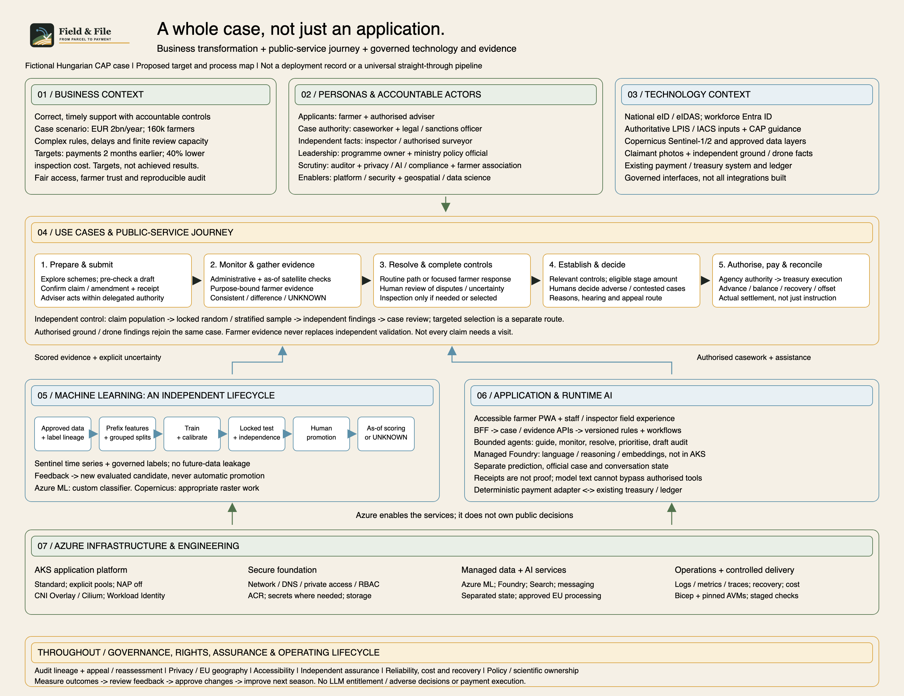

# The Whole CAP Case

**[Full-resolution picture](case-overview.png)** ·
**[Scalable SVG](case-overview.svg)** ·
**[Editable Excalidraw source](case-overview.excalidraw)**

This is a single-picture scope map of the fictional Hungarian CAP paying-agency
case: a business and public-service transformation supported by software,
geospatial evidence, governed AI/ML and Azure infrastructure. It is not an
app-deployment checklist, a resource inventory or evidence of an operating system.
The original [case brief](case-study-47.md), [source scan](case-study-47.jpg)
and [assessment rubric](rubrik/AMA_Capstone_Rubric_Participants.md) remain unchanged.

The scope picture retains its fixed source revision. For the current proposed
runtime hosting, use the **[Azure-icon deployment overview](../docs/architecture/azure-deployment-overview.png)**
and **[decision-agent flow](../docs/architecture/decision-agent-flow.png)**.
The [decision-agent contract](../docs/architecture/decision-agent-architecture.md)
records the approved Foundry-hosting direction and evidence/follow-up boundaries.

## Reading the Picture

| Angle | What it contributes |
|---|---|
| Business context | The problem, fictional scale, intended public value and measurable targets. Two-month-earlier payments and 40% lower inspection cost are case targets, not results |
| Personas | Applicants and advisers; case/legal authority; independent field controls; programme/policy leaders; scrutiny and farmer representation; platform and scientific enablers |
| Technology context | Government identity, authoritative agency inputs, CAP guidance, Copernicus observations, claimant/independent evidence and the existing treasury boundary |
| Use cases | Prepare/submit, monitor/gather evidence, resolve questions/complete controls, establish the relevant-stage amount, authorise payment and reconcile settlement |
| Machine learning | Approved data/labels, leakage-safe prefix features and splits, reproducible training/calibration, independent evaluation, human promotion and as-of scoring/abstention |
| Application | Accessible client journeys, controlled APIs, deterministic rules/workflows, bounded runtime agents, separate state domains and payment integration |
| Azure infrastructure | The AKS application platform, secure foundation, managed data/AI services, observability, recovery, cost and controlled Bicep/AVM delivery |

The **horizontal arrows** show the main business progression and the ML candidate
lifecycle. They are an overview, not a claim that every case requires every
exception activity. The **upward arrows** mean *supports/enables*, not that
infrastructure or a model makes an administrative decision.

Independent random/stratified selection starts from the **claim population**,
including apparently consistent cases; targeted selection is a separate route.
Neither claimant photos nor a consistent model result removes independent
validation. An inspection establishes scoped facts, not a sanction.

The bottom rail applies throughout: audit lineage, hearing/appeal rights,
privacy, processing geography, accessibility, independent assurance, operations,
policy/scientific ownership and governed improvement. Feedback produces reviewed
changes and new ML candidates, not automatic production self-learning.

## Important Boundaries

- Authorised officials and approved procedures retain administrative authority.
  LLMs do not determine entitlement, impose adverse decisions or execute payments.
- Established amounts, agency authorisation, treasury execution and reconciled
  settlement remain distinct. Advances, balances, recovery and offsets follow
  their applicable controls; an accepted instruction is not confirmed payment.
- The current proposal hosts custom runtime agents and foundation-model inference
  in Foundry. Azure ML owns the custom crop-classifier lifecycle; Copernicus performs
  appropriate raster processing. AKS hosts application, API and deterministic
  rules services. The fixed-revision scope picture predates this hosting amendment.
- The full map describes the **broader proposed target**, primarily the annual
  area-based claim process. Other interventions have their own controls. Current
  public/synthetic POC and foundation packages are narrower; their presence does
  not mean the full target is built, authorised, validated or deployed.

## Source Trace

The visual integrates business and technical source mappings from fixed repository
revision `38495b957ca71cc10d5c5b99cd1bb68487e24b40`, with the existing
[Field & File identity](../docs/Persona/farm-theme-and-persona-map.md) and unchanged
[logo](../assets/field-and-file-logo.svg).

| Coverage | Source locations at that revision |
|---|---|
| Fictional scale, problems and targets | [Case brief](case-study-47.md), lines 10-14, 30-39 |
| All twelve persona roles and their authority | [Persona catalogue](../docs/Persona/personas-and-use-cases.md), lines 24-57; use cases from lines 195-273, 383-421, 465-530, 569-828 |
| Business progression, independent controls, rights and payment lifecycle | [Business process](../docs/architecture/business-process-flow.md), lines 23-153, 155-247 |
| Identity, application services, agent boundaries and separate state | [Maintained architecture](../docs/architecture/aks-centered-foundry-architecture.md), lines 265-441, 489-514, 561-621 |
| Foundry, ML, Copernicus, Azure platform and operations | [Maintained architecture](../docs/architecture/aks-centered-foundry-architecture.md), lines 515-559, 636-702, 704-836 |
| ML data, splits, cutoffs, evaluation, promotion and monitoring | [Training procedure](../docs/copernicus/crop-classification/crop-classifier-training-procedure.md), lines 28-104, 173-203, 296-452, 508-579 |
| Evidence acceptance and independent factual assurance | [Evidence storyline](../docs/copernicus/crop-classification/evidence-validation-storyline.md), lines 16-93, 260-316, 366-432 |
| Narrower experiment, foundation scope and delivery boundaries | [First slice](../delivery/first-implementation-slice.md), lines 3-28; [WP-001 context](../delivery/releases/WP-001/context.md), lines 15-39; [workload standards](../delivery/workload-guidance.md), lines 78-110 |

The PNG and SVG are matching viewing copies; keep the `.excalidraw` file for
editing. The PNG is rendered locally from the matching SVG, not exported from a
live Excalidraw editor. This documentation is not independent workload assurance,
human approval or legal verification.
