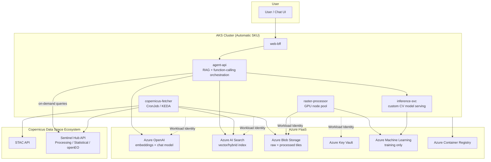

# AI Solution on AKS for Copernicus Earth Observation Data

## 1. Goal

Build a solution where users can **interact conversationally** (natural language) with Copernicus Earth Observation data — search scenes, ask analytical questions ("show me flooded areas near Rotterdam last week"), and get processed imagery/insights back — while keeping all custom business logic, agent orchestration, and web apps **self-hosted in AKS**, and using **Azure PaaS only where self-hosting adds no value** (model endpoints, managed search, managed storage).

---

## 2. High-Level Architecture

---

## 3. Component Breakdown — What, Where, How, Why

### 3.1 `copernicus-fetcher` — **AKS (CronJob / KEDA-scaled Deployment)**
**What:** Periodically (or event-triggered) queries the STAC API for new scenes matching your AOIs (areas of interest) and time windows; downloads or references the resulting Cloud Optimized GeoTIFFs (COGs); writes metadata into Azure AI Search.

**How:** A lightweight Python/Go service using the `pystac-client` (or REST directly) against `https://stac.dataspace.copernicus.eu/v1/`. Runs as a Kubernetes CronJob (e.g. every 6h) or is scaled via KEDA off a queue (e.g. new-AOI-registered event).

**Why AKS:** This is bursty, parallelizable, business-specific logic (which AOIs matter, how often to poll, de-duplication, retry logic). Running it as a Job lets you scale to zero between runs — no cost when idle, unlike an always-on VM or Function with cold-start/timeout constraints for larger downloads.

### 3.2 `raster-processor` — **AKS (Job, GPU-enabled node pool)**
**What:** Computes derivative products from raw imagery: NDVI, cloud masking, mosaicking, reprojecting, tiling for serving.

**How:** Containerized GDAL/rasterio/xarray pipeline. Scheduled as a Kubernetes Job per new scene (triggered by fetcher completion) or batch-processed nightly.

**Why AKS:** Needs GPU/CPU-heavy, autoscaling compute only when new data arrives — AKS node auto-provisioning (NAP) spins up a GPU node pool on demand and scales to zero after, which is much cheaper than a static GPU VM.

### 3.3 `agent-api` — **AKS (Deployment + HPA)**
**What:** The core RAG/agent orchestration layer. Receives a natural-language user query, decides whether to:
- Query Azure AI Search (semantic/hybrid search over indexed STAC metadata),
- Call Sentinel Hub's Processing/Statistical API directly for live/on-demand imagery or stats,
- Call `inference-svc` for a custom model (e.g., flood detection),
- Compose the final answer via Azure OpenAI.

**How:** Uses Azure OpenAI function-calling / tool-calling: each of the above becomes a callable "tool" the LLM can invoke. This is the classic RAG + agent pattern — retrieval augments the prompt, tools let the model take real actions (search, fetch, compute).

**Why AKS:** This is 100% your business logic — prompt assembly, tool routing, auth, rate limiting, caching, versioning of agent behavior. Nothing here benefits from being "managed"; you need fast iteration, custom scaling, and full control over how tools are wired together. Only the LLM *model* itself (Azure OpenAI) and the *index* (AI Search) are PaaS.

### 3.4 `inference-svc` — **AKS (Deployment + HPA, GPU pool)**
**What:** Serves a custom-trained computer vision model (e.g., land-cover classification, flood segmentation) for real-time inference requests from `agent-api`.

**How:** Model trained in Azure Machine Learning, exported as a container image, deployed to AKS like any other microservice.

**Why AKS (not AML endpoints):** Once trained, low-latency real-time serving alongside your other services (same cluster, same network, no cross-service hop to a separate AML endpoint) is cheaper and simpler to scale/monitor with the rest of your stack. AML is used only for what it's genuinely good at: experiment tracking, training job orchestration, GPU training clusters, model registry.

### 3.5 `web-bff` — **AKS (Deployment + Gateway API/App Routing)**
**What:** Chat UI backend-for-frontend; handles user sessions/auth, talks to `agent-api`.

**Why AKS:** Standard web app — no reason to run it anywhere else once you already have a cluster; co-locating reduces latency and cost vs. a separate App Service.

### 3.6 Azure AI Search — **PaaS**
**What:** Stores embeddings + structured metadata (bounding box, date, cloud cover %, sensor, product type) for every indexed scene. Supports vector, keyword, and hybrid queries, plus geo-filtering.

**Why PaaS, not AKS:** Running your own vector DB (e.g., self-hosted Qdrant/pgvector) in AKS is possible but adds real operational burden (backups, scaling, HA) for zero business differentiation — AI Search already does hybrid + vector + geo-filter search as a managed service with SLA. Only self-host a vector DB if you have a hard requirement AI Search can't meet (e.g., specific ANN algorithm).

### 3.7 Azure OpenAI — **PaaS**
**What:** Hosts the chat model (for reasoning/answer generation) and the embeddings model (for indexing + query-time vector search).

**Why PaaS:** You are consuming a foundation model, not building one. There is no reason to self-host an LLM inference stack (GPU cost, model ops, safety tuning) when Azure OpenAI gives you a managed, scalable, compliant endpoint. Your *value-add* is the orchestration around it (in AKS), not the model itself.

### 3.8 Azure Key Vault — **PaaS**
**What:** Stores Copernicus/Sentinel Hub API credentials, any third-party API keys.

**How:** Mounted into AKS pods via the **Secrets Store CSI Driver** + **Workload Identity** (Entra ID federated credentials) — no secrets ever stored in manifests or images.

### 3.9 Azure Container Registry — **PaaS**
Stores all your built images (`copernicus-fetcher`, `raster-processor`, `agent-api`, `inference-svc`, `web-bff`); AKS pulls via managed identity, no registry credentials needed.

---

## 4. Data Flow (Blob Storage question)

### Do we copy Copernicus data into Blob Storage, or query the API in real time? **Both — for different purposes.**

**Real-time / on-demand (no copy):**
When a user asks something ad-hoc ("what does this AOI look like right now?"), `agent-api` calls the **Sentinel Hub Processing API or openEO** directly and streams back a rendered result. No persistence needed — this is the cheapest and freshest path for one-off, exploratory queries.

**Cached in Blob Storage (copy needed) — for these reasons:**

1. **Re-use across users/queries.** If 50 users ask about the same AOI/time range, you don't want to re-download or re-render the same COG 50 times — that burns API quota and adds latency. A cached copy in Blob serves it instantly.
2. **Expensive derived products.** NDVI, cloud-masking, mosaics, and ML feature extraction (`raster-processor`) are compute-heavy. You compute them once, store the result, and reuse — recomputing on every request is wasteful and slow.
3. **ML training data.** Training a custom model (`inference-svc`'s source model in AML) requires a **stable, versioned, offline dataset** — you can't train against a live, rate-limited API. You need reproducible snapshots.
4. **API rate limits & cost control.** Copernicus/Sentinel Hub APIs have quotas (processing units, request rate). A live-only architecture means every user interaction consumes quota directly — a cache absorbs repeated/overlapping requests and protects you from quota exhaustion during traffic spikes.
5. **Offline/batch analytics.** Time-series analysis (e.g., "vegetation trend over the last 2 years for this field") needs many historical scenes at once — pulling all of that live, per request, is far slower than querying a local data lake.
6. **Resilience.** If the Copernicus API has an outage or degraded performance, previously fetched data is still servable from Blob.

**Design rule of thumb:**
- **Live API call** → single, one-off, "give me the latest/current state" queries where freshness matters more than repeat cost.
- **Blob cache** → anything reused, aggregated over time, expensive to (re)compute, or used for training.

`copernicus-fetcher` populates the cache proactively for AOIs you care about (subscriptions), while `agent-api` can still fall through to a live Sentinel Hub call for AOIs/dates not yet cached — a classic cache-aside pattern.

---

## 5. AKS Cluster Configuration (Day-0 decisions)

| Decision | Choice | Why |
|---|---|---|
| SKU | **AKS Automatic** | Curated best-practice defaults (security, networking, autoscaling) — least ops overhead; switch to Standard only if custom NAP/node-pool tuning is required. |
| Pod IP model | **Azure CNI Overlay** | Scales well, no VNet IP exhaustion; pods don't need to be directly VNet-addressable here. |
| Dataplane | **Azure CNI powered by Cilium** | eBPF performance + network policy + observability. |
| Ingress | **App Routing addon w/ Gateway API** | Managed HTTP/HTTPS ingress for `web-bff` without standing up your own controller. |
| Node pools | System pool (default) + **GPU pool (tainted, autoscale-to-zero)** for `raster-processor`/`inference-svc` | Only pay for GPU when jobs/inference actually run. |
| Identity | **Microsoft Entra Workload Identity** everywhere | No static secrets for Blob/Key Vault/AI Search/Azure OpenAI access from pods. |
| Secrets | **Key Vault + Secrets Store CSI Driver** | Centralized, auditable secret management for Copernicus API credentials. |
| Observability | **Managed Prometheus + Grafana**, **Container Insights**, **Application Insights** (for agent/LLM tracing — token usage, tool-call latency/failures) | Full-stack visibility across infra + AI-specific metrics. |
| Upgrades | Auto-upgrade (patch) + maintenance windows | Stay patched without surprise downtime. |
| Reliability | 3 Availability Zones, PodDisruptionBudgets, topology spread constraints | Standard production resilience posture. |

---

## 6. Security Notes
- All Copernicus/Sentinel Hub credentials in Key Vault, never in code/images.
- Azure Policy + Deployment Safeguards enforce only signed images from ACR.
- Network policies (Cilium) isolate `agent-api`/`inference-svc` namespace from `raster-processor` batch namespace.
- Azure OpenAI content filtering enabled by default for the chat layer.

## 7. Cost Levers
- GPU node pool scales to zero when no processing/inference jobs are running.
- Blob cache reduces redundant Sentinel Hub processing-unit consumption (their billing model).
- KEDA-based fetcher avoids an always-on polling pod.
- Spot node pool option for `raster-processor` batch jobs (interruption-tolerant).

## 8. Open Decisions / Next Steps
- [ ] Confirm AOIs / subscription list for proactive `copernicus-fetcher` caching.
- [ ] Decide custom CV model scope (if any) — determines whether AML training + `inference-svc` is needed at all, or if RAG-over-metadata is sufficient for v1.
- [ ] Provision AKS Automatic cluster.
- [ ] Scaffold `agent-api` with Azure OpenAI function-calling against STAC + AI Search + Sentinel Hub tools.
- [ ] Define Blob Storage lifecycle policy (tiering/expiry for cached tiles).
