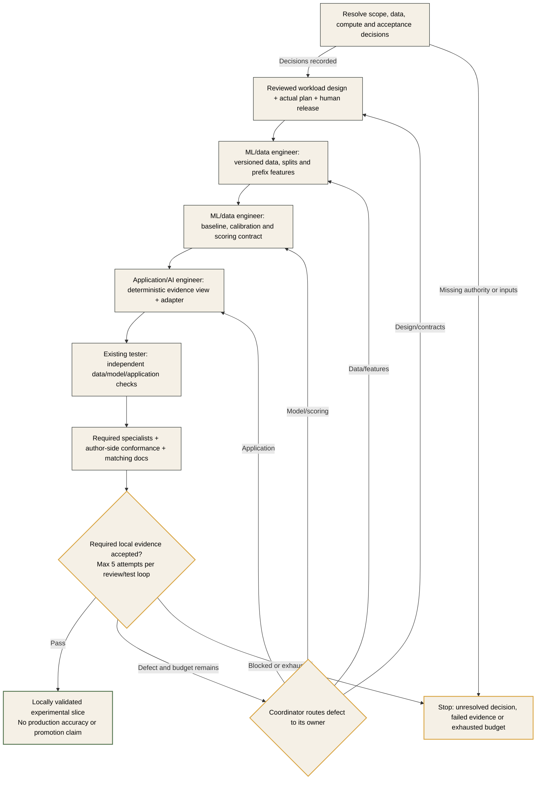

# First Implementation Slice: Public-Data Crop Evidence

## Status and Scope

The proposed first build target is the existing
[public-data crop prototype](../docs/copernicus/crop-classification/public-data-crop-prototype-plan.md).
Owners and artifacts are defined below. Design release, data access, compute
authority and implementation remain pending.

The experiment follows the maintained architecture. Azure ML is the target model
platform; a controlled-CPU route requires an explicit scoped decision.
Proposed review path: **standard**, subject to accountable-owner acceptance of the
actual scope. Source/licence and compute/identity triggers determine required
specialist review. Regulated use follows the regulated path.

## Bounded Outcome

Produce experimental crop evidence for one approved Hungarian region, using the
prototype's CLMS weak labels and Sentinel-1/2 sources, a selected training season
and a compatible later evaluation season. Confirm source availability first.
Select classes from actual regional coverage rather than guessing the taxonomy.
Preserve the source plan's full-season versus as-of-date distinction.

The output is a repeatable dataset/feature/model run, independent evaluation and a
small deterministic evidence view/scoring adapter. An `UNKNOWN` case and complete
lineage must be visible. Foundation-model chat, real claims, entitlement/payment
decisions, production personal data, drone operations and live model promotion are
outside this slice.

## Decisions Before Work Starts

| Decision | Responsible owner | Why it blocks |
|---|---|---|
| Region, training/evaluation years, source availability and geometry route | User/business owner with ML writer | Sets cohort, independent test reserve and processing volume |
| Target classes, weak-label selection/exclusions and supported as-of windows | Data-science/CAP owner with ML writer | Fixes taxonomy and prevents unsupported quality claims |
| Data-source access/licensing and permitted storage | User/data owner with compliance reviewer | Public availability alone does not authorise acquisition or local storage |
| Local controlled-CPU versus authorised Azure ML experiment; scope, budget and region | User/platform owner with architect | Prevents an unapproved platform change, cloud job or paid resource |
| Metrics, class/slice minima, calibration/abstention targets, reproducibility tolerance and holdout protocol | Business/data-science owner and independent tester | Must be agreed before final-test results; no invented quality thresholds |
| Named human data-science, CAP, legal/data-protection and operational owners applicable to this experiment | User | Engineering roles cannot supply those approval authorities |

Record each actual decision in the authorised package's `context.md` and ledger.
Unresolved values remain blockers, not template defaults.

## Work and Acceptance

| Work | Writer | Evidence required before local acceptance |
|---|---|---|
| Scoped design and actual plan | Architect / coordinator | Approved boundaries, interfaces, targets and exact task/check inventory |
| Required platform dependencies, only if in scope | Bicep engineer | Applicable WV checks; no deployment implied by local build |
| Source/geometry/weak-label/split pipeline | ML/data engineer | ML01-ML04 lineage, isolation and prefix-feature assertions |
| CPU baseline, calibration, scoring contract and replay bundle | ML/data engineer | ML05-ML07 results, explicit limitations and reproducible candidate |
| Deterministic experimental evidence view and scoring adapter | Application/AI engineer | Applicable AI01-AI05 consumer/access/failure checks; no assumed live/LLM coverage |
| Independent acceptance | Tester and triggered security/compliance reviewers | Fixed-candidate results, approved-target evaluation and required scoped dispositions |
| Conformance and documentation | Architect / documenter | Author-side conformance and matching scope/limitations |

Design changes reopen affected review/release. Counter and final-test isolation
rules survive every fix. S01-S08 in the [task catalogue](tasks.md#solution-slice-backlog)
prepare and implement the authorised scope.
Local acceptance requires replay plus results against the approved targets, honest
weak-label/coverage claims and a working evidence view. Live checks remain `NOT RUN`;
operational promotion is a later, separately approved stage.
