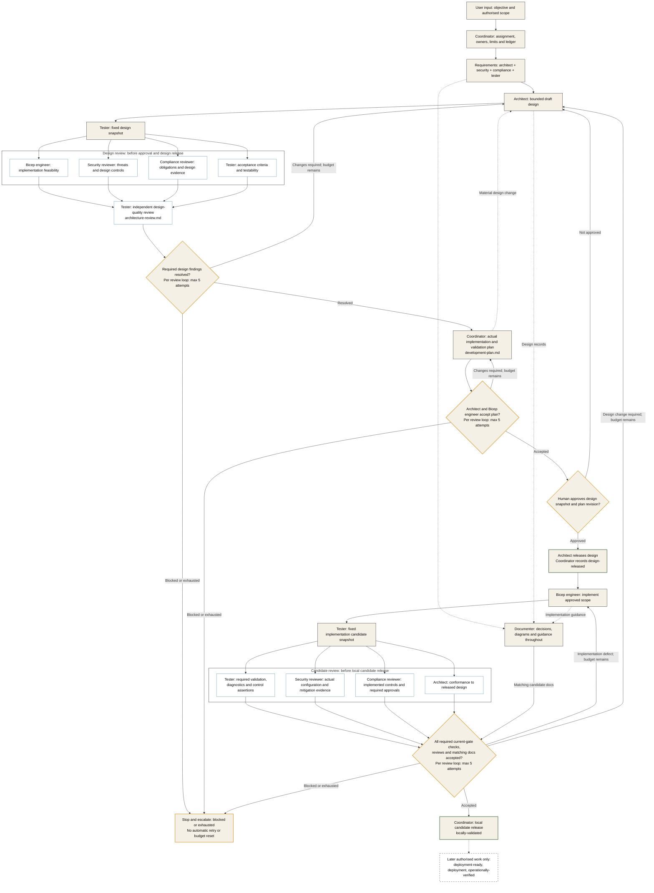

# Multi-Agent Framework and Orchestration

## Purpose and Current Status

This document defines how the repository's **engineering agents collaborate**.
It does not design the five runtime CAP agents, create new business personas or
prescribe Azure resources. Azure output standards live in
[Workload Guidance](workload-guidance.md).

The repository currently contains seven native Copilot profiles, five local skills,
reusable phase prompts, task records and artifact templates. These are contracts, not a
deployed multi-agent service or an executable orchestration engine.

## Research Basis

Primary sources checked on 15 October 2026:

| Source | Relevant guidance | Application here |
|---|---|---|
| [Microsoft: AI agent orchestration patterns](https://learn.microsoft.com/en-us/azure/architecture/ai-ml/guide/ai-agent-design-patterns) | Choose the lowest necessary complexity; distinguishes sequential, concurrent, group-chat, handoff and manager-led patterns; covers context, state, failures and output validation | Select specialists by task; preserve artifact state; avoid a rigid chain where iteration is needed |
| [Anthropic: Building effective agents](https://www.anthropic.com/engineering/building-effective-agents) | Distinguishes predefined workflows from model-directed agents; describes orchestrator-workers and evaluator-optimizer patterns | Coordinator delegates bounded work; makers and independent reviewers use feedback loops |
| [GitHub: custom agent configuration](https://docs.github.com/en/copilot/reference/custom-agents-configuration) | Native profile format, tool filters, model inheritance and client differences | Repository profiles declare capabilities without pretending to enforce an entire runtime |
| [GitHub: agent skills](https://docs.github.com/en/copilot/concepts/agents/about-agent-skills) | Reusable on-demand instructions | Shared repository procedures rather than duplicated role prompts |

These sources describe patterns and platform capabilities, **not a prescribed
seven-role team or mandatory order**. The selection below is our project decision.
Anthropic's article is foundational pattern guidance, not a current product/API manual.
No workload-adoption framework is used as the basis for this agent design.

## Selected Collaboration Model

Use a **coordinator-led specialist team**, drawing on orchestrator-worker delegation,
selective concurrent work and evaluator-optimizer feedback.

| Mechanism | Rule in this repository |
|---|---|
| Coordinator-to-specialist delegation | Coordinator chooses relevant roles, sends a bounded task and receives the result; specialists do not autonomously delegate onward |
| Selective fan-out/fan-in | Independent work may run against the same input revision; results return separately to the coordinator |
| Maker-checker loop | Artifact owner corrects a defect; the independent reviewer checks the changed revision |
| Artifact-based shared state | Tasks, designs, manifests, findings and approvals persist outside chat |
| Human decisions | Scope/design approval and material legal/risk decisions remain with the designated human owners |

This is not a claim to implement Microsoft's complete magentic pattern or a
particular agent SDK. We do not adopt unrestricted group chat, peer-to-peer control
transfer or a fixed pipeline that invokes every agent for every request.

Seven profiles are available, not seven mandatory executions. A small documentation
change can use the documenter and relevant checks alone. Full infrastructure work
requires its applicable design and assurance gates.

## Roles and Responsibility

| Agent | Contribution | Important boundary |
|---|---|---|
| `delivery-coordinator` | Decomposes the objective, owns the actual workload development plan, selects specialists and consolidates evidence | Does not produce specialist approvals or waive findings |
| `azure-architect` | Integrates requirements, owns design decisions, releases approved packages and checks implementation conformance | Does not replace independent review or human approval |
| `bicep-engineer` | Checks AVM feasibility during design; implements released contracts afterward | No infrastructure generation from an unapproved design |
| `infrastructure-tester` | Independently reviews design quality, prepares snapshots and checks the assignment's workload/framework criteria | Does not author the reviewed design, fix production code or change requirements to obtain a pass |
| `security-reviewer` | Establishes threat/control requirements early, reviews design and implementation | Does not accept risk on behalf of its human owner |
| `compliance-reviewer` | Establishes applicability/obligations early and maps controls to evidence | Does not supply legal certification or invent applicability |
| `architecture-documenter` | Maintains decisions, diagrams and guidance throughout; reconciles final docs to the candidate | Does not claim unobserved deployment or silently redesign the solution |

The [agent/skill catalogue](agents-and-skills.md) links to executable profile
instructions and describes tool access. This table defines collaboration,
not an organisational hierarchy or execution sequence.

## Collaboration Across a Work Package

**Requirements:** security/compliance shape constraints before decisions are locked;
the tester helps define measurable acceptance; the documenter starts the decision record.

**Design:** the architect integrates those inputs, the Bicep engineer checks published
module feasibility, and specialists review a fixed design revision. Feedback returns
through the coordinator to the owning role. Documentation evolves with the design.

**Planning:** the coordinator turns the reviewed architecture into an actual file/task
dependency plan, incorporates findings and defines per-layer validation. Architect
and implementer acceptance precede human approval and design release.

**Implementation:** an approved architect release and accepted workload plan are
prerequisites to infrastructure generation. Code, local checks and docs evolve together. Reviews
evaluate fixed candidates; code defects return to the implementer and design defects
return to the architect.

**Acceptance:** relevant tests/reviews, architect conformance and final documentation
must describe the same candidate. The coordinator reports evidence, exceptions and
remaining blockers for the authorised next decision. It does not use majority voting
or completion of all agent turns as a definition of success.

The [task catalogue](tasks.md) records prerequisites for a full first package.
Its rows are work items, not a hardcoded schedule for every request.

### Input to Candidate Release

Solid arrows show prerequisites and feedback; dotted arrows show ongoing documentation
or later work. The coordinator routes work throughout, even where its node is not
repeated. Review branches may run in parallel only with fixed inputs and separate
writes; this is not permission for autonomous peer delegation.

**Security and compliance are required at both labelled review gates.** Failed
current-gate checks block progress. Technical checks are executed by the tester;
security/compliance reviewers independently assess the evidence and their findings.
If documentation changes reviewed inputs, create a new snapshot and rerun affected
checks before accepting the candidate.

| Step / gate | Work and responsible roles | What permits progress |
|---|---|---|
| Input and assignment | Coordinator records authorised scope, exact inputs, owners, output shape, limits and target gate | Specialist accepts the assignment; missing inputs are resolved |
| Requirements | Architect frames the capability; security defines threat/control requirements, compliance establishes obligations, tester defines checks, documenter records decisions | Requirements and material decisions are explicit |
| Draft design and feasibility | Architect owns the design; Bicep engineer verifies AVM feasibility; documenter maintains the published explanation | Fixed design snapshot prepared for review |
| **Design review gate** | Security/compliance review their scoped requirements; tester independently evaluates design quality and testability against the assignment's criteria | Required evidence and specialist dispositions accepted; no invented sign-off or self-reviewed design pass |
| **Workload planning** | Coordinator derives actual files/contracts, dependencies, parallel boundaries and check inventory in `development-plan.md` | Plan completeness and architect/implementer acceptance; unresolved material findings still block |
| **Design release** | Human approves exact design snapshot and plan revision; architect releases that scope; coordinator records `design-released` | Implementation assignment references approved design and accepted plan |
| Implementation and fix loops | Bicep engineer writes released infrastructure; tester executes local checks; documentation evolves alongside code | Fixed candidate snapshot supplied to independent review |
| **Candidate security/compliance gate** | Security reviews actual configuration and mitigation/test evidence; compliance verifies implemented controls and required procedural/legal evidence; tester runs executable control checks; architect checks conformance | All required current-gate checks and review dispositions accepted for the same candidate; defects return to their owner |
| **Local candidate release** | Coordinator consolidates accepted evidence and matching documentation | `locally-validated` recorded with later checks still pending; no implied deployment permission |

"Release" here identifies an approved design or evidence-backed candidate, not
a Git tag, commit, push, pipeline execution or production release. Authenticated
validation, deployment readiness and observed operational security/compliance
checks belong to later authorised stages under [gate-specific acceptance](handoffs.md#gate-specific-acceptance).

Security/compliance reviewers own their findings. The tester executes requested
technical assertions and supplies evidence; it cannot supply legal authority or
approve residual risk. Post-deployment results cannot be claimed from code review.

### Framework Versus Workload Criteria

The framework specifies **how** a requirement is assigned, reviewed, evidenced and
accepted. It does not supply domain quality standards or derive its roles/routing
from them. The selected workload supplies **what** checks are required through its
design, validation catalogue and accepted assignment.

For this repository's Azure work, concrete checks and the later authenticated/live
flow are in [Workload Guidance](workload-guidance.md#later-azure-validation-and-live-verification)
and [Workload Checks](workload-checks.md). They assess produced artifacts and deployed
behaviour, not whether the multi-agent collaboration framework is properly designed.
No deployment runtime, deployer agent or pipeline is implemented by these documents.

## Reusable Phase Entry Points

The numbered [prompt files](../.github/prompts/) cover design, independent review,
planning, design release, implementation, local validation, documentation,
authenticated validation and live verification. They execute only the selected
assignment; numbering is navigation, not an automatic pipeline or permission to
invoke all phases. Documentation can run throughout.

Supporting VS Code Local sessions can select these prompt files. In Copilot CLI,
select the named profile and explicitly ask it to read/apply the chosen prompt body;
do not assume native `.prompt.md` discovery or identical cross-client behaviour.
Each phase still requires accepted inputs, current approvals and bounded limits.
See [prompt-file support](https://code.visualstudio.com/docs/agent-customization/prompt-files).
For a concrete prompt-to-profile-to-skill example and CLI invocation, see
[Using and Linking Prompts](README.md#using-and-linking-prompts).

## Task and Handoff Contract

Every specialist assignment supplies:

- Authorised objective, task/package ID, owner and stop condition.
- Exact input revisions, relevant requirements and artifact paths.
- Permitted output/write scope and required output shape.
- Acceptance criteria and requested checks.
- Known blockers, decisions/approvals needed and applicable execution limits.

A specialist validates the inputs and returns a result with evidence, findings and
remaining gaps. A malformed or unsupported output is rejected explicitly, not passed
downstream because an agent sounded confident.

The coordinator completes [assignment.md](templates/assignment.md) before work;
the specialist's actual output is recorded in [handoff.md](templates/handoff.md).
The assignment records applicable limits, attempts used and explicit path ownership,
not just a general objective. Both records name the target gate or framework-check scope.

"Handoff" here means **artifact-contract acceptance**, not autonomous transfer of
control between peers. Specialists return to the coordinator; any further work is
routed within the user's authorised scope. Use [Handoffs and Gates](handoffs.md) for
states and the [handoff template](templates/handoff.md) for records.

## Shared Context and Artifact Ownership

Persist the minimum useful task state in the repository's
[work-package records](releases/README.md): objective, revisions, task disposition,
findings, decisions and next owner. Do not rely on a long chat transcript as the
authoritative state.

Send only the context required by each specialist. A handoff should link to the
relevant source and exact artifact revision, not indiscriminately forward all
conversation history or sensitive data.

Only one writer owns an artifact at a time. Parallel work is safe when inputs are
fixed and output paths do not overlap. In particular, do not edit implementation
while reviewers are evaluating a supposedly frozen candidate.

Use the [artifact ownership table](releases/README.md#artifact-ownership): the architect
owns package technical decisions, while the documenter writes published architecture
content subject to technical acceptance. Temporary transfers must identify the exact
path, writer and return point.

The tester prepares snapshots using the [snapshot protocol](releases/README.md#snapshot-protocol).
Committed inputs use full commit references; uncommitted candidates also require
preserved bytes and scoped hashes. Other roles consume the producer's manifest.
Changes invalidate affected approvals, tests and reviews. Approval/state metadata
belongs in the coordinator's ledger, not in frozen design/candidate files.

## Feedback, Failure and Stopping

An unsuccessful check returns to its artifact owner with reproducible evidence.
The owner fixes the artifact; the relevant reviewer evaluates the new revision.
The coordinator cannot edit the finding into a pass.

### Review Loop Limit

Every logical review, test or validation loop has a maximum of **5 total attempts**:
the initial attempt plus at most four rechecks. This applies to all roles performing
these checks, including security/compliance review, design-quality review, conformance,
local tests and authorised environment validation. A lower assigned limit wins.

- Identify each loop by a stable ID in the package ledger, with its objective,
  reviewer/check scope and target gate. Distinct stages or independent review scopes
  have separate budgets; do not split or rename a failing scope to gain more attempts.
- Before execution, require an accepted assignment with the loop ID, ledger reference,
  integer limit from 1 to 5, attempts used and remaining. Reserve the next attempt in
  the ledger before the reviewer/tester starts; a started attempt consumes its slot.
- An attempt executes the assigned check scope once, not once per planned command.
  Re-execution after failed checks or tool failures consumes another attempt; do not
  hide repeated retries inside one attempt. Missing prerequisites block before work.
- Preserve usage across owner-fix handoffs, changed snapshots, sessions, task IDs and
  reassignment. The owner corrects defects; the independent reviewer uses the same
  loop's remaining budget. Changed inputs still invalidate affected evidence.
- Stop on a valid pass, earlier blocker or non-progress; five is a ceiling, not a
  target. A pass on attempt 5 succeeds. If that attempt does not satisfy the gate,
  keep the actual findings/disposition, mark further execution blocked and escalate
  to the user. No sixth attempt, waiver, additional agent or automatic budget reset.
  Further work requires an explicit recorded user decision, not another prompt invocation.

This is a prompt/contract rule, not a host-enforced iteration setting. No scheduler
or runtime counter is implemented here. Other assignment limits remain explicit.

Establish applicable run/iteration limits before delegated execution, honour user
budgets and avoid unbounded review loops. Stop and surface the blocker when work
does not progress, limits are reached, findings conflict, or essential tools/inputs
are unavailable. Do not create more agents merely to repeat unsuccessful work.

Distinguish a retryable tool failure from a wrong design or failed acceptance
criterion. Preserve checkpoints and actual results; never invent a successful
response, legal approval or completed test to keep the process moving.

For each check use `PASS`, `FAIL`, `BLOCKED`, `NOT RUN`, or justified
`NOT APPLICABLE`. Required missing evidence due at the current gate cannot count as
a pass. Later-gate checks stay `NOT RUN` and do not block earlier gates solely because
they are later. A known current defect cannot be relabelled as a later check.

Framework verification belongs to the existing tester under
[Agent Framework Checks](framework-checks.md). Static checks are distinct from
client discovery and behavioural fixtures; defined cases are not claimed as executed.

## Permissions and Human Control

Only the coordinator normally has agent delegation. Shell access is limited by role
instructions to the Bicep engineer, tester and documenter for their relevant checks.
All roles inherit host model selection; no model or cloud identity is pinned.

These restrictions are **not a filesystem, network or cloud security sandbox**.
Enforce real boundaries through host permissions, tool approvals and scoped identities.
Do not assume prompts prevent an edit-capable agent from changing another file.

Required human approval cannot be inferred from silence. Record its owner, scope and
reference. No role may autonomously deploy, commit, push, accept legal/security risk
or start a paid multi-agent runtime because a previous handoff was accepted.

## Defined Versus Implemented

| Capability | Current status |
|---|---|
| Native profiles and repository-local skill instructions | Files provided; discovery depends on the client/session |
| Reusable phase prompts | Files provided for supporting VS Code sessions; explicit prompt-body use in other clients |
| Coordinator routing and specialist contracts | Prompt-defined behaviour; executed only when invoked and authorised |
| Durable artifacts and handoff templates | File conventions provided; records created as authorised work starts |
| Learn documentation tools | Profile configuration provided; runtime discovery/connectivity still required |
| Automatic scheduling, durable execution/retries, programmatic gates and budget accounting | No repository orchestration runtime implemented |
| GitHub Actions and Azure deployment | Separate future work; not created or authorised by these documents |

If automatic orchestration is later requested, select and evaluate a runtime against
these contracts. Verify routing, output schemas, rejection, review invalidation,
parallel-write safety, stopping and approval enforcement before calling it operational.
