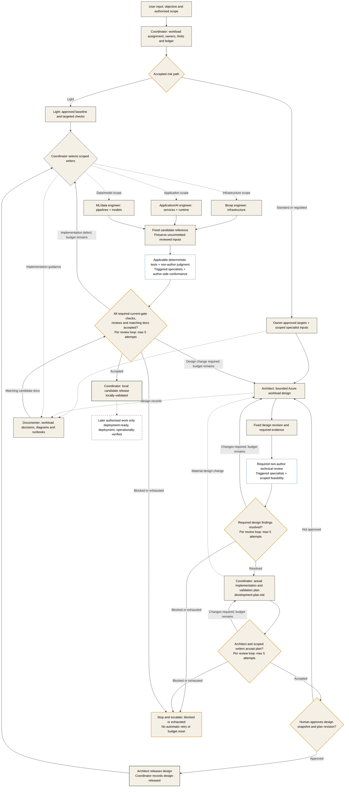

# Multi-Agent Framework and Orchestration

## Purpose and Current Status

The engineering team uses nine native profiles, eight local skills and twelve
phase prompts to deliver Azure infrastructure, applications, runtime AI and ML/data
artifacts. The coordinator selects specialists and review depth for the accepted
[risk path](handoffs.md#risk-based-review-paths).

Coordination and gates are procedural. The accountable human verifies release
evidence; executable enforcement is deferred. Azure output standards are defined
in [Workload Guidance](workload-guidance.md).

## Research Basis

Primary sources checked on 15 October 2026:

| Source | Relevant guidance | Application here |
|---|---|---|
| [Microsoft: AI agent orchestration patterns](https://learn.microsoft.com/en-us/azure/architecture/ai-ml/guide/ai-agent-design-patterns) | Choose the lowest necessary complexity; distinguishes sequential, concurrent, group-chat, handoff and manager-led patterns; covers context, state, failures and output validation | Select specialists by task; preserve artifact state; avoid a rigid chain where iteration is needed |
| [Anthropic: Building effective agents](https://www.anthropic.com/engineering/building-effective-agents) | Distinguishes predefined workflows from model-directed agents; describes orchestrator-workers and evaluator-optimizer patterns | Coordinator delegates bounded work; makers and independent reviewers use feedback loops |
| [GitHub: custom agent configuration](https://docs.github.com/en/copilot/reference/custom-agents-configuration) | Native profile format, tool filters, model strings, inheritance when unset and client differences | Declare tools and repository model defaults in native profiles; see the routing policy checked 21 October 2026 |
| [GitHub: agent skills](https://docs.github.com/en/copilot/concepts/agents/about-agent-skills) | Reusable on-demand instructions | Shared repository procedures rather than duplicated role prompts |

The collaboration model combines coordinator-worker delegation, selective
concurrency and evaluator feedback from these sources.

## Selected Collaboration Model

Use a **coordinator-led specialist team**, drawing on orchestrator-worker delegation,
selective concurrent work and evaluator-optimizer feedback.

| Mechanism | Rule in this repository |
|---|---|
| Coordinator-to-specialist delegation | Coordinator chooses relevant roles, sends a bounded task and receives the result; specialists do not autonomously delegate onward |
| Selective fan-out/fan-in | Independent work may run against the same input revision; results return separately to the coordinator |
| Maker-checker loop | Artifact owner corrects a defect; the independent reviewer checks the changed revision |
| Artifact-based shared state | Tasks, designs, manifests, findings and approvals persist outside chat |
| Human decisions | Scope/design approval and material legal/risk decisions remain with the designated human owners |

The accepted risk path determines the roles, reviews and evidence needed for each
task. A small documentation change uses its assigned writer and relevant checks.

## Roles and Responsibility

| Agent | Contribution | Important boundary |
|---|---|---|
| `delivery-coordinator` | Decomposes the objective, owns the actual workload development plan, selects specialists and consolidates evidence | Does not produce specialist approvals or waive findings |
| `azure-architect` | Integrates requirements, owns design decisions, releases approved packages and checks implementation conformance | Does not replace independent review or human approval |
| `bicep-engineer` | Checks AVM feasibility during design; implements released contracts afterward | No infrastructure generation from an unapproved design |
| `application-ai-engineer` | Implements applications, runtime agents/tools, evidence integrations and packaging | Consumes ML-owned scoring contracts; reviewers own independent verdicts |
| `ml-data-engineer` | Implements data/features, training/calibration, scoring contracts and replay bundles | Preserves test isolation and obtains human promotion authority |
| `infrastructure-tester` | Performs scoped non-author review and independent infrastructure/application/AI/ML tests | Uses owner-approved targets and returns production fixes to writers |
| `security-reviewer` | Establishes threat/control requirements early, reviews design and implementation | Does not accept risk on behalf of its human owner |
| `compliance-reviewer` | Establishes applicability/obligations early and maps controls to evidence | Does not supply legal certification or invent applicability |
| `architecture-documenter` | Maintains decisions, diagrams and guidance throughout; reconciles final docs to the candidate | Does not claim unobserved deployment or silently redesign the solution |

The [agent/skill catalogue](../docs/delivery/agents-and-skills.md) defines artifact ownership and tools.
Its [Model Routing Policy](../docs/delivery/agents-and-skills.md#model-routing-policy)
is the single role/model mapping and task-risk escalation policy. Optimisation
affects development agents only, not runtime Azure Foundry/ML model selection or
deployment permission; route mixed tasks by their highest-risk part.

## Collaboration Across a Work Package

**Requirements:** business/domain owners approve targets; the tester turns them
into checks. Triggered specialists supply constraints and the documenter records decisions.

**Design:** the architect integrates scoped feasibility and required non-author
review. Infrastructure, application and ML writers supply interface/contracts.
The coordinator returns findings to the owning role.

**Planning:** the coordinator turns the reviewed architecture into an actual file/task
dependency plan, incorporates findings and defines per-layer validation. Architect
and implementer acceptance precede human approval and design release.

**Implementation:** assigned writers implement the released scope. Independent
acceptance evaluates fixed candidates. The architect supplies author-side conformance;
the designated non-author reviewer supplies the required technical verdict.

**Acceptance:** relevant tests/reviews, architect conformance and final documentation
must describe the same candidate. The coordinator reports evidence, exceptions and
remaining blockers for the authorised next decision.

The [task catalogue](tasks.md) contains scoped solution tasks and the
regulated infrastructure reference path.

### Input to Candidate Release

Only selected implementation branches and required reviews execute.

Review scope follows the accepted risk matrix. Regulated packages require full
design and candidate specialist evidence; standard packages use one non-author
technical review plus triggered specialists. Parallel writes require fixed
contracts and distinct paths. Changed inputs invalidate affected evidence.

| Step / gate | Work and responsible roles | What permits progress |
|---|---|---|
| Input and assignment | Coordinator records authorised scope, exact inputs, owners, output shape, limits and target gate | Specialist accepts the assignment; missing inputs are resolved |
| Requirements | Business/domain owners approve targets; scoped specialists supply constraints; tester defines checks | Approved targets and scope |
| Draft design and feasibility | Architect owns the design; scoped writers verify feasibility | Fixed design revision |
| **Design review gate** | Required non-author technical review and triggered specialist findings | Required evidence and dispositions accepted |
| **Workload planning** | Coordinator derives actual files/contracts, dependencies, parallel boundaries and check inventory in `development-plan.md` | Plan completeness and architect/implementer acceptance; unresolved material findings still block |
| **Design release** | Human approves exact design snapshot and plan revision; architect releases that scope; coordinator records `design-released` | Implementation assignment references approved design and accepted plan |
| Implementation and fix loops | Bicep, application and ML writers implement assigned outputs; tester independently validates | Fixed candidate supplied for review |
| **Candidate assurance gate** | Tester runs applicable deterministic checks and non-author review; required security/compliance specialists assess their scope; architect supplies author-side conformance | All required current-gate evidence accepted for the same candidate; defects return to their owner |
| **Local candidate release** | Coordinator consolidates accepted evidence and matching documentation | `locally-validated` recorded with later checks still pending; no implied deployment permission |

Release records identify the approved design or candidate. Authenticated validation,
deployment and operational checks follow [gate-specific acceptance](handoffs.md#gate-specific-acceptance).

Security/compliance reviewers own their findings. The tester executes requested
technical assertions and supplies evidence; it cannot supply legal authority or
approve residual risk. Post-deployment results cannot be claimed from code review.

Workload criteria are defined in [Workload Checks](workload-checks.md) and
[Application/AI/ML Checks](ai-ml-checks.md). Later Azure validation is described in
[Workload Guidance](workload-guidance.md#later-azure-validation-and-live-verification).

## Reusable Phase Entry Points

The numbered [prompt files](../.github/prompts) cover design, independent review,
planning, design release, implementation, local validation, documentation,
authenticated validation, live verification, application/runtime implementation, ML implementation and
independent AI/ML acceptance. Each invocation executes its accepted assignment.
Documentation evolves throughout.

Supporting VS Code Local sessions can select these prompt files. In Copilot CLI,
select the named profile and explicitly ask it to read/apply the chosen prompt body;
do not assume native `.prompt.md` discovery or identical cross-client behaviour.
Each phase still requires accepted inputs, current approvals and bounded limits.
See [prompt-file support](https://code.visualstudio.com/docs/agent-customization/prompt-files).
For a concrete prompt-to-profile-to-skill example and CLI invocation, see
[Using and Linking Prompts](../docs/delivery/README.md#using-and-linking-prompts).

## Task and Handoff Contract

Every specialist assignment supplies:

- Authorised objective, task/package ID, owner and stop condition.
- Exact input revisions, relevant requirements and artifact paths.
- Permitted output/write scope and required output shape.
- Acceptance criteria and requested checks.
- Known blockers, decisions/approvals needed and applicable execution limits.

A specialist validates the inputs and returns a result with evidence, findings and
remaining gaps. A malformed or unsupported output is rejected explicitly, not passed
downstream because an agent sounded confident.

The coordinator completes [assignment.md](templates/assignment.md) before work;
the specialist's actual output is recorded in [handoff.md](templates/handoff.md).
The assignment records risk path, approved targets, applicable limits, attempts used,
explicit ownership and the workload gate/check scope.

Specialists return artifacts to the coordinator, which routes further authorised work.
Use [Handoffs and Gates](handoffs.md) for
states and the [handoff template](templates/handoff.md) for records.

## Shared Context and Artifact Ownership

Persist the minimum useful task state in the repository's
[work-package records](releases/README.md): objective, revisions, task disposition,
findings, decisions and next owner. Do not rely on a long chat transcript as the
authoritative state.

Send only the context required by each specialist. A handoff should link to the
relevant source and exact artifact revision, not indiscriminately forward all
conversation history or sensitive data.

Only one writer owns an artifact at a time. Parallel work is safe when inputs are
fixed and output paths do not overlap. In particular, do not edit implementation
while reviewers are evaluating a supposedly frozen candidate.

Use the [artifact ownership table](releases/README.md#artifact-ownership): the architect
owns design decisions; the Bicep, application and ML engineers own their scoped
implementation artifacts and author tests. The tester owns independent acceptance
suites; the documenter owns published explanations. Transfers identify exact paths,
writers and return points.

The tester prepares snapshots using the [snapshot protocol](releases/README.md#snapshot-protocol).
Committed inputs use full commit references; uncommitted candidates also require
preserved bytes and scoped hashes. Other roles consume the producer's manifest.
Changes invalidate affected approvals, tests and reviews. Approval/state metadata
belongs in the coordinator's ledger, not in frozen design/candidate files.

## Feedback, Failure and Stopping

An unsuccessful check returns to its artifact owner with reproducible evidence.
The owner fixes the artifact; the relevant reviewer evaluates the new revision.
The coordinator cannot edit the finding into a pass.

### Review Loop Limit

Every logical review, test or validation loop has a maximum of **5 total attempts**:
the initial attempt plus at most four rechecks. This applies to all roles performing
these checks, including security/compliance review, design-quality review, conformance,
local tests and authorised environment validation. A lower assigned limit wins.

- Identify each loop by a stable ID in the package ledger, with its objective,
  reviewer/check scope and target gate. Distinct stages or independent review scopes
  have separate budgets; do not split or rename a failing scope to gain more attempts.
- Before execution, require an accepted assignment with the loop ID, ledger reference,
  integer limit from 1 to 5, attempts used and remaining. Reserve the next attempt in
  the ledger before the reviewer/tester starts; a started attempt consumes its slot.
- An attempt executes the assigned check scope once, not once per planned command.
  Re-execution after failed checks or tool failures consumes another attempt; do not
  hide repeated retries inside one attempt. Missing prerequisites block before work.
- Preserve usage across owner-fix handoffs, changed snapshots, sessions, task IDs and
  reassignment. The owner corrects defects; the independent reviewer uses the same
  loop's remaining budget. Changed inputs still invalidate affected evidence.
- Stop on a valid pass, earlier blocker or non-progress; five is a ceiling, not a
  target. A pass on attempt 5 succeeds. If that attempt does not satisfy the gate,
  keep the actual findings/disposition, mark further execution blocked and escalate
  to the user. No sixth attempt, waiver, additional agent or automatic budget reset.
  Further work requires an explicit recorded user decision, not another prompt invocation.

Attempt accounting is procedural. Runtime counter enforcement is deferred.

Establish applicable run/iteration limits before delegated execution, honour user
budgets and avoid unbounded review loops. Stop and surface the blocker when work
does not progress, limits are reached, findings conflict, or essential tools/inputs
are unavailable. Do not create more agents merely to repeat unsuccessful work.

Distinguish a retryable tool failure from a wrong design or failed acceptance
criterion. Preserve checkpoints and actual results; never invent a successful
response, legal approval or completed test to keep the process moving.

For each check use `PASS`, `FAIL`, `BLOCKED`, `NOT RUN`, or justified
`NOT APPLICABLE`. Required missing evidence due at the current gate cannot count as
a pass. Later-gate checks stay `NOT RUN` and do not block earlier gates solely because
they are later. A known current defect cannot be relabelled as a later check.

## Permissions and Human Control

Only the coordinator has agent delegation. The Bicep, application and ML engineers,
tester and documenter have shell access for assigned local work.
Profiles declare repository `model:` defaults, subject to host/account availability
and explicit overrides; effective precedence is not independently verified.
Follow the [routing policy](../docs/delivery/agents-and-skills.md#model-routing-policy)
for runtime-model evidence, clerical-only LOW work and stop/relaunch rules.
No cloud identity is pinned. Higher-tier relaunches preserve the existing loop's
attempt counter, scope, review independence and human approval requirements.

Host permissions, tool approvals and scoped identities enforce access boundaries.

Required human approval cannot be inferred from silence. Record its owner, scope and
reference. No role may autonomously deploy, commit, push, accept legal/security risk
or start a paid multi-agent runtime because a previous handoff was accepted.

## Defined Versus Implemented

| Capability | Current status |
|---|---|
| Native profiles and repository-local skill instructions | Files provided; discovery depends on the client/session |
| Reusable phase prompts | Files provided for supporting VS Code sessions; explicit prompt-body use in other clients |
| Coordinator routing and specialist contracts | Prompt-defined behaviour; executed only when invoked and authorised |
| Durable artifacts and handoff templates | File conventions provided; records created as authorised work starts |
| Learn documentation tools | Profile configuration provided; runtime discovery/connectivity still required |
| Automatic scheduling, durable execution/retries, programmatic gates and budget accounting | No repository orchestration runtime implemented |
| GitHub Actions and Azure deployment | Separate future work; not created or authorised by these documents |

Executable orchestration enforcement remains a separately authorised maintenance task.
