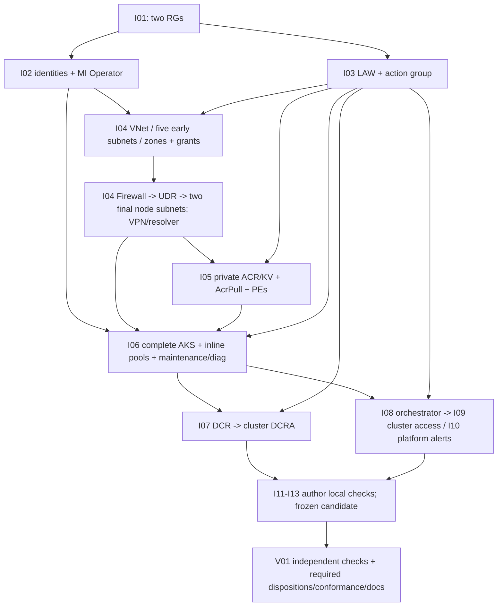

# WP-001 development plan — ARM foundation r2

**8 November 2026 · F06-r2-plan · OFFERED, not accepted or released.**
Next implementation: **Bicep infrastructure → separately released ML → separately
released application/runtime**. No code, parameter, test, workflow or snapshot
files are produced by this planning pass.

## 1. Assignment acceptance and fixed evidence

Accepted `assignments/F06-r2-plan.md` and the current user instruction. Owner:
`delivery-coordinator`; sole write: this file. Target: an actionable offered
WV04/T02 plan, not a gate PASS. One drafting pass **1/1 consumed, 0 remaining**;
not an F03 author correction or technical validation attempt. No new user monetary
or elapsed-time budget was supplied. Gates, ownership and counters are procedural,
not host-enforced permissions.

Routing: **HIGH, chosen/assigned `gpt-6.1-sol`**. Actual runtime model/provider
**NOT VERIFIED**: no authoritative effective-model field exposed. No fallback,
switch, escalation invocation or delegation occurred. Any confirmed conflicting
override/unavailable required model stops subsequent work.

Fixed input roots (absolute, session-local; retain these references in the release
packet rather than assuming another session can access them):

- `/Users/verboompj/.copilot/session-state/ea45f1eb-0d29-42dc-af7f-f9f5959f94f5/files/R2-review-inputs/manifest.json`;
  all workload sources mean adjacent `files/<source-relative-path>` copies.
  Base: `ebcbba37dae933e1deec3af2a3f15b61d5a3a7a5`.
- `/Users/verboompj/.copilot/session-state/ea45f1eb-0d29-42dc-af7f-f9f5959f94f5/files/r2-plan-reports/manifest.json`;
  stopped reports are adjacent `feasibility-r2.md` and `architecture-review.md`,
  not under a source-relative subdirectory.

| Fixed artifact | Supplied SHA-256, not newly computed here |
|---|---|
| Design r2 | `1f7afbb65e84b302f8930b2b2ed0669a5ae6a59e79b074ebd20b625bbd26c375` |
| Cost r2 | `62e64af0052db55f424139fd8334e32bfea06f3af7c7fc7373436dfa35b9cf29` |
| Stopped F04-r2 feasibility | `48729202e2b323c4585c280e5da6b8d63ec3290adf4ea3965f5f72495b2df64f` |
| Stopped F05 technical review | `7983e72b15adf5a36daca0ed8764da2ffcecc1e80e91ebc817332a2b2d08cd21` |

Read both manifests and stopped reports, fixed design/cost, direction/context,
relevant fixed workload contracts and feasibility role definitions. Manifest
coverage, locations and supplied report hashes agree with the assignment/user.
Parent reports original source/copy preservation PASS; F04 reports Node SHA-256
16/16 copy matches, and F05 independently reports Python SHA-256 16/16 matches.
**Reliance, not independent hashing by this coordinator**: no shell/hash tool is
exposed here. Stopped report byte equality relies on the parent's exact-copy
attestation. No new integrity PASS or output digest is invented.

Operating reads: AGENTS, team/task/handoff guides, collaboration/routing/ownership
contracts, assignment/templates, `ama-context`, `ama-handoff` and first-slice
guidance. The ledger was read only for counters/current blockers; it was not
substituted for fixed workload evidence or updated. Initial guessed copy paths
returned file-not-found; corrected preserved paths were used. No moving author
design/cost/report output was read.

## 2. Scope and release stop

Implement **only fixed r2 §§3–7 and T03–T05**: two new RGs, isolated private AKS,
private ACR, empty private KV, two MIs, network/private access/egress and minimal
monitoring. Keep Standard tier/mode, explicit sys/usr pools, Manual/NAP-off,
Overlay/Cilium, OIDC/WI and selected managed add-on ARM enablement.
No Kubernetes bootstrap, Gateway/listener/Route/Service, TLS-sync/FIC, authored
image/probe, app ILB, ML workspace/job/model, Foundry/Search, business store,
messaging, dataset acquisition, workflow or deploymentScript.

**Current release blockers — not later Azure prerequisites:**

1. Architect and Bicep writer have **not accepted this exact plan** or its
   composition/type/test contracts. F04 proposals are usable planning inputs,
   not their acceptance of this offered revision.
2. R2-01/FND-05/AGENTS still requires the binding review-path disposition and
   triggered identity/trust/exposure/secrets safety and compliance-applicability
   inputs. The accepted regulated path is not silently renamed standard/light.
   R2 technical-review PASS supplies the bounded five-pillar judgment only,
   not specialist acceptance, certification, legal exemption or release.
3. Human approval of the exact r2 design, paired full cost and accepted plan,
   retained/deferred scope/path, private access, complete-native exceptions,
   preview APIs, Azure DNS/proxy-off and secure nested LAW-output treatment is
   absent. External address allocation/overlap and network approval are absent.
4. Architect release against that exact approved packet is absent.

The user wants a **technical NON-compliant PoC, no certification campaign**.
Preserve SEC01–12, CR01–13, old F04/EP findings/reports as deferred/reference
evidence, not PASS. Request only bounded triggered safety/applicability
dispositions and the real path decision; do not start a legacy certification,
app TLS/admission or managed-build qualification campaign.
Any genuinely material design correction is **BLOCKED for escalation**:
`WP001-F03-AUTHOR` is exhausted **5/5, 0 remaining**. This plan cannot change
resource topology, exposure, roles, addresses, sizing, cost meaning or acceptance
targets, rename the scope, change writer, or author a sixth design/cost revision.

## 3. Exact future files, scopes and contracts

All following paths are **future assignment inventories, not write permission
now**. Bicep writer owns the ten Bicep files, two parameter files and author test
below; no overlapping writers. Use matching typed contracts in owning files:
no new shared-types file, package tooling, lint configuration or helper framework
unless separately required, enumerated and approved.

| ID / future file | Scope; required inputs → outputs / ownership |
|---|---|
| I01 `infra/main.bicep` | Subscription root; approved inputs below → one typed `foundation:FoundationInterfacesV2`. Creates only `rg-ama-poc-sec-platform` and `rg-ama-poc-sec-aks` via RG AVM; invokes logical modules at explicit scopes. Never creates node RG. |
| I02 `infra/modules/identities.bicep` | Platform RG; location/tags → `controlPlane`, `kubelet` each `{resourceId,principalId,clientId}` strings. Two independent MI invocations; kubelet AVM owns MI Operator grant to already-created control-plane principal. |
| I03 `infra/modules/monitoring-base.bicep` | Platform RG; location/tags, observer ID/type, alertEmail → workspaceResourceId, workspaceGuid, actionGroupId strings. LAW AVM owns observer LAW Reader; action group owns one common-schema email receiver. No cluster dependency. |
| I04 `infra/modules/connectivity.bicep` | Platform RG; location/tags, controlPlanePrincipalId, **required workspaceResourceId:string**, AddressPlan, full roots/revocations → vnetId, typed subnetIds/zoneIds, firewallPrivateIp, natPublicIp, vpnGatewayId/vpnPublicIp, dnsResolverId/dnsInboundConfiguredIp. Sole network/DNS/VPN owners; Firewall AVM and native VPN diagnostics consume LAW. |
| I05 `infra/modules/services.bicep` | Platform RG; location/tags, tenantId, peSubnetId, acrZoneId, vaultZoneId, kubeletPrincipalId, **required workspaceResourceId:string** → registryId/loginServer, vaultId/vaultUri, privateEndpointIds. ACR AVM owns AcrPull/diagnostics; KV AVM owns diagnostics; external PE modules own both PEs/zone groups. |
| I06 `infra/modules/aks.bicep` | AKS RG; location/tags, tenantId, version, public SSH key, final SubnetIds, aksZoneId, both MI objects, workspaceResourceId, systemNodeCount/userNodeCount → resourceId/name/privateFqdn/oidcIssuerUrl/nodeResourceGroupId/poolIds/controlPlanePrincipalId. One complete native cluster, both inline pools, two maintenance children, native AKS diagnostic. |
| I07 `infra/modules/monitoring-cluster.bicep` | AKS RG; clusterId, workspaceResourceId, location/tags → dcrId/associationId. One DCR and cluster-extension DCRA; no cluster PUT or second onboarding writer. |
| I08 `infra/modules/access-and-alerts.bicep` | **Subscription orchestrator**, explicitly `targetScope=subscription`; both RG names, cluster/LAW/action-group IDs, operator/observer IDs/types → roleAssignmentIds/alertIds. Invokes I09 at AKS RG and I10 at platform RG. No subscription grants/resource declarations. |
| I09 `infra/modules/cluster-access.bicep` | **AKS RG**; existing cluster identified by exact cluster ID/name, operator/observer IDs/types → cluster-extension role IDs. Every roleAssignment scoped to that cluster, not RG/subscription. |
| I10 `infra/modules/platform-alerts.bicep` | **Platform RG**; clusterId, workspaceResourceId, actionGroupId, both project RG IDs, location/tags → three alert IDs. Cross-RG cluster ID is a query literal, not an illegally cross-scoped resource declaration. |
| I11 `infra/environments/poc.bicepparam` | Sole actual environment variant, `using` main; fixed configuration plus required locally supplied approved context values. Never commit actual contacts, principal inventory or keys unnecessarily. |
| I12 `infra/tests/fixtures/poc.contract.bicepparam` | Same root; synthetic valid-format nonsecret GUIDs, `example.invalid` contact, public-only valid SSH/CER material, no real operator/device data. No private fixture keys; not a deployment environment. |
| I13 `infra/tests/contracts.test.mjs` | Bicep author's Node built-in runner, existing Node v25.8.1 from F04 evidence; captures compile JSON/diagnostics in memory and checks effective compiled contracts with synthetic bindings. No npm/package dependency. |
| V01 `tests/acceptance/wp001-infra.test.mjs` | **Infrastructure tester only**, independent Node built-in suite against frozen candidate/compiled fixture, same criteria below; not authored by Bicep writer. Exact independent suite proposed for tester acceptance before release. |

Writer report: `delivery/releases/WP-001/implementation.md`. Tester owns
`test-plan.md`, `test-review.md` and authorised candidate preservation; architect
owns `conformance.md`; documenter owns `documentation.md` and any subsequently
explicitly assigned published docs/diagrams, with architect technical acceptance.
Coordinator owns future assignments/handoff/ledger/readiness outside frozen inputs.
Those are later bounded assignments, not additional writes in F06.

### Parameter and output contract

- Required root strings: `tenantId`, `operatorPrincipalId`, `observerPrincipalId`,
  `sshPublicKey`, `alertEmail`; IDs must be valid GUIDs. Required human
  `operatorPrincipalType`, `observerPrincipalType`: **User or Group**, explicitly
  bound to approved actual object type, never guessed ServicePrincipal.
  MI grant principal types are **ServicePrincipal**.
- Required `vpnRoots:VpnRoot[]` nonempty: `{name:string,publicCertData:string}`.
  `vpnRevokedClients:RevokedClient[]`: `{name:string,thumbprint:string}`; empty
  default permitted only for genuinely approved empty inventory. Public Base64
  X.509 CER/SSH public keys only, no actual values in this plan.
- Selected `location='swedencentral'`, `kubernetesVersion='1.36.4'`;
  module `version` is wired from that root input. Fixed names/tags/addresses
  below, no latest/reuse/public/safety-disable/role-array switches.
- **Creation:** `systemNodeCount:int=2`, `userNodeCount:int=1`.
  Bounds sys exactly2, usr1–2; inline autoscaler min/max remain sys2/2 and usr1/2.
  **Replay:** never use creation defaults unexamined. Separately authorised
  operator reads current inline pool counts and pending scaling, reconciles with
  approved bounds and captures approved **live usr count (1 or2)** explicitly in
  the protected parameter snapshot. Inspected preview must show no unintended
  autoscaler reset. If count changes before execution, re-confirm parameters/
  preview; unknown/out-of-range state blocks. No ARM runtime lookup, partial PUT,
  separate pool writer or automatic read/merge/write workaround.
- `SubnetIds`: system/user/ingress/privateEndpoints/dnsInbound/gateway/firewall
  strings; `ZoneIds`: aks/acr/vault strings; MI objects have distinct resourceId/
  principalId/clientId strings. `costCenter` is string `"10122"`.
- `FoundationInterfacesV2` whitelist: platformRgId/aksRgId, clusterId/poolIds/
  nodeResourceGroupId, vnetId/subnetIds/zoneIds/privateEndpointIds, registryId/
  loginServer, vaultId/vaultUri, privateFqdn/oidcIssuerUrl, controlPlane/kubelet MI
  IDs, workspaceResourceId/workspaceGuid/dcrId/actionGroupId and
  dnsInboundConfiguredIp. Only these approved nonsecret interfaces; no raw AVM
  output dump, human contacts, kubeconfig, tokens, profile or workspace keys.
  Use actual native `privateFQDN`/`oidcIssuerProfile.issuerURL`, KV AVM `uri`,
  Firewall AVM `privateIp`; node RG/pool IDs are derived, not created.

**AddressPlan: thirteen exact string keys**, fixing the imprecise “ten” wording
without changing an address:

| Key | Value |
|---|---|
| vnetCidr | `10.83.0.0/20` |
| systemSubnetCidr | `10.83.0.0/24` |
| userSubnetCidr | `10.83.1.0/24` |
| ingressSubnetCidr | `10.83.2.0/27` |
| privateEndpointsSubnetCidr | `10.83.2.32/27` |
| dnsInboundSubnetCidr | `10.83.2.64/28` |
| gatewaySubnetCidr | `10.83.3.0/27` |
| firewallSubnetCidr | `10.83.4.0/26` |
| podCidr | `172.25.0.0/20` |
| serviceCidr | `172.26.0.0/24` |
| dnsServiceIp | `172.26.0.10` |
| vpnClientCidr | `172.27.83.0/27` |
| dnsInboundConfiguredIp | `10.83.2.68` |

Reserved frontend `10.83.2.10` is **not** an AddressPlan allocation, ARM frontend
or output. External corporate/device/VPN overlap approval is still missing.

### Grant ownership and deduplication

Use subscription role-definition IDs built from these fixed built-in GUIDs.
The frozen F04-r1 table has punctuation-corrupted GUID renderings; normalised
GUIDs below must be checked against the pinned module role mapping/compiled
definition IDs by writer and independent tester, not merely matched to this text.

| Principal / scope / sole owner | Role definition GUID |
|---|---|
| Control-plane MI / dedicated VNet / connectivity VNet AVM | Network Contributor `4d97b98b-1d4f-4787-a291-c67834d212e7` |
| Control-plane MI / AKS private zone / connectivity zone AVM | Private DNS Zone Contributor `b12aa53e-6015-4669-85d0-8515ebb3ae7f` |
| Control-plane MI / kubelet MI / identities kubelet AVM | MI Operator `f1a07417-d97a-45cb-824c-7a7467783830` |
| Kubelet MI / ACR / services ACR AVM | AcrPull `7f951dda-4ed3-4680-a7ca-43fe172d538d` |
| Operator and observer / cluster / cluster-access | Cluster User `4abbcc35-e782-43d8-92c5-2d3f1bd2253f`; AKS RBAC Reader `7f6c6a51-bcf8-42ba-9220-52d62157d7db` |
| Observer / LAW / monitoring-base workspace AVM | LAW Reader `73c42c96-874c-492b-b04d-ab87d138a893` |

Deduplicate by canonical `(scopeId, principalId, roleDefinitionId)`, not duty
label. Same human/group in both duties yields **two**, not four cluster grants;
LAW Reader remains one separate workspace grant. Conflicting types for identical
IDs block. Stable assignment names derive from the same canonical tuple; reorder/
repeat must preserve names. No Cluster Admin, app/FIC/vault data rights or
Monitoring Metrics Publisher. Contributor/bootstrap RBAC authority on new RGs
is a later approved operator prerequisite, not an extra standing subscription
grant created by this package. LAW Reader includes export capability in its
published definition; do not describe it as “no export”.

## 4. Resource graph and implementation sequence



1. **Release prerequisites first** (§2); coordinator assigns writer against exact
   accepted inputs and records limits before any infrastructure generation.
2. Writer establishes root/types/parameter fixture and independent identities/
   monitoring-base. Build these files locally before integrating consumers.
3. Connectivity: VNet parent omits `subnets` and `dnsServers` (not `subnets=[]`);
   three NSGs, PIPs → NAT; five early child subnets include FirewallSubnet with
   NAT, Gateway, ingress, PE and DNS. Zones/links and scoped MI grants complete.
   Firewall policy → Firewall → UDR using actual `privateIp` → final sys/usr
   subnet children with NSGs/UDR and creation defaultOutboundAccess=false.
   Resolver/VPN consume their final early subnets/PIP; no back edge or patch root.
4. Services consume LAW, PE subnet/zones and kubelet principal. Complete AcrPull/
   PEs and connectivity grants/links before private cluster. IDs fabricated by
   string alone are not completion dependencies; use output wiring and narrowly
   justified module `dependsOn` for grant/link/PE completion without consumed data.
5. Build complete AKS and then monitoring-cluster/access/alerts. Module deployment
   success does not prove RBAC propagation, DNS readiness or capacity.
6. Run the entire local inventory once per assigned attempt; writer fixes
   implementation defects, tester independently checks a frozen candidate.
   Architect conformance and matching documentation precede local acceptance.
   Stop at **locally-validated**, never automatic Azure execution.

One Bicep writer integrates all infra files. I02/I03 and later I07/I09/I10 have
independent authoring work after their contracts freeze, but no second writer
may edit the root/shared contracts. Independent reviews may run against the
same frozen candidate with disjoint report ownership; implementation changes
and reviewer rechecks remain serial. Changed bytes invalidate affected evidence.

**Retained resource contract:** exact names/quantities/properties in fixed design
§§3–7 are normative; do not replace them with wrappers' defaults. Specifically:
7 exclusive subnet children, 3 NSGs/3 PIPs/3 linked private zones, Firewall
Standard zone1/NAT zone1/VpnGw1AZ, one inbound resolver, 2 customer PEs, ACR
Premium/classic/private/default-deny/None bypass, empty KV Standard/private/RBAC/
7-day soft deletion/purge protection. AKS alone owns node RG/API PE/VMSS/disks.
Baseline3/max4/simultaneous-surge6 nodes/disks, 10/12/18 vCPU; no app capacity claim.
Tags on supported project resources/cluster/pools:
`environment=poc`, `workload=ama`, `workPackage=WP-001`, `owner=paverboo`,
`costCenter="10122"`; explicitly list untaggable children, never assert inheritance.

**Twenty exact AVM pins**, all prefixed `br/public:avm/res/`:

| Path | Version | Path | Version |
|---|---|---|---|
| resources/resource-group | 0.4.4 | network/virtual-network | 0.10.2 |
| network/virtual-network/subnet | 0.2.0 | network/network-security-group | 0.5.4 |
| network/route-table | 0.5.0 | network/public-ip-address | 0.13.0 |
| network/nat-gateway | 2.1.1 | network/firewall-policy | 0.3.6 |
| network/azure-firewall | 0.11.1 | network/dns-resolver | 0.5.8 |
| network/private-dns-zone | 0.8.1 | network/private-endpoint | 0.12.1 |
| container-registry/registry | 0.13.1 | key-vault/vault | 0.14.2 |
| managed-identity/user-assigned-identity | 0.6.0 | operational-insights/workspace | 0.16.1 |
| insights/data-collection-rule | 0.11.0 | insights/action-group | 0.8.0 |
| insights/scheduled-query-rule | 0.6.0 | insights/activity-log-alert | 0.4.2 |

Disable direct telemetry where supported; inspect, do not fork, transitive
artifacts. Native APIs only: complete AKS `2026-03-01`, complete VPN `2025-01-01`,
maintenance `2025-10-01`, cluster roleAssignments `2022-04-01`, DCRA `2023-03-11`,
AKS/VPN diagnosticSettings `2021-05-01-preview`. ACR/action-group/scheduled-rule
pins contain preview APIs identified by design; human approval remains required.

### Monitoring and alert composition

All diagnostic owners receive **the same monitoring-base LAW resource ID**:
root → connectivity/services/aks/monitoring-cluster/platform-alerts. No sibling
implicit reference or missing input. LAW PerGB2018, retention31, dailyQuotaGb
string `'1'`, local auth disabled, forceCmkForQuery=false, public ingestion/query
Enabled as explicitly proposed by r2. Secure nested workspace key outputs remain
unused/unforwarded; inspect effective transitive behavior and secure metadata,
not a fake “no listKeys anywhere” PASS.

Diagnostics select only AKS kube-audit-admin/cluster-autoscaler; ACR login/
repository events; KV AuditEvent; Firewall legacy application/network rules;
VPN GatewayDiagnosticLog/P2SDiagnosticLog. Dedicated destination where supported,
retaining legacy Firewall/VPN AzureDiagnostics semantics. Set explicit **empty
metric selection** on each owner (native metrics=[] / service AVM metric input
empty), no implicit AllMetrics or allLogs export. Inventory/Perf arrives through
DCR, not diagnostic metric defaults. Unsupported target category is a later
reported failure, never an automatic category substitution.

DCR: Linux/ContainerInsightsExtension; interval1m, namespace filtering Off/[],
enableContainerLogV2=true; exactly five identical source/dataFlow streams:
Microsoft-KubeNodeInventory, Microsoft-KubePodInventory, Microsoft-KubeEvents,
Microsoft-KubeMonAgentEvents, Microsoft-Perf. One ciworkspace destination/flow,
no ContainerLog/V2 stdout/group stream/DCE/AMPLS/transform. DCRA at cluster named
ContainerInsightsExtension, properties.dataCollectionRuleId=actual DCR ID.

**R2-03 mapping:** scheduled AVM input `criterias` → native `properties.criteria`;
AVM `actions.actionGroupResourceIds=[actionGroupId]` →
native `properties.actions.actionGroups=[actionGroupId]`. Do not pass native
spellings as module parameters. Both rules enabled/autoMitigate true, PT5M/PT10M,
Count/GreaterThan/0, severity2, no dimensions, skipQueryValidation=false.
Node query is fixed design §7 latest inventory/non-Ready, actual cluster ID
literal, failing periods2/2; warning-events query fixed reasons, periods1/1.
Activity alert uses its own pinned actions/condition contract, native
`actions.actionGroups` entries with actionGroupId; Administrative/Error, global,
enabled, scopes **exactly both new RG IDs**, no subscription default. Compiled
assertions verify native query/actions/criteria/scopes after parameter binding.
Cold-workspace query validation failure is reported, not bypassed.

## 5. Smallest local command inventory — future, NOT RUN

F04 verified direct **Bicep CLI 0.43.8 (`310735909d`)** at
`/Users/verboompj/.azure/bin/bicep`, with restore/build/lint/build-params and
stdout/no-restore support; not on PATH. Node v25.8.1 was also verified by F04.
This coordinator did not execute either. Reconfirm versions once at writer start;
missing/mismatching capability blocks, no silent install/update or `az` fallback.

From repository root, writer's one assigned local check attempt:

```text
/Users/verboompj/.azure/bin/bicep --version
node --version
/Users/verboompj/.azure/bin/bicep restore --pattern 'infra/**/*.bicep'
/Users/verboompj/.azure/bin/bicep build --no-restore --stdout infra/main.bicep
/Users/verboompj/.azure/bin/bicep build --no-restore --stdout infra/modules/identities.bicep
/Users/verboompj/.azure/bin/bicep build --no-restore --stdout infra/modules/monitoring-base.bicep
/Users/verboompj/.azure/bin/bicep build --no-restore --stdout infra/modules/connectivity.bicep
/Users/verboompj/.azure/bin/bicep build --no-restore --stdout infra/modules/services.bicep
/Users/verboompj/.azure/bin/bicep build --no-restore --stdout infra/modules/aks.bicep
/Users/verboompj/.azure/bin/bicep build --no-restore --stdout infra/modules/monitoring-cluster.bicep
/Users/verboompj/.azure/bin/bicep build --no-restore --stdout infra/modules/access-and-alerts.bicep
/Users/verboompj/.azure/bin/bicep build --no-restore --stdout infra/modules/cluster-access.bicep
/Users/verboompj/.azure/bin/bicep build --no-restore --stdout infra/modules/platform-alerts.bicep
/Users/verboompj/.azure/bin/bicep lint --no-restore --pattern 'infra/**/*.bicep'
/Users/verboompj/.azure/bin/bicep build-params --no-restore --stdout infra/tests/fixtures/poc.contract.bicepparam
/Users/verboompj/.azure/bin/bicep build-params --no-restore --stdout infra/environments/poc.bicepparam
node --test infra/tests/contracts.test.mjs
```

Capture stdout JSON and stderr/exit statuses via process APIs **in memory**, no
shell redirection or generated source files. Author runner must reuse that
attempt's compiled artifacts or perform this inventory once itself, not hide
repeat builds as free retries. Build **each of all ten files even if unreachable
from main**; pattern discovery must reconcile against the explicit inventory.
No additional `.bicep`/`.bicepparam` escapes validation if later authorised.
Restore is the only planned public-registry operation, authorised separately with
implementation; no Azure authentication is needed for these local commands.

Actual `poc.bicepparam` compilation uses approved locally supplied required values
(protected environment/local input binding, not fabricated operational IDs).
Synthetic success cannot replace actual-environment compilation. If those values
are unavailable, WV06 actual variant is BLOCKED, not PASS.
For contract tests use compiled synthetic parameters and in-memory mutations:
creation usr1, replay usr2; distinct/same human and User/Group; multiple/reordered
roots/revocations and genuine empty revocations; invalid types/counts/duplicate
names/thumbprints. These are test cases, not new deployment variants.

Independent tester runs the same full compile/lint/parameter inventory on the
fixed candidate within its reserved attempt, then:
`node --test tests/acceptance/wp001-infra.test.mjs`.
No new test package/tool installation; an unsupported effective-expression check
is an explicit blocker/limit, not licence to substitute a grep test.

Evidence: writer's `implementation.md` and tester's `test-review.md` record input
revision, per-file command/version/exit, diagnostics and assertion results.
Compiled JSON/parameters stay in memory unless tester/operator is separately
authorised to preserve sanitised candidate evidence at a named protected path.
Never dump protected environment values/secure output results into reports.
Every warning needs rule/location/rationale and genuine scoped disposition;
exit0 alone is not WV07 PASS. No blanket suppression or lint-rule rewrite.

### Acceptance assertions and gates

Assert **evaluated resource properties and dependencies in recursively compiled
templates**, binding synthetic module parameters/output references and resolving
the supported ARM expression subset. Check actual extension scopes/native bodies,
not just root module parameters or wrapper/proxy constants. Source pin checks
supplement, never replace, effective-property assertions. Unresolvable expressions
are explicitly BLOCKED; dynamic service state belongs to later authorised checks.

| WV / targets / earliest gate | Concrete expected evidence / owner |
|---|---|
| WV01–03 / T01–02 / design-released | Fixed complete r2 inventory/graph, feasibility and F05 bounded five-pillar report, required scoped specialist/path dispositions, real human exceptions/address approval. Existing report PASS is not the whole gate. |
| WV04 / T02 / design-released | This exact plan accepted by architect/Bicep writer and tester's scoped test contract acceptance; unresolved §2 blockers explicit. No acceptance signatures supplied here. |
| WV05–07 / T03 / locally-validated | Ten independent builds, two parameter compilations, separate lint diagnostics with no errors/undispositioned warnings; version and command results per file. Writer then non-author tester. |
| WV08 / T03–05 / locally-validated | Twenty exact pins/native API exceptions; evaluated subscription/RG/extension scopes and real output-derived ordering; one owner each for VNet/seven subnet children/pools/PEs/diagnostics/DCR/DCRA; no cycles/partial PUT. Native alert mapping, fixed queries/failing periods/actions/dual RG scope. |
| WV09 / T04–05 / locally-validated | Exact design names/counts/five tags on supported resources and both pools; enumerated untaggable children. Distinguish customer resources from AKS-generated node-RG/VMSS/API PE, not fictional authored children. |
| WV10 / T04 / locally-validated | AKS private/custom zone/public Disabled/no public FQDN; ACR/KV public Disabled/default Deny/None bypass, no admin/anonymous access; registry/vault PE group IDs and zone groups, exactly three non-registering links. PE presence alone insufficient. |
| WV11 / T03–05 / locally-validated | Two MI object/client/resource ID mappings; Entra/Azure RBAC/local accounts disabled/OIDC/WI; exact GUID tuples/scopes/principal types and stable grant dedup for same/reordered human IDs. Full VPN roots/revocations native properties, retention on replay, valid public-only inputs. Whitelisted outputs and actual secure LAW non-forwarding; no credential retrieval/logging/app/FIC/data grants. |
| WV12 / T04–05 / locally-validated | Evaluate all thirteen addresses, containment/disjointness/IP membership, correct seven subnet associations/delegation; NAT only FirewallSubnet, no forbidden Gateway/DNS/PE associations. UDR default VirtualAppliance actual Firewall privateIp, BGP preserved. Azure VNet DNS/proxy=false; exact design §4 FQDN/service-tag sources/priorities/HTTPS443, no broad allow/DNAT/proxy inspection claim. Node TCP22 deny4000; ingress VPN443 allow100/other deny4000; no platform NSG rewrite. Supported service TLS≥1.2 contract, no invented listener. Same LAW on all diagnostics, precise categories/empty metric exports, DCR streams/flow/DCRA and alerts above. |
| WV13 / T04 / locally-validated | Complete native Base/Standard/KubernetesOfficial/Manual cluster, patch1.36.4/Overlay/Cilium/IPv4/UDR, exact selected add-ons and disabled storage/paid extras. Inline sys D4as_v5/usr D2as_v5 Linux/AzureLinux3/Regular/zone1/Managed128/maxPods50/no public IP, sys taint/labels, autoscaler bounds, creation/replay counts, surge string1/drain30/soak5. Two named Saturday weekly four-hour UTC06:00 maintenance children. Zero authored app/LB/ML/Foundry/bootstrap/workflow/script resources. Inspect transitive ACR/KV/LAW/FW default overrides from fixed design §6. |
| WV14 / T05 / locally-validated | Tester fixed-candidate results, required targeted dispositions, author-side architect conformance, matching documenter runbooks/diagrams/limitations. Current defects block; later checks remain NOT RUN. |
| WV15 / T06 / deployment-ready | Separately authorised actual context/identity/MFA/permissions/offer/credit, named funded hours/expiry/closure, fresh patch/SKU/zone/services/quotas/names and corporate/device permissions. User/operator + tester; NOT RUN. |
| WV16–17 / T07 / deployment-ready | Separate validate, then inspected subscription-root preview of exact parameters. Creation and replay effects: service-populated subnet retention, current usr count, full revocations, deduplicated grants, no estate changes/deletion/replacement. Unsupported preview/destructive effects block, no read/merge/write workaround. NOT RUN. |
| WV18–20 / T08 / operationally-verified | Real deployment inventory; trusted private API/TLS/Entra read over VPN/resolver; ACR login **and layer**/KV private DNS/reachability; public denial and no unintended frontend. NOT RUN, foundation endpoint subset only. |
| WV21–22 / T09–10 / operationally-verified | Actual IAM/egress/telemetry/action-group signal, observed managed fit and authorised cleanup/residual resources/roles/device access/cost or funded retention. Proposed readiness30min + stability30min and telemetry/email15min need human approval before evaluation. NOT RUN. |

Negative/mutation checks must fail when the **effective resource body** changes:
public access/bypass, wrong LAW/role/scope/action ID, missing/reordered VPN entries,
extra stream/paid resource, unsafe count, duplicated owner or credential forwarding.
Do not invent hash assertions of wrapper text or tests which only grep constants.
Local checks cannot prove provider subnet reconciliation, live autoscaler safety,
current service availability, IAM propagation, DNS, TLS response, data arrival
or paid capacity.

## 6. Finding dispositions, later owners and limits

| Finding | Plan disposition, not reviewer closure |
|---|---|
| R2-F04-01 | I04/I05 required LAW input/root wiring; implemented effective diagnostics assertions due locally. Architect/writer contract acceptance due design release. |
| R2-F04-02 | I08 subscription orchestration, I09 AKS RG cluster extensions, I10 platform RG alerts; no broader grant shortcut. |
| R2-F04-03 | Explicit creation/replay count inputs and protected inspected-state/preview prerequisite; no autoscaler reset assumption. |
| R2-F04-04 | Thirteen AddressPlan keys, reserved unallocated IP, typed human/MI principals and tuple dedup. |
| R2-01/02 | Offered actual plan completes drafting only; path/safety/applicability/human approval and owner acceptances remain current blockers. |
| R2-03 | Explicit AVM/native actions/criterias mapping and effective assertions, not a design change. |
| R2-04/05 | Actual environment/funding/preview and observed private/monitoring/capacity/closure evidence remain later NOT RUN. |
| Historical F04/SEC/CR/EP | Preserve reference/deferred states and fixed r2 §8 dispositions. No signature/TLS/certification campaign reinstated, no historical FAIL/BLOCKED relabelled PASS. |

Future review recipients: `infrastructure-tester` accepts fixed-candidate
technical checks; `security-reviewer` and `compliance-reviewer` receive only
authorised triggered safety/applicability scopes, never a blanket certification
request; `azure-architect` accepts technical plan meaning and supplies conformance;
`architecture-documenter` reconciles docs throughout against frozen contracts.
Each accepts/rejects its bounded assignment explicitly before execution.
No specialist phase is invoked by this plan.

Later stage 2: `ml-data-engineer` owns Copernicus/geometry/features/splits,
training/calibration/scoring and versioned `contracts/data/`/`contracts/scoring/`
interfaces/packaging/job contracts. First resolve region/years/classes/as-of
windows/source licence/access/storage, Azure ML versus explicitly approved CPU
route, compute/region/budget, domain/statistical competence, locked holdout and
quality/calibration/abstention/replay targets under `first-implementation-slice.md`.
No AML resource/job is smuggled into infra1. Stage 3:
`application-ai-engineer` owns app/API/evidence/runtime/tool/scoring consumer and
packaging after explicit scoring-contract acceptance. Shared interfaces have
one writer/version and named consumer acceptance. AI01–06/ML01–08 are **not
applicable to this empty ARM candidate**, pending instantiation for later
separate releases, never passed by foundation success.

Future release-automation author: **bicep-engineer**, consuming app packaging
and ML job contracts; no workflow creation/execution authority here.
Intended manual operator and human operational/budget owner: **requesting user**,
as recorded in fixed context/direction. Actual authorised executing principal,
delegation scope, activation and device users are **not bound**; obtain them
before their later authorised use. Numeric funded ceiling/window/expiry,
cost-rate refresh/uncertainty acceptance, validate/preview, deployment and cleanup
each require separate authority. Cost r2 short/extended/month illustrations
USD216.87/503.47/2,299.66 are **not budgets or newly validated totals here**;
stopping AKS is not a free foundation pause.

| Stable loop / scope | Existing consumed / cap / remaining; no reset |
|---|---|
| F06-r2-plan drafting | 1 / **1** / 0; offered output complete, not review |
| WP001-F03-AUTHOR | 5 / **5** / 0, exhausted |
| WP001-F04-AVM | 4 / **5** / 1, stopped report delivered |
| WP001-TECHNICAL-DESIGN | 1 / **5** / 4, bounded technical PASS |
| WP001-R2-INPUT-INTEGRITY | Parent reported 1 / **5** / 4, PASS; no new check here |
| Stopped-report preservation integrity | Parent manifest reports initial1/5; no stable ID exposed in that manifest, no new invocation/check here. Parent retains attribution before any recheck. |
| WP001-SEC-REQ / WP001-COMP-REQ | Each 1 / **5** / 4, requirements only, not r2 acceptance |
| WP001-DOCS | 2 / **5** / 3, prior draft; no new cycle |
| Historical snapshot bucket / EP-TECH / EP-SEC | Closed5/5 / 2/5 / 2/5 retained, untouched |

Before future local author, independent validation, specialist, plan-acceptance or
conformance review: coordinator checks the ledger, establishes the stable logical
objective, **cap at most5 including initial (lower assigned cap wins)**, exact
used/remaining, and reserves the attempt outside frozen inputs. Those future
attempts are **NOT STARTED/unreserved**, not authorised 0/5 loops invented here.
Carry usage through fixes/snapshots/reassignment. Reject missing counters,
exhaustion, conflicting findings, unavailable tools, repeated non-progress or
material design change; no nested agents/automatic recursion.

## 7. Offered handoff and stop

**Output:** `delivery/releases/WP-001/development-plan.md`, this offered revision;
no computed output hash. Next recipients: architect and Bicep writer for explicit
accept/reject of contracts/sequence, tester for scoped independent test inventory,
then human for the exact design/cost/accepted-plan packet and still-blocking
path/safety/network/exception decisions. Record genuine acceptances/release in
ledger/handoffs outside frozen inputs; do not insert signatures into design/cost.

Actual checks here: assignment/manifest/location/hash-reference consistency and
direct fixed-input contract/finding-to-task coverage inspection. No shell hash,
Bicep/version execution, restore/build/lint/parameter/contract test, SQL,
public-web/browser, Azure/auth, deployment or AI/ML operation performed.
All executable candidate checks **NOT RUN**. This is drafting evidence, no
independent test/review PASS or release-ready assertion.

**Complete offered plan; stopped writing after the sole drafting pass.**
SQL/task-store interface is unavailable; intended update only, **not applied**:
`UPDATE todos SET status='done' WHERE id='wp001-development-plan';`
Missing approvals remain explicit workload blockers, not missing drafting input.
Only this file was authored; no design/cost/requirements/framework/lifecycle/
snapshot changes, implementation/workflow files, nested agents, commit or push.
