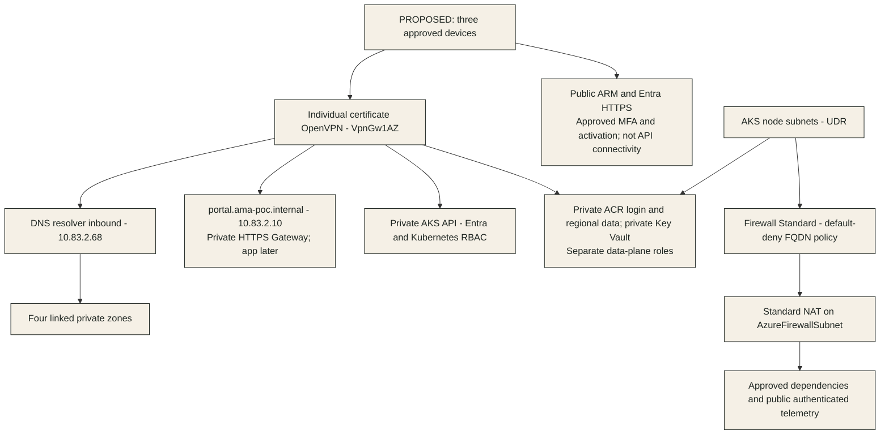

# WP-001 foundation draft guide — F03 / S001 / r1

**21 October 2026 — draft offered to coordinator; NOT RELEASED.**
This is a faithful explanation of the architect's S001 proposal, not a deployable
runbook, technical acceptance, security/compliance verdict or permission to spend.
Nothing is deployed or endpoint-tested. All resource settings and procedures below
are **PROPOSED** unless explicitly identified as accepted boundaries or local checks.

## 1. Assignment acceptance and exact inputs

**ACCEPTED:** [F03-documentation assignment](assignments/F03-documentation.md),
including its resumed invocation and sole write ownership of this file.
The user renewed coordinated delivery on 21 October 2026. This regulated technical
assignment is **HIGH**; host-declared chosen model **`gpt-6.1-sol`**, escalated before
work from the clerical default. Actual runtime model: **NOT VERIFIED**; no runtime
model attestation is exposed. No self-switch, fallback or further delegation.

`ama-context` and `ama-handoff` were activated by reading and applying their
`SKILL.md` instructions. No matching visualisation skill is available in the
repository inventory; the editable Mermaid source below stays in this sole file.
Field & File colours, explicit labels and a textual equivalent avoid colour-only
meaning. Rendering/accessibility acceptance remains pending.

### Fixed workload sources

Use [S001 manifest](snapshots/S001/manifest.md), not the moving source files:

| Input | Preserved reference / use |
|---|---|
| Scope and authority | [context](snapshots/S001/files/delivery/releases/WP-001/context.md): foundation boundaries and F01–F07 sequence |
| Technical proposal | [design r1](snapshots/S001/files/delivery/releases/WP-001/design.md): §§2–9 resources, access, identity, operations; §10 deviations; §11 AC01–AC19 |
| Cost proposal | [cost estimate r1](snapshots/S001/files/delivery/releases/WP-001/cost-estimate.md): §§4–7 meter quantities, stopped residuals and sensitivity; §8 prerequisites |
| Security input | [requirements](snapshots/S001/files/delivery/releases/WP-001/security-requirements.md): SEC01–SEC12, requirements only, not design acceptance |
| Compliance input | [requirements](snapshots/S001/files/delivery/releases/WP-001/compliance-requirements.md): CR01–CR13; authoritative legal/version confirmation remains limited |

All sixteen committed dependencies are identified by path and SHA-256 in the
manifest at **`01002b21e5c6cb57d391c685adcbc05f03885b38`**. In particular, the
maintained architecture §§12–16/20, WP-001 decisions/assessment/historical ledger,
workload guidance/checks, AI/ML checks and handoff/ownership contracts are read at
that commit. Current lifecycle records are not technical approval inputs.
Operational model guard **`5ecf21c2e8333b83c176073b02fece55c9a16f62`**
(`AGENTS.md`, `docs/delivery/agents-and-skills.md`) supplements the older S001
policy only; it changes no workload choice. Current team/skill/style instructions
are authoring aids, not replacement workload inputs.

**Input integrity PASS:** local Node SHA-256 checks matched all five preserved
files and sixteen Git-object dependencies to the manifest (21/21). This corroborates
the parent's integrity report, not approval or historical author-read verification.
The independent feasibility writer's moving output was not consumed.

## 2. State, scope and resource map

**Accepted boundaries:** one non-production public/synthetic-business-data POC,
maximum three users, private-only application audience, dedicated project resource
groups, no reuse/change of existing estate, regulated review path. Requesting user
holds FND-01 accountable roles; those roles do not approve detailed settings or
establish legal/procurement competence.

**Not implemented, validated, deployed or observed:** this assignment delivers
documentation only. Historical F02 discovery is not fresh availability, write
authority, deployed configuration or live-control evidence.

| Proposed scope | Resource/access summary | S001 design anchor |
|---|---|---|
| `rg-ama-poc-sec-platform` | VNet, three NSGs, node UDR; Firewall Standard + policy, Standard NAT on firewall subnet, three public IPs; P2S VpnGw1AZ; DNS resolver inbound only and four private zones | §§3–4 |
| Same platform RG | Private ACR Premium `acramapocsec001`, private KV Standard `kv-ama-poc-sec-001`, two customer PEs; three user-assigned MIs; LAW, DCR/association, action group and four log alerts | §§3, 6, 8 |
| `rg-ama-poc-sec-aks` | `aks-ama-poc-sec`: Standard mode/paid Standard tier, CNI Overlay/Cilium, OIDC/Workload Identity, NAP off, local accounts off | §§3, 5–7 |
| `rg-ama-poc-sec-aksnodes` | Created/owned by AKS, never precreated or directly repaired: VMSS/NICs/P10 OS disks, API PE; Kubernetes-owned internal Standard LB at `10.83.2.10` | §§3–5, 9 |
| Kubernetes bootstrap | Managed Gateway API/application-routing Istio, CSI, KEDA, Policy/Gatekeeper; `ama-ingress` Gateway/TLS-sync, `ama-demo` policy boundary; no business HTTPRoute/application | §§3–7 |
| Excluded / later owners | Foundry, Search, AML, stores, evidence/messaging, business apps, data acquisition/training/scoring, payment/treasury and pipelines | §§2, 7 |

Regional resources: **Sweden Central**; private DNS zones are global. Proposed
Kubernetes **1.36.4 / AzureLinux3**, supported add-ons and globally unique names
remain unverified for deployment. No automatic suffix/version substitution.
Required tag values: `environment=poc`, `workload=ama`, `workPackage=WP-001`,
`owner=paverboo`, `costCenter="10122"`; cluster/pool/managed-child coverage and
untaggable exceptions require feasibility, not presumed RG inheritance.

Pool proposal: `sys` two D4as_v5 nodes, min/max 2/2; `usr` one D2as_v5,
min/max 1/2, zone 1, maxPods 50, maxSurge **one node per pool**.
Initial/max/surge vCPU are **10/12/18**, compared with historical total-region
and DASv5-family limits of 20 each, not an additive 40. Allocation is not reserved.
Proposed requests: platform ≤4 CPU/10 GiB; initial user pods ≤1.5 CPU/4.5 GiB,
maximum ≤3 CPU/9 GiB. Actual managed add-on requests must fit before release.
Three users is not sizing evidence; the later 3-session/1-RPS synthetic envelope
and performance targets in §5 are unapproved and unmeasured.

## 3. Private routes, DNS, TLS and egress

Text equivalent and prerequisites (design §4; SEC02–04/07–08):

- Device → encrypted internet VPN tunnel → POC VNet. Only the VPN/firewall/NAT
  infrastructure has the stated public IPs; none is a public application frontend.
  No corporate private route, Bastion, jump host or hosted runner is assumed.
- Route VNet **`10.83.0.0/20`** through VPN; not pod `172.25.0.0/20`,
  service `172.26.0.0/24` or all internet traffic. Client pool `172.27.83.0/27`.
  Network owner must check external/home/corporate/container-route overlap.
- Client split-DNS uses resolver **`10.83.2.68`**, TCP/UDP 53, with zones
  `ama-poc.internal`, `privatelink.swedencentral.azmk8s.io`,
  `privatelink.azurecr.io`, `privatelink.vaultcore.azure.net`. Test public ACR
  login/data CNAME chains too. Do not direct VPN clients to `168.63.129.16`.
  Approved OS/browser secure-DNS configuration must not bypass private resolution.
- User HTTPS → `portal.ama-poc.internal` → internal Gateway `10.83.2.10`.
  No business route is delivered: an empty foundation is not a usable portal.
  VPN reachability is neither application authentication nor authorisation.
- Operator API access additionally requires Entra/Kubernetes RBAC. ARM access
  alone neither provides private API connectivity nor Kubernetes permission.
  ACR publishing and KV access need their own roles and private data-plane route.
- Private API/public FQDN off; ACR/KV public access and bypass off. ACR login and
  regional layer endpoints must both resolve privately from nodes and publisher.
  Internal Gateway subnet/IP annotations must be set **before creation** because
  the managed default is external. No public fallback.
- Both node subnets use `userDefinedRouting` → firewall → NAT on
  `AzureFirewallSubnet`, not NAT directly on node subnets. NAT is SNAT, not filtering.
  Exact required AKS/OS/add-on/identity/monitoring FQDN rules need approval.
  Cilium workload policy does not constrain host processes; no broad internet/
  `*.azure.com` allow, DNAT or direct outbound bypass is approved.

**Trust ownership:** requesting user operates separate offline private-CA trust and
VPN issuance; exactly three approved devices need permission to install profiles/
trusted roots. App root lifetime proposed one year, leaf with hostname SAN 90 days;
separate individually revocable VPN client certificates 90 days. VPN certificate
authentication is **not MFA**. Retain inherited human-write MFA/activation controls.
Custodian imports only app leaf private material via private KV; TLS-sync CSI
Deployment produces namespaced Secret for Gateway. Root private key stays encrypted
offline, never in Git, ARM outputs or cluster.

Renew leaf at day 60; review expiry at 30/14/7 days; verify rotation on every device.
Compromise means revoke/reissue and rotate trust as appropriate, not disable TLS.
Minimum TLS 1.2 and hostname/trust verification; never routine insecure flags.
The Gateway-to-later-app HTTP hop inside Cilium isolation is a disclosed synthetic
demo residual requiring security acceptance, not end-to-end encryption.

## 4. Identity and bootstrap ownership

All actual IDs, memberships, activation conditions and grantors need protected
owner confirmation. Proposed group names are not effective grants (design §6).

| Principal / owner | Proposed minimum purpose and scope |
|---|---|
| Human initial bootstrap | Temporary subscription RG-creation authority; constrained RBAC Administrator at new project RGs only; actual grantor/identity/MFA approval required, no inferred Owner |
| Human infrastructure deployer | Contributor on two project RGs, not role-assignment authority; no direct node-VMSS mutation |
| `ama-poc-platform-operators` | Cluster User role on cluster for user credential retrieval; time-bounded AKS RBAC Cluster Admin on cluster for bootstrap/incident |
| `ama-poc-observers` | AKS RBAC Reader on cluster and LAW Reader on workspace; no secret rights |
| Cluster MI `id-ama-poc-sec-aks` | Network Contributor on isolated VNet, Private DNS Zone Contributor on API zone only, Managed Identity Operator on kubelet MI only |
| Kubelet MI `id-ama-poc-sec-kubelet` | `AcrPull` on this classic-RBAC registry; no push/admin/business-data roles |
| `ama-poc-image-publishers` | `AcrPush` on this ACR from connected device; approved provenance/digest, no ACR Tasks/hosted runner workaround |
| TLS-sync MI `id-ama-poc-sec-tls` | KV Secrets User on leaf secret only; actual OIDC issuer, subject `system:serviceaccount:ama-ingress:tls-sync`, audience `api://AzureADTokenExchange` |
| Human certificate custodian | Temporary KV Secrets Officer on dedicated TLS-only vault for import/rotation; revoke after operation |
| Monitoring/add-on MIs | Supported DCR/workspace-specific roles, verified in feasibility; never reuse operator or kubelet identity |

**Proposed sequence, not executed:** confirmed bootstrap authority → new RGs,
network/DNS/identities → firewall/NAT/UDR → VPN/resolver and client readiness →
private ACR/KV/PEs and narrow RBAC propagation → private AKS/add-ons → operator
private API access → separately authorised Kubernetes policies/Gateway/TLS-sync →
tester synthetic probes. ARM and data-plane readiness are different.

Bicep engineer owns future ARM/add-on implementation only after release. The
coordinator must explicitly assign the Kubernetes bootstrap writer (not implicitly
the Bicep engineer), CA/certificate operations and policy/signature-enforcement
installation. Application writer owns later HTTPRoutes/auth; ML writer owns later
scoring/lineage. Pin signing/scan/admission tooling and platform exemptions before
implementation; unresolved verification never means default permit.

Emergency access is authorised ARM repair/start plus VPN recovery and time-bound
Entra roles. No local-admin kubeconfig, public API opening or command-invoke bypass.

## 5. Proposed operational walkthrough — execution withheld

Before any use: approved fixed design/plan/cost, named operator and competent
privacy/legal/procurement delegates; independent reviews; released candidate and
matching docs; explicit environment/identity/scope/parameter confirmation and
separate authority for validation, deployment or disruptive drills. No executable
Azure change commands are supplied while contracts and approvals remain open.

| Step | Proposed operator procedure / exit criterion |
|---|---|
| Prepare | Confirm exact approved context, MFA/activation, offer eligibility and usable balance, fresh quota/SKU/version availability, names/IPAM, client trust/certificates, RBAC, egress inventory and alert recipient. Unexpected estate changes or missing grants stop the operation |
| Start | Check VPN/DNS/firewall/routes, then authorised manual ARM AKS start. Allow a proposed 60-minute pre-demo window, not an SLA. Wait for Running, expected Ready nodes/pods, reconciled pool limits and schedulable requests |
| Readiness | Revalidate API PE/DNS/IP, user/API roles, ACR login **and layer pull** via kubelet MI, KV/TLS-sync and hostname trust, required/denied egress, workload isolation and telemetry/test alert. Announce availability only after required evidence; no app success inferred from Gateway readiness |
| Operate | Proposed 09:00–17:00 Europe/Budapest, 22 days/month plus one preparation hour/day = 198 running hours. Daily ingestion/cost/credit review and protected incident/change record; no automatic scheduler |
| Stop | Notify users, reject new work/drain, wait managed work, inspect PDB/webhook blockers; standalone Pods unsupported by this procedure. Record diagnostics/time/state; authorised AKS stop, then confirm Stopped. Wait 15–30 minutes before restart per S001 source |
| Restart | Capacity is not reserved; counts can temporarily restore before autoscaler convergence. API PE/IP may recreate/change; do not edit AKS-owned endpoint directly. Repeat full readiness, including trust expiry/rotation and monitoring-gap closure |
| Maintain | Proposed Saturday 06:00–10:00 UTC window; monthly owner patch review, NodeImage maintenance, Kubernetes patch channel and reviewed one-minor-at-a-time upgrades. Serial pools preferred, one-node surge each; start stopped cluster for approved window. Retest managed Gateway/Istio/TLS compatibility |
| Incident | Suspend affected demo; isolate/revoke compromised device/session/federation as authorised, preserve approved evidence and contact operational/security/privacy/legal owners for assessment/support. No invented statutory deadline or automatic risk acceptance |
| Recover | Separately approved manual rebuild from released IaC, parameters, locked image/policy digests and owner-held certificate materials. Validate as a new candidate/deployment, then full readiness. Partial ARM provisioning is nontransactional, not automatic rollback |
| Retire | Separate explicit cleanup authority/hold decision: preserve evidence; revoke credentials/roles/trust, remove frontend, delete AKS through owner and verify node-RG cleanup, then approved platform dependency cleanup and residual billing inventory. Never target existing estate |

**Cost does not stop with AKS.** S001 estimate §6 proposes **USD 1,448.08/month
fixed residual** if stopped all month, before variable use; conservative full-month
Standard control-plane fee sensitivity adds USD 73. Disks, firewall, VPN, NAT,
resolver, ACR, DNS, IP/PE/LB allowances, alerts and retained logs persist.
No firewall deallocation/daily VPN rebuild saving is assumed.
S001 §7 recommends reviewing **USD 2,030/month demo envelope** including contingency
and control-plane sensitivity; always-on comparison USD 2,325/month rounded.
These are retail planning proposals, not approved ceilings, quotes, benefit
eligibility or measured invoices; tax/support/labour/device assumptions remain.
Budget alerts are not a cap. If unaffordable, return design/cost to owners;
never remove filtering while nodes run or bypass offer spending limits.

**Recovery limitations:** proposed RTO one working day; configuration RPO last
approved revision, no business-data/PVC RPO. No backup service, snapshots or
durable demo state; retained AKS stop state (up to 12 months per cited S001 guidance)
is not backup. Zone/region failure, depleted offer or unavailable capacity can
exceed target. Two system nodes and one initial user node are not end-to-end HA;
replicas/PDB cannot protect against sole user-node loss. Kubernetes downgrade is
not rollback: stop rollout, restore last compatible app if applicable, escalate
or rebuild within approved quota; no parallel blue/green cluster under this budget.

## 6. Validation, troubleshooting and evidence plan

The following command examples are **illustrative, NOT RUN**, for a later
authorised tester on an approved VPN-connected device, after a listener exists:
`nslookup portal.ama-poc.internal` (expect `10.83.2.10`) and
`curl --head https://portal.ama-poc.internal` (verify hostname/trust, then inspect
expected listener response). An empty Gateway can return no application route;
neither command proves authentication, backend readiness or full TLS policy.
No insecure TLS override. Additional API/ACR/KV probes require actual endpoint
outputs and separately approved identity/location/positive-negative test cases.

| Symptom | Safe proposed diagnostic / owner; never a bypass |
|---|---|
| Private DNS fails/public answer | Network owner checks tunnel route, split-DNS/browser policy, resolver and zone links/records; ACR checks login + regional data chain. No hosts-file/public endpoint workaround |
| VPN up but API forbidden | Platform owner distinguishes private routing from user credential retrieval and Kubernetes RBAC; confirm MFA/activation/propagation, not admin credentials |
| HTTPS trust failure | Custodian checks approved root installation, SAN, expiry, KV/CSI sync and Gateway certificateRef; rotate correctly, never skip verification |
| Image pull fails | Publisher/platform owner checks layer DNS/private connection, classic-RBAC kubelet identity and approved digest/signature; no registry admin password |
| Node/add-on unready or egress blocked | Network/platform owner inspects reviewed UDR/firewall FQDN dependencies, quota and request inventory; no generic internet allow or silently disabling add-ons |
| Post-start IP/cert/log gap | Operator waits for managed reconciliation, rechecks DNS/PE/rotation, then sends approved monitor test signal; preserve gap record |
| Alert absent/ingestion cap reached | Operations owner checks DCR/categories, recipient and retention/volume. Daily 1-GB cap may overshoot and omit evidence; it is not a hard bill cap |
| Partial deploy/failed upgrade | Operator records exact completed/failed resources; architect approves compatible repair/rebuild. No blanket RG deletion or direct managed-child repair |

### Applicable checks and development-plan boundary

S001 context's actual planning sequence is **F03 design → F04 independent
feasibility → F05 regulated review → F06 coordinator's actual implementation
plan → F07 architect release**, not an implementation release already granted.
That plan must fix files, pins, bootstrap sequencing/owners, policy/signature
mechanism, tool prerequisites, tests and finding dispositions. This guide does
not invent the missing plan or depend on moving feasibility output.

| Gate / inventory | Expected evidence / present status |
|---|---|
| Design release: WV01–04; AC01–07 | Fixed inventory/diagram, exact AVMs/defaults/gaps, measured add-on request inventory, independent five-pillar/security/compliance reviews, actual accepted plan and human design/cost/target decisions. **NOT RUN** as independent acceptance; release remains withheld |
| Local candidate: WV05–14; AC08–12 | Every root/module/parameter build, warning disposition, names/tags, exposure/DNS/TLS, exact roles/federation/secrets, NAP/pools/policies/diagnostics and matching runbook/conformance. **NOT RUN**, no implementation candidate |
| Deployment readiness: WV15–17; AC13–14 | Fresh explicitly confirmed context/authority/availability, authorised validate and inspected what-if, no unexpected existing-estate change, renewed cost/offer acceptance. **NOT RUN**, later separate authority |
| Observed operation: WV18–22; AC15–19 | Actual deployment record; three-device positive/negative access/DNS/TLS, kubelet digest pull, KV/federation/egress/isolation, monitor signal/alert, cost and separately approved recovery drill with elapsed evidence. **NOT RUN**, nothing deployed |
| AI01–AI06, ML01–ML08 | **NOT APPLICABLE to this delivered foundation scope**, not passed: no app/agent/model/dataset/scoring delivery. Later package must instantiate checks before its own acceptance |

No dataset/model lineage exists here. Preserve later source/licence/version/hash/
as-of/cohort manifests, model hash/card, supported scoring contract/taxonomy/
cutoffs, abstention/quality limits and consumer compatibility checks (design §7);
public weak labels are not inspected Hungarian ground truth. App and ML writers
must accept interfaces and operational/drift/rollback ownership before later
release. Foundry remains managed foundation models, AML custom classifier,
Copernicus appropriate raster processing; no Global personal/case processing,
LLM entitlement/adverse decision or treasury execution is authorised.

## 7. Human decisions and remaining reconciliation

Return these open matters to their owners, do not fill them by assumption:

- **Architect/engineer:** exact published AVM pins/contracts/defaults and native
  gaps; Gateway API ARM/add-on support and internal-before-create contract;
  managed Gateway/istiod requests/HPA/PDB customisation; AzureLinux3/1.36.4;
  UDR/firewall/NAT order, API custom-zone roles, secret-scope federation,
  signing/admission tooling, managed-resource tags and diagnostics.
  S001 records CLI 2.84.0 below Gateway guide prerequisite 2.86.0:
  approved tool update or verified supported alternative remains required.
- **Requesting user/network/security:** exact topology/names/IPAM/external overlap,
  three-device permissions/private-CA/VPN trust and recovery, role grantors/
  membership/MFA/corporate constraints, exact egress list and shared-service risk.
  D-HA (reduced resilience), D-MON (no Prometheus/Grafana; application OTel deferred)
  and D-SEC (certificate VPN not MFA, public authenticated telemetry, internal
  HTTP hop) need genuine scope/reason/compensation/expiry decisions.
- **Operations/budget/procurement:** actual bootstrap/deployment/runbook owners,
  hours/timezone/maintenance, RTO/RPO/retention/lifecycle, complete cost/funding/
  usable credit and individual/team/demo offer eligibility; no numeric ceiling or
  service entitlement is inferred. New required services/licences must be repriced.
- **Competent privacy/legal owner:** actual entity/controller/processor,
  operator-data purposes/basis/notice/contracts, destinations/support/transfers,
  retention/rights/hold/deletion and cybersecurity applicability. Sweden Central
  is not “all processing EU”; telemetry/IDs/IPs/contacts remain potentially personal.
  Proposed LAW 31 days, native Activity Log 90 days, protected approval/provenance
  90 days after closure and KV deleted-secret recovery 7 days require disposition.
  No WORM/tamper-proof, CAP/AI/eID/accessibility or legal-compliance certification.
  CR authoritative source/version limitations remain for specialist resolution.
- **Coordinator/reviewers:** return reviewed-design delta and actual accepted plan,
  then reconcile this guide against that exact candidate. Architect technical
  acceptance and security/compliance acceptance of affected assertions are pending.
  A changed design invalidates affected evidence; no silent simplification.

## 8. Author checks and stopped-writing handoff

| Check actually performed in this invocation | Result / limit |
|---|---|
| Assignment/skills/ownership/model-boundary inspection | **PASS, author inspection only**; accepted fixed scope, HIGH host declaration; actual model NOT VERIFIED |
| S001 integrity | **PASS**: Node v25.8.1 SHA-256 of five preserved files + sixteen `git show` objects matched all 21 hashes; read-only, no snapshots created/changed |
| Source fidelity / state separation | **PASS, author inspection only** against S001 sections cited above; unresolved contracts/approvals remain explicit, no feasibility/reviewer verdict supplied |
| Local Markdown links and fence/whitespace | **PASS**: Node checked all 7 relative Markdown links exist, balanced fences, no trailing whitespace and final newline; `git diff --check` also exited 0 (tracked changes only; new file checked separately). Link fragments/target content approval not assessed |
| Browser-free Mermaid syntax attempt | **BLOCKED**: installed Mermaid core `mermaid.parse` under Node v25.8.1 exited 1: `TypeError: DOMPurify.addHook is not a function`. This is a parser-environment failure, not demonstrated diagram invalidity or a syntax pass. No workaround/install/browser/retry; tester must supply diagram validation before design acceptance |
| Rendered diagram/readability/accessibility | **NOT RUN**: no browser/rendering performed; textual equivalent retained. Installed Mermaid CLI is not permission to launch its browser |
| Build, Azure/context/endpoint/role/effective control, price/legal refresh, independent review | **NOT RUN**; outside this assignment. Initial Python-based read failed because `python` is unavailable; Node was used for read-only extraction/hash/documentation checks, not acceptance retesting |
| Write-scope inspection | **PASS, author inspection only**: before/after `git status --short` showed this new output plus the same pre-existing source/assignment/snapshot paths; tracked changed-path list remains context/ledger. No tracked source edits, commits, snapshots or other output paths authored here |

**Loop:** `WP001-DOCS` cycle 2 used; **2 used / 3 remain of 5**, including prior
model-service failure before a turn. This draft consumes the reserved cycle, no
counter reset or new reconciliation cycle. AI credits/billing are not exposed;
no runtime-cost claim, Azure spend or tool installation.

**Handoff offered:** documenter → coordinator. Sole output:
`delivery/releases/WP-001/documentation.md`, r1 against S001; exact final SHA-256
returned in the response, outside its own bytes. Tester/authorised snapshot
producer may preserve that path for later acceptance; documenter creates no shared
snapshot and edits no ledger/assignment/other source.

**Draft delivery complete; reviewed-design reconciliation and technical acceptance
remain pending.** No SQL/task-store tool is exposed, so no todo update was executed;
coordinator must apply the requested update to `wp001-documentation` as done for
this draft, with the pending reconciliation and cycle usage retained. Task-store
visibility is not a missing draft-input prerequisite or a release pass.
**Stopped-writing acknowledgement:** after local checks and recording their
results below, this revision is frozen for coordinator/tester handoff; no automatic
next-phase work, operational changes or approval follows.
