# AKS-Centered Architecture with Microsoft Foundry

## 1. Decision

Use **AKS as the primary application and agent runtime**, while using managed Azure
services for the models and data capabilities that do not benefit from self-hosting.

The recommended split is:

- **AKS CPU nodes** host the web application, agent orchestration, deterministic CAP
  services, integrations, evidence APIs, and background workers.
- **Microsoft Foundry model deployments** provide foundation-model inference.
- **Azure Machine Learning managed compute and endpoints** train and serve the custom
  crop classifier.
- **Copernicus Data Space processing services** perform large raster operations.
- **Azure AI Search, Storage, Key Vault, Service Bus, and monitoring services** remain
  managed PaaS components.

This architecture provides substantial practical AKS experience without using
Kubernetes to operate GPU drivers, model servers, vector databases, or foundation
models.

This is the maintained architecture for the case. The earlier GPU-serving design
has been retired; it is not an alternative implementation baseline.

For business ownership, evidence branches, and the advance/final-payment lifecycle,
see the [business process flow](./business-process-flow.md).

## 2. Why Agents Fit AKS

An agent is not the model itself. The agent runtime is application code that:

- receives a user request;
- retrieves state and permissions;
- constructs model input;
- calls a managed model endpoint;
- invokes approved tools;
- validates tool results;
- applies guardrails and workflow rules;
- records traces and case evidence;
- returns a response.

This workload is normally CPU- and network-bound. It does not require GPU nodes because
the expensive model inference happens in Foundry or another managed model endpoint.

Hosting the agent in AKS is reasonable when the project wants:

- one deployment platform for agents and non-AI services;
- full control over prompts, tools, state graphs, retries, and error handling;
- custom agent frameworks such as Semantic Kernel, LangGraph, or Microsoft Agent
  Framework;
- explicit separation between conversational reasoning and administrative decisions;
- normal container CI/CD, canary deployment, and rollback;
- private networking and workload identity;
- hands-on experience operating production-style AKS workloads.

## 3. Trade-Off

The choice is justified, but it is not operationally free.

### Advantages

- Agent, portal, APIs, workers, and deterministic rules use one runtime platform.
- Shared deployment, identity, networking, observability, and release practices.
- No dependency on a hosted-agent runtime for custom orchestration behaviour.
- Easier local/container development and framework portability.
- Agent code can be tested like any other service.
- The architecture demonstrates meaningful AKS skills for the capstone.

### Responsibilities retained by the project

- container-image security and dependency patching;
- pod scaling and disruption management;
- conversation/session persistence;
- retry, timeout, and circuit-breaker behaviour;
- agent and prompt versioning;
- tool-call tracing;
- evaluation integration;
- safe rollout and rollback;
- framework upgrades;
- protection against prompt injection and unsafe tool calls.

Foundry-hosted agents would reduce some of this operational work. In this project,
learning and demonstrating AKS is an explicit objective, so retaining it is a
deliberate trade-off rather than accidental complexity.

## 4. High-Level Architecture

```mermaid
flowchart TB
    subgraph Users
        FARMERWEB[Farmer Web Portal / PWA]
        FARMERMOBILE[Farmer Mobile Experience]
        STAFF[Caseworker / Inspector Portal]
        INSPECTOR[Inspector Field Mobile]
        AUDITOR[Audit and Governance Users]
    end

    subgraph Field["Authorised Drone Survey Side Flow"]
        DRONE[Drone Camera / Sensor]
        FIELDCONTROLLER[Approved Controller / Field App\ncapture QC and encrypted staging]
    end

    subgraph Identity["User Identity"]
        NATIONALID[Hungarian National eID / eIDAS Identity Provider]
        ENTRA[Microsoft Entra ID\nagency workforce tenant]
        EXTERNALID[Optional Entra External ID\napproved federation broker]
    end

    subgraph AKS["AKS Standard - CPU Only"]
        INGRESS[Gateway API / App Routing]
        BFF[web-bff]
        INTERACTIVE[interactive-agent-api]
        WORKER[agent-worker\nqueue and schedule driven]
        FARMERAGENT[Farmer Guidance Agent\nL3 - bounded actions]
        MONITORAGENT[Parcel Monitoring Agent\nL4 - classify, abstain, or escalate]
        RESOLUTIONAGENT[Discrepancy Resolution Agent\nL3 - bounded actions, escalate disputes]
        INSPECTIONAGENT[Inspection Prioritisation Agent\nL2 - recommendation only]
        AUDITAGENT[Audit Evidence Agent\nL4 - autonomous draft only]
        CASE[case-api]
        RULES[CAP rules-service]
        EVIDENCE[evidence-api]
        PAYMENT[payment-system-adapter\ncontrolled export and reconciliation]
        FETCH[copernicus-fetcher]
        FEATURE[feature-worker]
        DRONEWORKER[drone-evidence-worker\nmanifest validation and photogrammetry]
        GUIDANCE[guidance-indexer]
        AUDIT[audit-pack-worker]
    end

    subgraph Foundry["Microsoft Foundry"]
        CHAT[Chat Model Deployment]
        EMBED[Embedding Model Deployment]
        EVAL[Evaluation Assets / Model Experiments]
    end

    subgraph AML["Azure Machine Learning"]
        TRAIN[Managed Training Jobs\nCPU first, GPU optional]
        REGISTRY[Model Registry]
        BATCH[Managed Batch Endpoint]
        ONLINE[Managed Online Endpoint]
        DRONEVISION[Optional Drone Vision\nManaged Batch Endpoint]
    end

    subgraph Data["Managed Azure Data Services"]
        LAKE[ADLS Gen2 / Blob Storage]
        QUARANTINE[Blob Upload Quarantine]
        EVIDENCESTORE[Immutable Evidence Store]
        SEARCH[Azure AI Search]
        CASEDB[Operational Case Database]
        STATE[Conversation / Thread State]
        PRED[Prediction Result Store]
        BUS[Service Bus]
        EVENTS[Event Grid\nobject and scan notifications]
        KV[Key Vault]
        MON[Application Insights / Azure Monitor]
        AUDITLOG[Immutable Audit Log]
        ACR[Azure Container Registry]
    end

    subgraph Copernicus["Copernicus Data Space Ecosystem"]
        STAC[STAC Catalogue]
        PROCESS[openEO / Sentinel Hub]
    end

    subgraph Agency["Existing Authorised Agency Systems"]
        TREASURY[Payment / Treasury System\nauthorisation, execution and ledger]
    end

    FARMERWEB --> NATIONALID
    FARMERMOBILE --> NATIONALID
    NATIONALID -.federation if approved.-> EXTERNALID
    EXTERNALID --> INGRESS
    NATIONALID --> INGRESS
    STAFF --> ENTRA
    INSPECTOR --> ENTRA
    DRONE --> FIELDCONTROLLER
    INSPECTOR --> FIELDCONTROLLER
    ENTRA --> INGRESS
    AUDITOR --> INGRESS
    INGRESS --> BFF
    BFF --> INTERACTIVE
    BFF --> CASE
    BFF --> EVIDENCE

    INTERACTIVE --> FARMERAGENT
    INTERACTIVE --> RESOLUTIONAGENT
    FARMERAGENT --> CHAT
    FARMERAGENT --> SEARCH
    FARMERAGENT --> CASE
    FARMERAGENT --> RULES
    RESOLUTIONAGENT --> CHAT
    RESOLUTIONAGENT --> CASE
    RESOLUTIONAGENT --> RULES
    RESOLUTIONAGENT --> EVIDENCE

    WORKER --> MONITORAGENT
    WORKER --> INSPECTIONAGENT
    MONITORAGENT --> PRED
    MONITORAGENT --> EVIDENCE
    MONITORAGENT --> RULES
    INSPECTIONAGENT --> CASE
    INSPECTIONAGENT --> RULES

    CASE --> CASEDB
    CASE --> BUS
    CASE -->|Approved readiness and decision record| PAYMENT
    PAYMENT -->|Controlled payment handoff| TREASURY
    TREASURY -->|Transaction and recovery status| PAYMENT
    PAYMENT -->|Reconciled status and references| CASE
    RULES --> CASEDB
    EVIDENCE --> LAKE
    EVIDENCE --> EVIDENCESTORE
    EVIDENCE --> CASE
    BUS --> WORKER
    BUS --> AUDIT
    AUDIT --> AUDITAGENT
    AUDITAGENT --> CASE
    AUDITAGENT --> EVIDENCE
    AUDIT --> LAKE

    FETCH --> STAC
    FETCH --> BUS
    BUS --> FEATURE
    FEATURE --> PROCESS
    FEATURE --> LAKE
    FEATURE --> BATCH

    FIELDCONTROLLER --> BFF
    EVIDENCE -.authorises restricted upload.-> FIELDCONTROLLER
    FIELDCONTROLLER -.direct resumable upload.-> QUARANTINE
    QUARANTINE --> EVENTS
    EVENTS -->|Object and scan status| EVIDENCE
    EVIDENCE -->|Finalised complete clean mission| BUS
    BUS --> DRONEWORKER
    DRONEWORKER --> DRONEVISION
    DRONEVISION --> DRONEWORKER
    DRONEWORKER --> EVIDENCE
    DRONEWORKER --> EVIDENCESTORE

    LAKE --> TRAIN
    TRAIN --> REGISTRY
    REGISTRY --> BATCH
    REGISTRY --> ONLINE
    BATCH --> PRED

    GUIDANCE --> SEARCH
    FARMERAGENT --> STATE
    RESOLUTIONAGENT --> STATE
    EMBED --> SEARCH
    AKS --> ACR
    AKS --> MON
    AML --> MON
    AKS --> AUDITLOG
    AML --> AUDITLOG

    AKS -.Workload Identity.-> Data
    AKS -.Managed Identity / RBAC.-> Foundry
    AKS -.Managed Identity / RBAC.-> AML
    AML -.Managed Identity / RBAC.-> LAKE
```

## 5. AKS Workloads

### 5.1 `web-bff`

Responsibilities:

- user sessions and portal-specific APIs;
- shared backend-for-frontend for responsive web and mobile clients;
- request aggregation;
- streaming chat responses;
- validation of authenticated identity tokens and user context;
- protection against exposing internal service contracts.

### 5.1.1 User authentication and client channels

The architecture has three distinct identity planes. Do not treat them as
interchangeable:

| User/workload | Authentication authority | Intended use |
|---|---|---|
| Farmers | Hungarian national eID or another government-approved, eIDAS-compatible identity provider | Sign in to submit claims, respond to discrepancies, and provide evidence |
| Agency staff and inspectors | Microsoft Entra ID workforce tenant | Staff portal, inspector tools, case review, and privileged administration |
| AKS services | Microsoft Entra Workload Identity and managed identities | Passwordless service-to-service access to Azure resources and APIs |

The national eID provider is authoritative for farmer identity. **Microsoft Entra
External ID may be used as a federation/CIAM broker only if the agency confirms that
the national identity provider, assurance level, claims, and eIDAS requirements are
supported.** It must not silently replace or downgrade the government identity
assurance. The final federation pattern is a discovery and security sign-off item.

All interactive clients use OpenID Connect Authorization Code flow with PKCE. The
backend validates issuer, audience, signature, expiry, scopes, and required claims;
authorization is rechecked server-side for every case and parcel. Do not trust
client-supplied farmer, role, or case identifiers. Staff access uses Entra Conditional
Access and MFA; privileged roles use PIM and time-bound elevation.

#### Farmer web and mobile

Provide a responsive, accessible farmer portal that works on mobile browsers. Start
with an installable Progressive Web App (PWA) sharing the same APIs and identity flow;
consider a separate native app only if discovery confirms a need for capabilities a
PWA cannot reliably provide, such as robust offline field capture or device integration.

The mobile experience must support:

- claim and parcel status, clear notices, deadlines, and evidence requests;
- map and parcel context suitable for a small screen;
- an always-available parcel evidence option for voluntary material events, approved
  scheme milestones, and focused evidence requests;
- guided geo-tagged photo capture with explicit location permission and displayed
  positioning accuracy;
- upload progress, resumable uploads, and retry on intermittent connectivity;
- accessible Hungarian-language content and assisted-service alternatives; and
- secure local handling of drafts and evidence.

Offline mode may capture a draft or queue an upload, but must not make eligibility
decisions or present an unsynchronised submission as received. The server confirms
receipt and records authoritative timestamps.

#### Inspector field mobile

Provide inspectors with a responsive field workflow for assigned visits, parcel maps,
approved evidence, checklists, photographs, and signed inspection notes. Use the staff
Entra identity, device-compliance policy, and least-privilege case assignments. Cache
only the minimum required field data, encrypt it on the device, and expire or wipe it
after synchronisation or loss of access.

Where the agency authorises drone surveys, the field workflow also associates the
approved inspection task with a flight plan, mission manifest, raw-image hashes,
capture footprint, surveyor findings, and upload receipt. Drone-control software must
not receive broader case access than required, and consumer cloud synchronisation is
not part of the evidence path.

### 5.2 `interactive-agent-api` and `agent-worker`

Responsibilities:

- prompt and instruction versioning;
- conversation orchestration;
- tool selection;
- state-graph execution;
- retrieval orchestration;
- model endpoint invocation;
- structured output validation;
- tool timeout/retry policies;
- response generation;
- correlation IDs and tracing.

The service calls the Foundry-hosted model. It does not run the model locally.

Deploy the interactive and asynchronous paths separately:

- `interactive-agent-api` serves farmer and caseworker conversations.
- `agent-worker` consumes scheduled or event-driven work from Service Bus.

They may share code, but use separate Kubernetes Deployments, service accounts,
scaling policies, and concurrency limits.

### 5.3 `case-api`

Responsibilities:

- official claim and parcel state;
- case chronology;
- farmer responses;
- human-review tasks;
- appeal and discrepancy status;
- intervention-level provisional/final amounts, advance readiness, payment holds,
  and reconciled advance, balance, recovery, and offset status;
- role-based access control;
- immutable material-event history.

`case-api` establishes case readiness; it does not transfer funds. A deterministic
`payment-system-adapter` hands off only approved decision/readiness records to the
existing authorised paying-agency/treasury system. That system retains payment
authorisation, execution, scheduling, and the authoritative transaction ledger.

The adapter records claim year, intervention, approved amount, rule/decision version,
authorisation reference, and a stable idempotency key. It reconciles acknowledgements,
failures, settlements, balances, offsets, and recoveries back to the case with
transaction references. A submitted or accepted instruction is not a paid amount.
Duplicate callbacks and retries must not create a second payment; unresolved or
conflicting status creates an operational exception. Agents cannot invoke payment
execution or edit these fields.

### 5.4 `rules-service`

Responsibilities:

- deterministic CAP eligibility rules;
- scheme-year and policy versioning;
- confidence/escalation thresholds;
- required human approvals;
- decision authority boundaries.

The agent may explain a rule but cannot replace this service.

### 5.5 `evidence-api`

Responsibilities:

- approved imagery and chart references;
- model result and provenance;
- task-scoped farmer and inspector upload authorisation;
- upload-session finalisation against a versioned expected-object manifest;
- quarantine validation, raw-object hashes, receipts, and evidence registration;
- evidence-package generation;
- farmer-safe and caseworker-safe views;
- signed or tamper-evident evidence manifests.

### 5.6 Background workers

- `copernicus-fetcher`: discovers acquisitions and creates work.
- `feature-worker`: requests/produces parcel features.
- `guidance-indexer`: chunks and indexes versioned CAP guidance and removes superseded
  index versions through a governed publication process.
- `audit-pack-worker`: compiles traceable draft audit packages.
- optional `drone-evidence-worker`: validates authorised mission manifests and creates
  versioned orthomosaics, quality reports, and parcel overlays while preserving raw
  imagery and complete processing lineage.
- optional notification worker: sends approved notices through configured channels.

Workers should use Kubernetes Jobs or KEDA-scaled Deployments where appropriate.

### 5.7 Agent deployment map

| Case agent | Autonomy level | AKS runtime | Trigger | Allowed autonomy and hard boundary |
|---|---|---|---|---|
| **Farmer Guidance Agent** | **L3 – bounded action** | `interactive-agent-api` | Farmer conversation | Explains approved rules, pre-checks claims, and guides evidence submission. Cannot change an official claim or decide eligibility. |
| **Parcel Monitoring Agent** | **L4 – autonomous analytical output** | `feature-worker` + `agent-worker` | Seasonal schedule/new acquisition | Produces parcel classification and evidence, including an inconclusive result. Must abstain/escalate on uncertainty; cannot reject a claim, reduce payment, or impose a sanction. |
| **Discrepancy Resolution Agent** | **L3 – bounded action** | `interactive-agent-api` + `agent-worker` | Case event/farmer response | Sends approved notices, requests evidence, validates submissions, and resolves only routine cases under deterministic rules. Escalates disputes and any potentially adverse outcome. |
| **Inspection Prioritisation Agent** | **L2 – recommendation only** | `agent-worker` | Unresolved/risk-review event | Ranks cases for human consideration. Cannot order an inspection, determine non-compliance, or use unapproved risk factors. |
| **Audit Evidence Agent** | **L4 – autonomous draft only** | `audit-pack-worker` | Audit request/scheduled control | Compiles and validates a draft evidence pack. An authorised official must review and approve it before submission. |

The monitoring and audit agents are not dependent on a user chat session.

L-level labels describe **workflow autonomy, not legal decision authority**. L4 is
limited to reversible analytical or drafting work. No agent has authority to issue an
official adverse decision, alter payment entitlement, or replace human review.

### 5.8 Drone evidence side flow

The drone route is an evidence side flow that branches from inspection selection and
rejoins the authoritative case at human review. It is not a second decision system.

1. `case-api` records a human-approved targeted, random/stratified, or
   inconclusive-imagery inspection task.
2. The inspector field application downloads the minimum task, parcel, and flight
   context needed for offline work.
3. The drone/controller performs capture and lightweight local quality checks. It
   does not run the case LLM or make a crop-compliance decision.
4. `evidence-api` validates the user's task assignment and creates a short-lived,
   task-scoped upload session.
5. The field application uploads large raw files directly and resumably to a
   quarantine Blob container. The payload does not traverse `web-bff` or
   `evidence-api`.
6. Blob object/scan notifications reach `evidence-api` through an Event Grid
   subscription. The client explicitly finalises the upload session. Only after every
   manifest object is committed, hashes and sizes match, and malware scans are clean
   does the service publish a mission-ready message to Service Bus. Missing, failed,
   or pending objects keep the mission in quarantine with an explicit status.
7. `drone-evidence-worker` revalidates the pinned manifest/object versions, media,
   capture metadata, and quality before preserving raw originals. Session/manifest
   version is the deduplication key; retries are idempotent, and exhausted failures
   enter the dead-letter queue with an operator-visible task exception.
8. The worker creates versioned orthomosaics, capture masks, LPIS overlays, and a
   processing report. Optional high-resolution image analysis uses a separate Azure
   ML batch model.
9. `evidence-api` registers approved raw evidence and derivatives. The surveyor
   attests an independent finding before model suggestions are revealed. Optional
   model outputs may be registered separately but remain hidden from the surveyor
   until that finding is locked; any later reconciliation is a separate record.
10. The Caseworker reviews Copernicus, drone, farmer, and surveyor evidence together.
   Any administrative outcome follows the existing human-controlled decision path.

The existing Sentinel crop classifier is not reused directly for raw drone imagery.
Its input contract is a seasonal parcel-level Sentinel-1/Sentinel-2 feature sequence.
Any drone computer-vision model has its own training data, taxonomy, calibration,
versioning, and approval lifecycle.

The Foundry model may explain a registered evidence summary, draft a case note, or
compare already approved structured results. It does not ingest the complete raw
mission, perform photogrammetry, replace the vision model, or establish the factual
inspection finding. If a vision-capable model is evaluated for selected image tiles,
its output remains advisory and must preserve the approved EU processing boundary.

### 5.9 Farmer evidence lane

Farmer photo evidence is a normal case capability that runs beside Copernicus
monitoring. It is always available for an approved purpose but is not universally
mandatory.

1. The Farmer selects a claimed parcel and evidence purpose in the PWA/mobile
   experience.
2. `case-api` confirms the current claim, parcel, task, rule, and user authority.
3. The application guides capture and records time, location, positioning accuracy,
   task context, and an integrity hash. GPS is supporting provenance, not proof.
4. `evidence-api` authorises receipt, validates the package in quarantine, preserves
   the raw original, and registers the evidence reference.
5. Deterministic checks verify package completeness and timing. Optional image-quality
   models may identify blur or missing content but cannot decide compliance.
6. The Discrepancy Resolution Agent may explain instructions or summarise registered
   evidence. It cannot invent capture metadata or make an authoritative visual
   finding.
7. A bounded workflow or Caseworker records whether the evidence answers the scoped
   question.
8. Unresolved cases may enter the human-approved ground/drone inspection side flow.

Random or stratified validation remains independent. Claimant-supplied photographs
may be reviewed as part of the case, but they do not replace the independently
collected observation required to evaluate false negatives and control-system quality.

## 6. Keep Models Outside AKS

### Foundation models

Use Microsoft Foundry model deployments for:

- chat/reasoning;
- embeddings;
- plain-language explanations;
- correspondence drafts;
- evidence summaries.

Advantages:

- no model weights or GPU serving stack in AKS;
- managed capacity and safety controls;
- model deployment/version management;
- simpler upgrades and quota management.

For farmer/case data, deploy the model in an approved EU region using a **Regional**
or **EU Data Zone** deployment type. Do not use Global deployment types for this
workload. Minimise personal/case data sent to the model, use private networking where
required, and document the selected deployment's processing geography.

### Crop classifier

Use Azure Machine Learning for the custom crop classifier:

- managed CPU/GPU training jobs;
- experiment tracking;
- model registration;
- managed batch inference;
- managed online inference where required.

The first classifier should be XGBoost, LightGBM, or another CPU-friendly model over
seasonal parcel features. GPU is optional for later temporal deep-learning
experiments, not required for the baseline.

Operational inference has an explicit `asOfDate` and data-availability cutoff.
Features, calibration, and abstention thresholds must be approved for that cutoff;
full-season accuracy cannot substantiate readiness for an October advance. See the
[training procedure's as-of contract](../copernicus/crop-classification/crop-classifier-training-procedure.md#81-as-of-date-feature-contract).

Foundry foundation-model fine-tuning is not a substitute for training this arbitrary
geospatial classifier.

## 7. Agent Responsibility Boundary

### Agent may

- explain rules and evidence requirements;
- retrieve authorised parcel/case status;
- request approved analysis operations;
- explain an existing model result;
- guide the farmer through evidence submission;
- draft correspondence;
- summarise a case for an official;
- create a human-review task through a controlled API.

### Agent may not

- directly update payment or sanction fields;
- calculate official parcel area through free-form reasoning;
- choose an unapproved model or rule version;
- suppress low confidence or missing evidence;
- close a disputed case autonomously;
- issue a sanction;
- write directly to the claims database.

All tools validate identity, authority, input, current case state, and permitted
transition independently of the agent.

## 8. Suggested Agent Tools

| Tool | Backing service | Purpose |
|---|---|---|
| `get_case_status` | `case-api` | Retrieve structured claim and parcel status |
| `get_cap_rule` | `rules-service` / AI Search | Retrieve authoritative versioned guidance |
| `get_parcel_evidence` | `evidence-api` | Retrieve approved evidence and provenance |
| `get_crop_result` | Prediction Result Store | Return an approved stored prediction, alternatives, confidence, and quality |
| `request_reanalysis` | `case-api` + Service Bus | Queue an approved scoring request |
| `submit_farmer_evidence` | `case-api` | Validate and register evidence |
| `request_human_review` | `case-api` | Create a caseworker task |
| `create_audit_draft` | audit worker | Request a draft audit package |

Use structured schemas and narrow operations. Avoid generic database, shell, or
unrestricted HTTP tools.

## 9. Conversation and Workflow State

Do not store durable conversation state only in pod memory.

Use:

- a managed database or Cosmos DB for conversation/thread state;
- the operational case database for authoritative workflow state;
- Redis only for transient cache/locks where required;
- Blob Storage for uploaded files and evidence artifacts.

Pods remain disposable and horizontally scalable.

The case state and conversation state must remain separate. Deleting a chat thread
must not delete the administrative case record.

Use a dedicated Prediction Result Store, or a clearly separated case-database schema,
for batch and online crop results. Agent tools query this store rather than scanning
Blob/Parquet output.

## 10. Crop Training and Inference

### Training

1. Build weak or validated parcel labels.
2. Extract Sentinel-1/Sentinel-2 parcel features.
3. Store versioned features and manifests in ADLS Gen2.
4. Run Azure ML managed training jobs.
5. Track data, code, environment, parameters, and metrics.
6. Evaluate spatial and temporal holdouts.
7. Calibrate confidence and abstention.
8. Register the approved model.

### Batch inference

Use a managed batch endpoint for national or seasonal scoring.

This is the default because:

- parcel scoring is naturally asynchronous;
- large groups can be processed together;
- results can be reviewed before entering case workflows;
- compute only runs for the job;
- retries and failed-row handling are explicit.

### Online inference

Use a managed online endpoint for:

- interactive demonstrations;
- caseworker-requested rescoring;
- low-latency agent tools using already prepared features.

Do not run full satellite ingestion and seasonal feature extraction synchronously
inside a chat request.

Use an internal crop-scoring client/adapter with one stable application contract. The
adapter owns AML endpoint authentication, scoring paths, retries, and response
normalisation. If inference later moves to AKS, callers do not change.

The complete procedure remains in
[`../copernicus/crop-classification/crop-classifier-training-procedure.md`](../copernicus/crop-classification/crop-classifier-training-procedure.md).

## 11. Raster Processing

Most raster processing does not require GPU.

### Copernicus services

Use openEO or Sentinel Hub for:

- cloud masking;
- band math;
- vegetation indices;
- parcel statistics;
- temporal aggregation;
- archive-scale processing.

### AKS CPU

Use AKS jobs for:

- catalogue polling;
- work orchestration;
- geometry validation;
- light GDAL/rasterio transformations;
- schema conversion;
- evidence packaging;
- metadata indexing.

### Azure ML

Use managed batch compute for:

- reproducible feature-generation experiments;
- custom algorithms not available through Copernicus processing APIs;
- model-linked training dataset preparation.

Avoid downloading complete Sentinel products when parcel statistics or selected COG
windows are sufficient.

## 12. AKS Configuration

| Decision | Recommendation |
|---|---|
| SKU | **AKS Standard**: explicit node pools, scaling, maintenance, and policy controls support the platform-learning objective |
| Node pools | System pool plus CPU user pool; no GPU pool |
| Networking | Azure CNI Overlay powered by Cilium |
| Ingress | App Routing/Gateway API |
| Identity | Microsoft Entra Workload Identity |
| Secrets | Key Vault plus Secrets Store CSI Driver only where managed identity is not possible |
| Scaling | HPA for APIs, KEDA for queue workers, Cluster Autoscaler for CPU node pools; do not enable NAP |
| Availability | Availability Zones, topology spread, PodDisruptionBudgets |
| Images | Private ACR, signed/scanned images, managed-identity pulls |
| Policy | Azure Policy/Gatekeeper rejects `nvidia.com/gpu`, GPU tolerations/runtime classes, privileged workloads, and unapproved images |
| Observability | Managed Prometheus/Grafana, Container Insights, Application Insights/OpenTelemetry |

CPU-only operation is an enforced platform rule, not merely the absence of a GPU pool.
Restrict allowed VM families/SKUs in infrastructure code and subscription policy, and
reject workload specifications that request or tolerate GPU resources.

## 13. Agent Scaling

The agent is largely I/O bound while waiting for:

- Foundry model responses;
- AI Search;
- case APIs;
- AML endpoints;
- storage.

Scale on:

- concurrent requests;
- request latency;
- CPU/memory;
- custom in-flight conversation metric;
- queue depth for asynchronous agent work.

Do not scale solely on CPU, because a saturated model endpoint can create high latency
while agent pods remain CPU-idle.

Use timeouts, bounded retries, circuit breakers, and bulkheads for every downstream
tool.

## 14. Identity and Security

### Human identity

- Farmers authenticate with the agency-approved national eID/eIDAS-compatible
  provider; validate any federation through Entra External ID before selecting it.
- Staff and inspectors authenticate through the agency Microsoft Entra workforce
  tenant, with Conditional Access, MFA, and PIM for privileged actions.
- Web, PWA, and mobile clients use OIDC Authorization Code with PKCE and short-lived
  tokens; APIs validate tokens and enforce case-level authorization server-side.
- Do not put client secrets in browser or mobile applications. Treat mobile devices as
  untrusted clients and use secure OS storage for refresh tokens where applicable.
- Do not rely on device GPS or client-provided identity claims as proof of eligibility.

### Workload identity

Use:

- AKS Workload Identity for each service account;
- separate managed identities for agent, case API, ingestion, and workers;
- Azure RBAC at the narrowest scope;
- `ManagedIdentityCredential` in production;
- `DefaultAzureCredential` only for local development;
- private endpoints where required;
- network policies between namespaces/services;
- explicit egress controls for external Copernicus endpoints;
- no secrets in images or Kubernetes manifests.

The agent identity should be able to call narrow tool APIs and Foundry models. It
should not have direct write access to the claims database or unrestricted access to
the evidence lake.

## 15. Prompt and Tool Security

Controls include:

- treat retrieved documents and farmer uploads as untrusted data;
- do not allow retrieved text to redefine tool permissions;
- validate every tool argument against a schema;
- enforce authorisation in the tool service;
- malware-scan uploaded files;
- strip or isolate active content;
- use allowlisted outbound destinations;
- limit tool result size;
- redact sensitive data before model calls where required;
- preserve prompt, model, retrieval, and tool versions in traces;
- require human approval for high-impact actions.

## 16. Observability

### Agent

- model and tool-call latency;
- token use and model cost;
- selected tool and outcome;
- retries and timeouts;
- grounding sources;
- policy/guardrail results;
- prompt and agent version;
- user/case correlation ID.

### AKS

- pod availability and restarts;
- saturation and scaling;
- queue depth;
- network and downstream dependency failures;
- deployment version and rollback events.

### Crop model

- data and feature lineage;
- model version;
- class/confidence distribution;
- abstention and override rates;
- drift;
- batch job completion;
- endpoint latency/failure.

Use one correlation ID across the portal request, agent turn, model call, tool call,
case event, crop prediction, and human decision.

Persist material AI logs and technical evidence to an immutable/WORM-capable storage
destination. Retain model, prompt, tool, dataset, rule, and deployment versions for the
period required by the applicable AI Act classification, CAP audit, national
administrative law, and the agency's approved records schedule. Where high-risk
requirements apply, use at least the applicable AI Act minimum and
extend it where CAP/audit obligations require longer retention. Keep transient chat
retention separate from the legally required case/evidence record; GDPR erasure does
not remove records retained under a valid public-task or legal-obligation basis.

## 17. Evaluation

Foundry remains useful even though the agent runtime is in AKS:

- use Foundry models and evaluation capabilities for response-quality experiments;
- maintain versioned evaluation datasets;
- test groundedness, rule citation, tool selection, refusal, and escalation;
- correlate application traces with evaluation results;
- compare prompt/model versions before deployment.

The deployment pipeline should require:

- unit and contract tests;
- tool-authorisation tests;
- prompt-injection tests;
- agent evaluation thresholds;
- crop-model evaluation thresholds;
- staged/canary rollout.

## 18. Failure Behaviour

| Failure | Behaviour |
|---|---|
| Foundry model unavailable | Deterministic portal and case functions remain available; chat assistance degrades explicitly |
| Foundry quota/429 throttling | Apply bounded exponential backoff, per-user rate limits, queue non-interactive work, and fail over only to an approved deployment in the same EU processing boundary |
| Agent pod failure | Kubernetes restarts/replaces pod; durable state is recovered externally |
| Invalid tool call | Tool rejects request; no case transition |
| AI Search unavailable | Agent states guidance retrieval is unavailable; does not invent policy |
| AML online endpoint unavailable | Queue batch/rescore or show last approved result |
| Crop batch job fails | Preserve previous result and create an operational exception |
| Copernicus API unavailable | Use cached features/evidence or defer processing |
| Low observation quality | Return `UNKNOWN` and request additional evidence |
| Drone mission unsafe, prohibited, or incomplete | Record an explicit aborted/invalid result and route to another approved evidence method |
| Drone processing fails quality or lineage validation | Preserve raw evidence, reject the derivative, and create a human-review task |

## 19. Cost Model

Main cost levers:

- AKS CPU baseline and autoscaling;
- Foundry model tokens/capacity;
- Azure AI Search tier;
- AML training jobs;
- AML batch/online endpoint compute;
- Copernicus/Sentinel Hub processing quota;
- storage and data retention;
- observability ingestion.

Control cost by:

- keeping foundation-model inference managed;
- using a small CPU crop model first;
- preferring batch crop scoring;
- scaling workers from queues;
- caching reusable parcel features;
- applying storage lifecycle policies;
- using small models for routing/simple explanations where quality allows;
- keeping high-resolution imagery as an exception path.

AML managed online endpoints incur compute cost while deployments are provisioned.
Use batch endpoints as the default and keep online deployments small, autoscaled, or
disabled outside demonstration/interactive periods where operationally acceptable.

## 20. MVP Sequence

1. Deploy an AKS CPU cluster with Workload Identity, ingress, ACR, and monitoring.
2. Deploy `web-bff`, `interactive-agent-api`, `agent-worker`, `case-api`,
   `rules-service`, and `evidence-api`.
3. Deploy an EU Regional or EU Data Zone Foundry chat model and grant the agent
   workload identity access.
4. Add the governed guidance-indexing worker and AI Search index versioning.
5. Build the public crop-feature dataset.
6. Train the CPU crop classifier using Azure ML managed compute; evaluate both
   complete-season and truncated-season/as-of-date candidates.
7. Deploy a managed batch endpoint.
8. Add the Prediction Result Store and `get_crop_result`, `get_case_status`, and
   `get_cap_rule` tools.
9. Add farmer-safe explanations and human escalation.
10. Run agent and crop model in shadow mode.
11. Add the farmer capture/quarantine/receipt lane and KEDA workers for ingestion,
   evidence, and audits. Photo capture is in scope; automated photo interpretation
   is optional and separately evaluated.
12. Demonstrate an optional drone side flow with synthetic or authorised data,
   mission finalisation, independent findings, and both exception and random entry.
13. Demonstrate payment-status reconciliation using a mock treasury adapter. Connect
   the real system only after agency authorisation and integration assurance.
14. Add an online crop endpoint only if interactive rescoring is required.

## 21. If Azure ML Is Not Available

The architecture still works:

1. Train the XGBoost/LightGBM baseline on a controlled CPU runner.
2. Store the training container, feature manifest, model, and metrics in ACR/Blob.
3. Serve the CPU model as an AKS deployment.
4. Put it behind the crop-scoring adapter so callers keep the same application
   contract even though AML and AKS have different authentication and scoring APIs.
5. Move it to Azure ML later without changing the agent tool.

This puts one additional workload on AKS, but still requires no GPU nodes.

## 22. Recommendation

Adopt an **AKS-centered, Foundry-backed architecture**:

- agents and deterministic application services run on AKS CPU;
- foundation models remain managed in Foundry;
- crop training and serving use Azure ML managed compute/endpoints;
- raster-heavy processing uses Copernicus APIs or managed batch compute;
- AKS does not host GPU model servers unless future evaluation proves a need.

This is a good architectural compromise: it maximises relevant AKS learning and
platform consistency while avoiding the least valuable and most operationally
demanding part of self-hosted AI—GPU model infrastructure.

## 23. References

- [Microsoft Foundry](https://learn.microsoft.com/azure/ai-foundry/)
- [Azure Machine Learning managed online endpoints](https://learn.microsoft.com/azure/machine-learning/concept-endpoints-online)
- [AKS Workload Identity](https://learn.microsoft.com/azure/aks/workload-identity-overview)
- [Azure Kubernetes Service documentation](https://learn.microsoft.com/azure/aks/)
- [Passwordless Azure authentication](https://learn.microsoft.com/azure/developer/intro/passwordless-overview)
