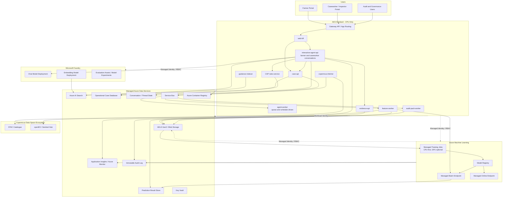

# AKS-Centered Architecture with Microsoft Foundry

## 1. Decision

Use **AKS as the primary application and agent runtime**, while using managed Azure
services for the models and data capabilities that do not benefit from self-hosting.

The recommended split is:

- **AKS CPU nodes** host the web application, agent orchestration, deterministic CAP
  services, integrations, evidence APIs, and background workers.
- **Microsoft Foundry model deployments** provide foundation-model inference.
- **Azure Machine Learning managed compute and endpoints** train and serve the custom
  crop classifier.
- **Copernicus Data Space processing services** perform large raster operations.
- **Azure AI Search, Storage, Key Vault, Service Bus, and monitoring services** remain
  managed PaaS components.

This architecture provides substantial practical AKS experience without using
Kubernetes to operate GPU drivers, model servers, vector databases, or foundation
models.

The original AKS GPU-serving option remains documented in
[`copernicus-ai-solution-architecture.md`](./copernicus-ai-solution-architecture.md).

## 2. Why Agents Fit AKS

An agent is not the model itself. The agent runtime is application code that:

- receives a user request;
- retrieves state and permissions;
- constructs model input;
- calls a managed model endpoint;
- invokes approved tools;
- validates tool results;
- applies guardrails and workflow rules;
- records traces and case evidence;
- returns a response.

This workload is normally CPU- and network-bound. It does not require GPU nodes because
the expensive model inference happens in Foundry or another managed model endpoint.

Hosting the agent in AKS is reasonable when the project wants:

- one deployment platform for agents and non-AI services;
- full control over prompts, tools, state graphs, retries, and error handling;
- custom agent frameworks such as Semantic Kernel, LangGraph, or Microsoft Agent
  Framework;
- explicit separation between conversational reasoning and administrative decisions;
- normal container CI/CD, canary deployment, and rollback;
- private networking and workload identity;
- hands-on experience operating production-style AKS workloads.

## 3. Trade-Off

The choice is justified, but it is not operationally free.

### Advantages

- Agent, portal, APIs, workers, and deterministic rules use one runtime platform.
- Shared deployment, identity, networking, observability, and release practices.
- No dependency on a hosted-agent runtime for custom orchestration behaviour.
- Easier local/container development and framework portability.
- Agent code can be tested like any other service.
- The architecture demonstrates meaningful AKS skills for the capstone.

### Responsibilities retained by the project

- container-image security and dependency patching;
- pod scaling and disruption management;
- conversation/session persistence;
- retry, timeout, and circuit-breaker behaviour;
- agent and prompt versioning;
- tool-call tracing;
- evaluation integration;
- safe rollout and rollback;
- framework upgrades;
- protection against prompt injection and unsafe tool calls.

Foundry-hosted agents would reduce some of this operational work. In this project,
learning and demonstrating AKS is an explicit objective, so retaining it is a
deliberate trade-off rather than accidental complexity.

## 4. High-Level Architecture

## 5. AKS Workloads

### 5.1 `web-bff`

Responsibilities:

- user sessions and portal-specific APIs;
- request aggregation;
- streaming chat responses;
- authentication and user context;
- protection against exposing internal service contracts.

### 5.2 `agent-api`

Responsibilities:

- prompt and instruction versioning;
- conversation orchestration;
- tool selection;
- state-graph execution;
- retrieval orchestration;
- model endpoint invocation;
- structured output validation;
- tool timeout/retry policies;
- response generation;
- correlation IDs and tracing.

The service calls the Foundry-hosted model. It does not run the model locally.

Deploy the interactive and asynchronous paths separately:

- `interactive-agent-api` serves farmer and caseworker conversations.
- `agent-worker` consumes scheduled or event-driven work from Service Bus.

They may share code, but use separate Kubernetes Deployments, service accounts,
scaling policies, and concurrency limits.

### 5.3 `case-api`

Responsibilities:

- official claim and parcel state;
- case chronology;
- farmer responses;
- human-review tasks;
- appeal and discrepancy status;
- role-based access control;
- immutable material-event history.

### 5.4 `rules-service`

Responsibilities:

- deterministic CAP eligibility rules;
- scheme-year and policy versioning;
- confidence/escalation thresholds;
- required human approvals;
- decision authority boundaries.

The agent may explain a rule but cannot replace this service.

### 5.5 `evidence-api`

Responsibilities:

- approved imagery and chart references;
- model result and provenance;
- evidence-package generation;
- farmer-safe and caseworker-safe views;
- signed or tamper-evident evidence manifests.

### 5.6 Background workers

- `copernicus-fetcher`: discovers acquisitions and creates work.
- `feature-worker`: requests/produces parcel features.
- `guidance-indexer`: chunks and indexes versioned CAP guidance and removes superseded
  index versions through a governed publication process.
- `audit-pack-worker`: compiles traceable draft audit packages.
- optional notification worker: sends approved notices through configured channels.

Workers should use Kubernetes Jobs or KEDA-scaled Deployments where appropriate.

### 5.7 Agent deployment map

| Case agent | AKS runtime | Trigger | Authority |
|---|---|---|---|
| Farmer Guidance Agent | `interactive-agent-api` | Farmer conversation | Guidance and bounded portal actions |
| Parcel Monitoring Agent | `feature-worker` plus `agent-worker` | Seasonal schedule/new acquisition | Produces monitoring evidence; abstains/escalates |
| Discrepancy Resolution Agent | `agent-worker` and interactive API | Case event/farmer response | Bounded evidence requests and routine resolution |
| Inspection Prioritisation Agent | `agent-worker` | Unresolved/risk-review event | Recommendation only |
| Audit Evidence Agent | `audit-pack-worker` | Audit request/scheduled control | Autonomous draft; human sign-off |

The monitoring and audit agents are not dependent on a user chat session.

## 6. Keep Models Outside AKS

### Foundation models

Use Microsoft Foundry model deployments for:

- chat/reasoning;
- embeddings;
- plain-language explanations;
- correspondence drafts;
- evidence summaries.

Advantages:

- no model weights or GPU serving stack in AKS;
- managed capacity and safety controls;
- model deployment/version management;
- simpler upgrades and quota management.

For farmer/case data, deploy the model in an approved EU region using a **Regional**
or **EU Data Zone** deployment type. Do not use Global deployment types for this
workload. Minimise personal/case data sent to the model, use private networking where
required, and document the selected deployment's processing geography.

### Crop classifier

Use Azure Machine Learning for the custom crop classifier:

- managed CPU/GPU training jobs;
- experiment tracking;
- model registration;
- managed batch inference;
- managed online inference where required.

The first classifier should be XGBoost, LightGBM, or another CPU-friendly model over
seasonal parcel features. GPU is optional for later temporal deep-learning
experiments, not required for the baseline.

Foundry foundation-model fine-tuning is not a substitute for training this arbitrary
geospatial classifier.

## 7. Agent Responsibility Boundary

### Agent may

- explain rules and evidence requirements;
- retrieve authorised parcel/case status;
- request approved analysis operations;
- explain an existing model result;
- guide the farmer through evidence submission;
- draft correspondence;
- summarise a case for an official;
- create a human-review task through a controlled API.

### Agent may not

- directly update payment or sanction fields;
- calculate official parcel area through free-form reasoning;
- choose an unapproved model or rule version;
- suppress low confidence or missing evidence;
- close a disputed case autonomously;
- issue a sanction;
- write directly to the claims database.

All tools validate identity, authority, input, current case state, and permitted
transition independently of the agent.

## 8. Suggested Agent Tools

| Tool | Backing service | Purpose |
|---|---|---|
| `get_case_status` | `case-api` | Retrieve structured claim and parcel status |
| `get_cap_rule` | `rules-service` / AI Search | Retrieve authoritative versioned guidance |
| `get_parcel_evidence` | `evidence-api` | Retrieve approved evidence and provenance |
| `get_crop_result` | Prediction Result Store | Return an approved stored prediction, alternatives, confidence, and quality |
| `request_reanalysis` | `case-api` + Service Bus | Queue an approved scoring request |
| `submit_farmer_evidence` | `case-api` | Validate and register evidence |
| `request_human_review` | `case-api` | Create a caseworker task |
| `create_audit_draft` | audit worker | Request a draft audit package |

Use structured schemas and narrow operations. Avoid generic database, shell, or
unrestricted HTTP tools.

## 9. Conversation and Workflow State

Do not store durable conversation state only in pod memory.

Use:

- a managed database or Cosmos DB for conversation/thread state;
- the operational case database for authoritative workflow state;
- Redis only for transient cache/locks where required;
- Blob Storage for uploaded files and evidence artifacts.

Pods remain disposable and horizontally scalable.

The case state and conversation state must remain separate. Deleting a chat thread
must not delete the administrative case record.

Use a dedicated Prediction Result Store, or a clearly separated case-database schema,
for batch and online crop results. Agent tools query this store rather than scanning
Blob/Parquet output.

## 10. Crop Training and Inference

### Training

1. Build weak or validated parcel labels.
2. Extract Sentinel-1/Sentinel-2 parcel features.
3. Store versioned features and manifests in ADLS Gen2.
4. Run Azure ML managed training jobs.
5. Track data, code, environment, parameters, and metrics.
6. Evaluate spatial and temporal holdouts.
7. Calibrate confidence and abstention.
8. Register the approved model.

### Batch inference

Use a managed batch endpoint for national or seasonal scoring.

This is the default because:

- parcel scoring is naturally asynchronous;
- large groups can be processed together;
- results can be reviewed before entering case workflows;
- compute only runs for the job;
- retries and failed-row handling are explicit.

### Online inference

Use a managed online endpoint for:

- interactive demonstrations;
- caseworker-requested rescoring;
- low-latency agent tools using already prepared features.

Do not run full satellite ingestion and seasonal feature extraction synchronously
inside a chat request.

Use an internal crop-scoring client/adapter with one stable application contract. The
adapter owns AML endpoint authentication, scoring paths, retries, and response
normalisation. If inference later moves to AKS, callers do not change.

The complete procedure remains in
[`../copernicus/crop-classification/crop-classifier-training-procedure.md`](../copernicus/crop-classification/crop-classifier-training-procedure.md).

## 11. Raster Processing

Most raster processing does not require GPU.

### Copernicus services

Use openEO or Sentinel Hub for:

- cloud masking;
- band math;
- vegetation indices;
- parcel statistics;
- temporal aggregation;
- archive-scale processing.

### AKS CPU

Use AKS jobs for:

- catalogue polling;
- work orchestration;
- geometry validation;
- light GDAL/rasterio transformations;
- schema conversion;
- evidence packaging;
- metadata indexing.

### Azure ML

Use managed batch compute for:

- reproducible feature-generation experiments;
- custom algorithms not available through Copernicus processing APIs;
- model-linked training dataset preparation.

Avoid downloading complete Sentinel products when parcel statistics or selected COG
windows are sufficient.

## 12. AKS Configuration

| Decision | Recommendation |
|---|---|
| SKU | **AKS Standard**: explicit node pools, scaling, maintenance, and policy controls support the platform-learning objective |
| Node pools | System pool plus CPU user pool; no GPU pool |
| Networking | Azure CNI Overlay powered by Cilium |
| Ingress | App Routing/Gateway API |
| Identity | Microsoft Entra Workload Identity |
| Secrets | Key Vault plus Secrets Store CSI Driver only where managed identity is not possible |
| Scaling | HPA for APIs, KEDA for queue workers, Cluster Autoscaler for CPU node pools; do not enable NAP |
| Availability | Availability Zones, topology spread, PodDisruptionBudgets |
| Images | Private ACR, signed/scanned images, managed-identity pulls |
| Policy | Azure Policy/Gatekeeper rejects `nvidia.com/gpu`, GPU tolerations/runtime classes, privileged workloads, and unapproved images |
| Observability | Managed Prometheus/Grafana, Container Insights, Application Insights/OpenTelemetry |

CPU-only operation is an enforced platform rule, not merely the absence of a GPU pool.
Restrict allowed VM families/SKUs in infrastructure code and subscription policy, and
reject workload specifications that request or tolerate GPU resources.

## 13. Agent Scaling

The agent is largely I/O bound while waiting for:

- Foundry model responses;
- AI Search;
- case APIs;
- AML endpoints;
- storage.

Scale on:

- concurrent requests;
- request latency;
- CPU/memory;
- custom in-flight conversation metric;
- queue depth for asynchronous agent work.

Do not scale solely on CPU, because a saturated model endpoint can create high latency
while agent pods remain CPU-idle.

Use timeouts, bounded retries, circuit breakers, and bulkheads for every downstream
tool.

## 14. Identity and Security

Use:

- AKS Workload Identity for each service account;
- separate managed identities for agent, case API, ingestion, and workers;
- Azure RBAC at the narrowest scope;
- `ManagedIdentityCredential` in production;
- `DefaultAzureCredential` only for local development;
- private endpoints where required;
- network policies between namespaces/services;
- explicit egress controls for external Copernicus endpoints;
- no secrets in images or Kubernetes manifests.

The agent identity should be able to call narrow tool APIs and Foundry models. It
should not have direct write access to the claims database or unrestricted access to
the evidence lake.

## 15. Prompt and Tool Security

Controls include:

- treat retrieved documents and farmer uploads as untrusted data;
- do not allow retrieved text to redefine tool permissions;
- validate every tool argument against a schema;
- enforce authorisation in the tool service;
- malware-scan uploaded files;
- strip or isolate active content;
- use allowlisted outbound destinations;
- limit tool result size;
- redact sensitive data before model calls where required;
- preserve prompt, model, retrieval, and tool versions in traces;
- require human approval for high-impact actions.

## 16. Observability

### Agent

- model and tool-call latency;
- token use and model cost;
- selected tool and outcome;
- retries and timeouts;
- grounding sources;
- policy/guardrail results;
- prompt and agent version;
- user/case correlation ID.

### AKS

- pod availability and restarts;
- saturation and scaling;
- queue depth;
- network and downstream dependency failures;
- deployment version and rollback events.

### Crop model

- data and feature lineage;
- model version;
- class/confidence distribution;
- abstention and override rates;
- drift;
- batch job completion;
- endpoint latency/failure.

Use one correlation ID across the portal request, agent turn, model call, tool call,
case event, crop prediction, and human decision.

Persist high-risk AI logs and technical evidence to an immutable/WORM-capable storage
destination. Retain model, prompt, tool, dataset, rule, and deployment versions for the
period required by the AI Act, CAP audit, national administrative law, and the
agency's approved records schedule. Use at least the applicable AI Act minimum and
extend it where CAP/audit obligations require longer retention. Keep transient chat
retention separate from the legally required case/evidence record; GDPR erasure does
not remove records retained under a valid public-task or legal-obligation basis.

## 17. Evaluation

Foundry remains useful even though the agent runtime is in AKS:

- use Foundry models and evaluation capabilities for response-quality experiments;
- maintain versioned evaluation datasets;
- test groundedness, rule citation, tool selection, refusal, and escalation;
- correlate application traces with evaluation results;
- compare prompt/model versions before deployment.

The deployment pipeline should require:

- unit and contract tests;
- tool-authorisation tests;
- prompt-injection tests;
- agent evaluation thresholds;
- crop-model evaluation thresholds;
- staged/canary rollout.

## 18. Failure Behaviour

| Failure | Behaviour |
|---|---|
| Foundry model unavailable | Deterministic portal and case functions remain available; chat assistance degrades explicitly |
| Foundry quota/429 throttling | Apply bounded exponential backoff, per-user rate limits, queue non-interactive work, and fail over only to an approved deployment in the same EU processing boundary |
| Agent pod failure | Kubernetes restarts/replaces pod; durable state is recovered externally |
| Invalid tool call | Tool rejects request; no case transition |
| AI Search unavailable | Agent states guidance retrieval is unavailable; does not invent policy |
| AML online endpoint unavailable | Queue batch/rescore or show last approved result |
| Crop batch job fails | Preserve previous result and create an operational exception |
| Copernicus API unavailable | Use cached features/evidence or defer processing |
| Low observation quality | Return `UNKNOWN` and request additional evidence |

## 19. Cost Model

Main cost levers:

- AKS CPU baseline and autoscaling;
- Foundry model tokens/capacity;
- Azure AI Search tier;
- AML training jobs;
- AML batch/online endpoint compute;
- Copernicus/Sentinel Hub processing quota;
- storage and data retention;
- observability ingestion.

Control cost by:

- keeping foundation-model inference managed;
- using a small CPU crop model first;
- preferring batch crop scoring;
- scaling workers from queues;
- caching reusable parcel features;
- applying storage lifecycle policies;
- using small models for routing/simple explanations where quality allows;
- keeping high-resolution imagery as an exception path.

AML managed online endpoints incur compute cost while deployments are provisioned.
Use batch endpoints as the default and keep online deployments small, autoscaled, or
disabled outside demonstration/interactive periods where operationally acceptable.

## 20. MVP Sequence

1. Deploy an AKS CPU cluster with Workload Identity, ingress, ACR, and monitoring.
2. Deploy `web-bff`, `agent-api`, `case-api`, and `rules-service`.
3. Deploy an EU Regional or EU Data Zone Foundry chat model and grant the agent
   workload identity access.
4. Add the governed guidance-indexing worker and AI Search index versioning.
5. Build the public crop-feature dataset.
6. Train the CPU crop classifier using Azure ML managed compute.
7. Deploy a managed batch endpoint.
8. Add the Prediction Result Store and `get_crop_result`, `get_case_status`, and
   `get_cap_rule` tools.
9. Add farmer-safe explanations and human escalation.
10. Run agent and crop model in shadow mode.
11. Add KEDA workers for ingestion, evidence, and audits.
12. Add an online crop endpoint only if interactive rescoring is required.

## 21. If Azure ML Is Not Available

The architecture still works:

1. Train the XGBoost/LightGBM baseline on a controlled CPU runner.
2. Store the training container, feature manifest, model, and metrics in ACR/Blob.
3. Serve the CPU model as an AKS deployment.
4. Put it behind the crop-scoring adapter so callers keep the same application
   contract even though AML and AKS have different authentication and scoring APIs.
5. Move it to Azure ML later without changing the agent tool.

This puts one additional workload on AKS, but still requires no GPU nodes.

## 22. Recommendation

Adopt an **AKS-centered, Foundry-backed architecture**:

- agents and deterministic application services run on AKS CPU;
- foundation models remain managed in Foundry;
- crop training and serving use Azure ML managed compute/endpoints;
- raster-heavy processing uses Copernicus APIs or managed batch compute;
- AKS does not host GPU model servers unless future evaluation proves a need.

This is a good architectural compromise: it maximises relevant AKS learning and
platform consistency while avoiding the least valuable and most operationally
demanding part of self-hosted AI—GPU model infrastructure.

## 23. References

- [Microsoft Foundry](https://learn.microsoft.com/azure/ai-foundry/)
- [Azure Machine Learning managed online endpoints](https://learn.microsoft.com/azure/machine-learning/concept-endpoints-online)
- [AKS Workload Identity](https://learn.microsoft.com/azure/aks/workload-identity-overview)
- [Azure Kubernetes Service documentation](https://learn.microsoft.com/azure/aks/)
- [Passwordless Azure authentication](https://learn.microsoft.com/azure/developer/intro/passwordless-overview)
