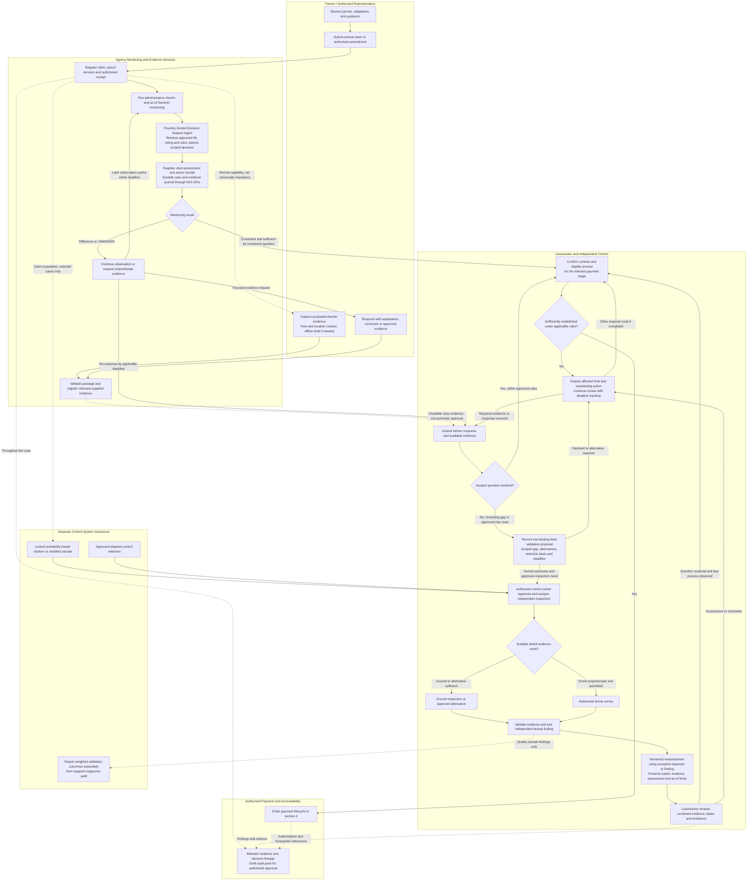
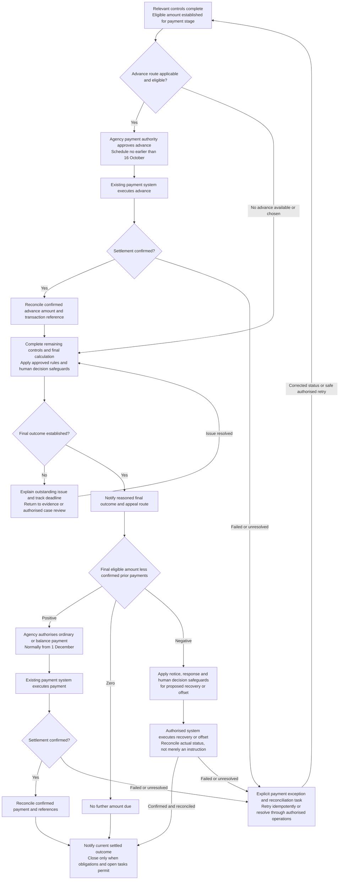

# Business Process Flow: From Parcel to Payment

**PROPOSED — technical amendment 11 November 2026.** The user selected Foundry Agent
Service for custom runtime agent orchestration; applications, typed APIs and
deterministic rules remain on AKS. This is not a deployed process or design release,
and does not amend historical WP-001 evidence.

## 1. Purpose and Scope

This is the business view of the
[maintained AKS-centred architecture](./aks-centered-foundry-architecture.md):
who acts, what evidence is needed, where exceptions rejoin the normal process, and
how an established entitlement reaches the authorised payment system.

The primary scope is an annual area-based CAP claim. Investment, reimbursement,
animal-based, and multi-year interventions use their own approved controls and
payment rules. This is a proposed process for the fictional case, not a statement
that a real Hungarian agency already operates it.

The diagrams are business flows, not formal BPMN or a replacement for the statutory
procedures. An editable
[Excalidraw overview](./business-process-flow.excalidraw) accompanies the detailed
Mermaid flows below. Open the source file in <https://aka.ms/excalidraw>.

**Core principle:** monitoring creates evidence, evidence supports case readiness,
and the authorised paying-agency system executes payments. These are distinct steps.
The [Decision Support Agent contract](./decision-agent-architecture.md) makes the
bounded assessment, evidence journal and farmer/field reassessment loop explicit.
“Decision Support Agent” is the public name/proposed hosted implementation of the
existing **Discrepancy Resolution Agent** role, not a sixth runtime role; the other
four runtime roles and all human authority boundaries remain distinct.
The intended [decision-agent PNG](./decision-agent-flow.png) and
[Azure deployment PNG](./azure-deployment-overview.png) are separately owned diagram
deliverables; editable-source targets are linked from that contract.

## 2. Claim, Evidence, and Review Flow

Solid arrows show business progression; dotted arrows show supporting evidence,
population sampling, or ongoing assurance. A farmer upload does not automatically
create a human-review obligation for every photo: approved task rules determine
whether bounded workflow handling or caseworker review is needed.

The Decision Support Agent accepts only registered case/evidence references,
calibrated Azure ML probabilities/confidence, quality/coverage, UNKNOWN/review
status, approved as-of and availability cutoffs, and model/feature/taxonomy/rule
versions. Labels and confidence are evidence, not entitlement. Typed AKS tools
enforce actor authority, current case state and permitted transitions independently
of the LLM; claimant content cannot supply instructions or permissions.

Every accepted farmer response or independent finding creates a new assessment
version. Farmer responses pass the same package acceptance checks before assessment;
`ASSESS` includes that versioned reassessment and applicable caseworker review.
The field route explicitly records a proposal before approval, never autonomous
dispatch. A focused farmer request must follow approved notice policy and state the
question, evidence alternatives, delivery status and response deadline; otherwise
it remains a draft for approval.

### What the branches mean

| Route | Trigger and owner | Rejoins at |
|---|---|---|
| Normal progression | Sufficient monitored evidence; agency completes other required controls | Relevant-stage readiness assessment |
| Routine farmer evidence | Farmer documents a material event, correction, or approved scheme milestone | Same case evidence file and scoped assessment |
| Requested evidence | Approved request explaining a discrepancy or missing observation | Response assessment; resolved cases need not be inspected |
| Technical escalation | Unresolved cloud, resolution, timing, or other evidence limitation | Human-approved ground/drone task, then combined review |
| Targeted inspection | Approved risk/control selection, not an agent's binding order | Independent finding and combined review |
| Random validation | Locked probability sample, including remotely consistent cases | Independent finding, same case review, and separate quality reporting |

Non-monitorable conditions still need the appropriate administrative, documentary,
or physical controls. A consistent satellite result does not establish all
intervention conditions.

Random quality selection cannot be cancelled merely because the farmer provides a
convincing photo or the monitoring result is consistent. Confidence bands may be
declared sampling strata; use random selection within strata and appropriate weights.
Independent findings are attested before model suggestions are revealed.

Independent checks may occur before or after an advance. Later accepted findings
update the versioned case and any remaining balance or recovery under the applicable
rules. Selection affects payment holds only where those rules require it; a quality
programme is not a universal pre-payment visit requirement.

## 3. Unresolved Questions and Adverse Decisions

The main diagram's hold/review loop is not permission to keep a farmer waiting
indefinitely or to treat missing imagery as non-compliance.

The caseworker identifies the affected intervention/amount, the factual gap, the
applicable rule, the response or review deadline, and the next permitted action.
Later monitoring is useful only if it can answer the question in time. Otherwise,
use a proportionate alternative evidence route or escalate.

Before a potentially adverse outcome, follow the applicable notice, opportunity to
respond, evidence access, and human-review procedure. An authorised official issues
a reasoned decision; the farmer receives the appeal route. New evidence, an appeal
outcome, or a permitted amendment returns to the relevant assessment/control step
with a new version, preserving earlier records.

Do not assume an appeal automatically suspends payment, or that one unresolved
parcel blocks every intervention. Apply the approved national rules. A valid
inspection finding establishes a scoped fact, not a sanction.

## 4. Advance, Final Calculation, and Payment Flow

This subprocess can start once the controls required for its payment stage establish
an eligible amount. It need not wait for every final-season check to finish.

The net calculation is intervention-specific and illustrative. Reductions, offsets,
recoveries, and earlier payments follow the approved accounting/legal rules; an LLM
does not perform or authorise this calculation.

The exception arrow returns to readiness/reconciliation, **not permission to
re-authorise or duplicate a payment**. Check the authoritative ledger and reuse the
original idempotency key for any retry. A pending instruction must be resolved before
an overlapping balance or replacement instruction is issued.
Remaining controls may continue while settlement status is being resolved; the
diagram does not require all case work to wait for a bank acknowledgement.

For the annual area-based scope, advances may start from **16 October**, ordinary
and balance payments normally from **1 December**, and the normal payment deadline
is **30 June next year**, subject to the applicable provisions and exceptions.
Other intervention schedules differ. Neither sowing, harvest, a photo, nor a
model-consistent result is a payment trigger.

Some farmers receive an advance followed by a balance; others receive only an
ordinary/final payment. An overpaid advance may lead to a governed recovery or offset.
Case and portal status distinguish estimated, established, authorised, scheduled,
and confirmed paid amounts.

## 5. Business Responsibility to Architecture Mapping

| Business responsibility | Accountable actor | Architecture support and boundary |
|---|---|---|
| Prepare and submit claim | Farmer or authorised representative | Portal/PWA, national eID, `web-bff`, `case-api`; guidance agent cannot submit an official change on its own |
| Capture farmer evidence | Farmer or representative | Guided app, `evidence-api`, quarantine, governed versioned evidence; GPS is supporting provenance |
| Check package acceptance | Agency evidence service | Complete clean pinned objects, manifest/hash validation, explicit receipt; offline draft is not submission |
| Monitor parcel and activity | Agency control owner; EO/model specialists maintain approved methods | Copernicus APIs, `feature-worker`, Azure ML, prediction store; approved as-of window and abstention |
| Explain and resolve routine questions | Approved workflow or caseworker | Decision Support Agent (discrepancy role), `rules-service`, `case-api`; contested/adverse outcomes escalate |
| Assess scoped evidence and propose next action | Agency control owner; bounded automation only within approved policy | Foundry-hosted Decision Support Agent consumes approved Azure ML rating and cited rules through typed AKS APIs; durable assessment receipt, farmer-request and field-proposal boundaries |
| Select independent checks | Authorised control owner | Locked quality sample or approved targeted selection; prioritisation agent recommends only |
| Inspect and establish facts | Inspector/surveyor | Field app, optional drone, evidence worker and store; attested pre-AI finding, dated limitations |
| Establish entitlement and decide adverse cases | Authorised agency officials under approved procedures | Versioned rules and authoritative case records; neither LLM nor crop model has decision authority |
| Authorise and execute payment | Existing agency payment authority | `payment-system-adapter` hands off approved records; existing treasury system retains authorisation, execution, and ledger |
| Reconcile and inform farmer | Agency payment operations and case services | Idempotent adapter, transaction references, case/portal state; an accepted instruction is not settlement |
| Audit and assure | Auditor and authorised submission owner | Immutable lineage, `audit-pack-worker`, Audit Evidence Agent; draft requires approval before submission |

### Durable record, deadlines and safe failure

The governed evidence file preserves accepted object versions/hashes, capture and
provenance. The durable case/action journal correlates case, parcel, evidence,
request and action IDs, actor/authority, reasons/citations, model/rule/agent versions,
request/response/result/status timestamps, approval references and payment transaction
links. Corrections and reassessments append linked versions rather than overwrite
the independent finding or original assessment.

Operational monitoring receives minimal correlated metadata, not raw claimant
content or whole prompts/tool payloads. Retention, access, legal holds and any
immutable-policy enforcement need approved legal/records/operational choices; no
perpetual WORM policy is implied by “immutable lineage.”

Persist accepted actions before acknowledgement and use stable idempotency keys
and case-version checks. Duplicate events return the existing receipt; conflicting
or stale commands are rejected. Replay cannot resend notices, dispatch inspections
or duplicate payments. Timeouts, UNKNOWN, failed delivery, invalid capture and
expired response deadlines are explicit case exceptions with owners and next
actions. No response or missing imagery does not establish non-compliance.
No automatic alternate model/region or indefinite wait is authorised.

## 6. Where the Two-Month Benefit Can Arise

The process removes avoidable waiting between observation, evidence request,
independent finding, case review, and authorised payment readiness. Examples are a
delayed advance moved into an earlier autumn batch or a winter balance released
earlier after a scoped issue is resolved.

It does not move an advance already paid on 16 October into August, skip required
controls, or replace inspections needed for independent quality assessment.

Measure first material payment separately from substantially complete payment,
including the proposed **90% of final eligible value** threshold, median/P90,
year-end paid share, and unpaid balances. Split results by advance cohort,
intervention, and validation route; the 90% threshold is a proposed KPI convention,
not a legal entitlement rule.

## 7. Source Procedures

- [AKS-centred Foundry architecture](./aks-centered-foundry-architecture.md)
- [Decision Support Agent contract and logical/sequence views](./decision-agent-architecture.md)
- [Personas and use cases](../Persona/personas-and-use-cases.md)
- [Evidence-validation storyline](../copernicus/crop-classification/evidence-validation-storyline.md)
- [Drone and independent validation procedure](../copernicus/crop-classification/drone-survey-validation-process.md)
- [As-of-date crop-model contract](../copernicus/crop-classification/crop-classifier-training-procedure.md#81-as-of-date-feature-contract)
- [CAP claim and payment calendar](../research/cap-claim-and-payment-calendar.md)
