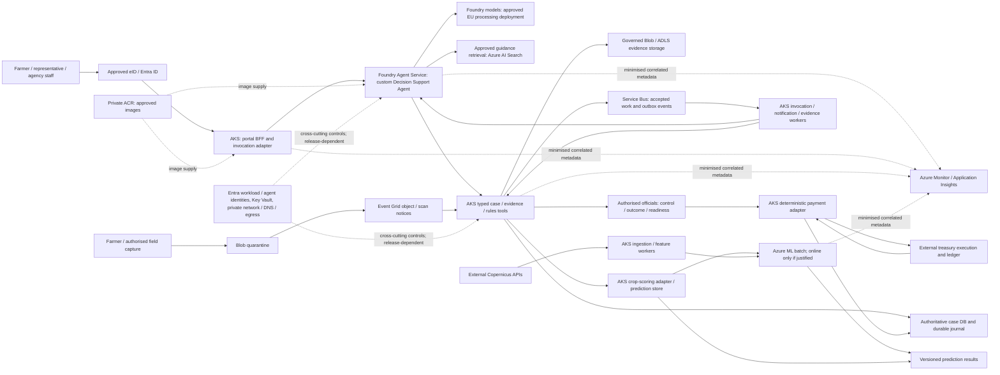
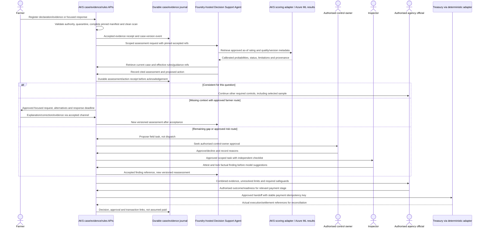

# Decision Support Agent: Proposed Architecture Contract

**PROPOSED — revision DA-2026-11-11-r2.** This is a documentation proposal for the
fictional paying-agency case, not an implemented service, approved business rule,
compliance certification, design release, or permission to deploy.

On **11 November 2026**, the user selected **Foundry Agent Service hosting for custom
runtime agent orchestration**. Application services, typed APIs, deterministic rules
and integration workers remain on AKS. This explicitly supersedes the earlier
AKS-agent-runtime proposal in the maintained architecture; it does not amend the
historical WP-001 release or establish that the hosted configuration is available
in the eventual approved environment.

## 1. What exists, and what this proposal adds

The baseline already describes the business flow, but distributes decision support
across Parcel Monitoring, Discrepancy Resolution and Inspection Prioritisation. It
does **not** contain a single named Decision Support Agent input/action/journal
contract. The agent below makes that assessment loop explicit within the existing
bounded discrepancy role, not a new authority or an additional runtime role.

### Terminology decision: five runtime roles, not six

**Decision Support Agent is the public name and proposed Foundry-hosted
implementation of the baseline Discrepancy Resolution Agent role.** It is not a
distinct sixth role and is not an umbrella that absorbs the other four roles.
Existing references to “Discrepancy Resolution Agent” refer to this same bounded
role; use “Decision Support Agent (baseline: Discrepancy Resolution Agent)” on first
mention where continuity matters.

| Canonical baseline runtime role | Public/proposed hosted name | Unchanged responsibility boundary |
|---|---|---|
| Farmer Guidance Agent | Farmer Guidance Agent | Guidance and evidence assistance; no official claim change or entitlement decision |
| Parcel Monitoring Agent | Parcel Monitoring Agent | Monitoring workflow and approved ML evidence/uncertainty; Azure ML remains the crop classifier |
| Discrepancy Resolution Agent | **Decision Support Agent** | Scoped discrepancy assessment, approved farmer-validation requests, routine rule-bounded progression and proposed field tasks; no binding administrative outcome |
| Inspection Prioritisation Agent | Inspection Prioritisation Agent | Approved candidate ranking/recommendation, not inspection dispatch or probability-sample replacement |
| Audit Evidence Agent | Audit Evidence Agent | Draft evidence pack; authorised approval before submission |

These are five logical runtime roles, separate from the nine delivery-team roles.
The eventual number of hosted deployments is a later feasibility/design choice,
not permission to merge authority boundaries.

| Fixed baseline evidence at `c179b1c2d28298b6b1a135277090672989900913` | Existing coverage | Gap closed here |
|---|---|---|
| `aks-centered-foundry-architecture.md:5-16, 334-361, 433-451` | AKS orchestration, managed models, distributed runtime roles | Dated Foundry-hosting amendment and one explicit assessment contract |
| `aks-centered-foundry-architecture.md:363-422, 559-609` | Case, rules and evidence APIs; tool-side authority checks | Typed action preconditions, version pins, idempotency and assessment results |
| `business-process-flow.md:24-166` | Farmer response, independent checks, holds and adverse safeguards | Agent entry, durable action receipt and versioned reassessment made explicit |
| `crop-classifier-training-procedure.md:296-323, 374-398, 486-505` | As-of features, calibrated probabilities, UNKNOWN and lineage | Exact ML evidence envelope consumed by the agent, not a second classifier |
| `drone-survey-validation-process.md:96-121, 367-421` | Locked sample, pre-AI findings, factual limits and case review | Enforcement across agent proposals, independent evidence and reassessment |
| `aks-centered-foundry-architecture.md:799-847` | Correlated telemetry and material AI records | Durable case/evidence journal distinguished from minimised operational traces |

These are baseline line references, not line numbers of the revised files. Detailed
controls remain in the [business flow](./business-process-flow.md),
[crop procedure](../copernicus/crop-classification/crop-classifier-training-procedure.md)
and [independent-validation procedure](../copernicus/crop-classification/drone-survey-validation-process.md).
The [personas](../Persona/personas-and-use-cases.md) retain their authority boundaries.

## 2. Business purpose and hard limits

The **Decision Support Agent** answers a scoped question such as “does the registered
evidence resolve this declared-crop discrepancy at this cutoff?” It accepts
registered evidence, retrieves Azure ML's crop rating and the approved rules,
produces an evidence-cited assessment, and requests only permitted next actions.

Crop labels, calibrated confidence, a farmer photograph and GPS are **evidence, not
entitlement**. A consistent crop assessment continues all other required controls;
it does not approve an intervention, cancel an independent sample, release a hold,
or authorise payment. The agent cannot change an official declaration, invent a
threshold, make a binding visual inspection finding, issue an adverse decision,
dispatch a field mission, or execute a payment.

The role consumes Parcel Monitoring/Azure ML evidence; it does not take over the
monitoring or classifier role. The existing Inspection Prioritisation Agent may
recommend candidates, but only the
authorised control owner approves a targeted field task. Probability sampling
remains an independent control-system process, not an LLM selection tool.

## 3. Logical deployment and data boundaries

Arrows are logical contracts, not proof of working routes or resource provisioning.
The deployment PNG contract is [azure-deployment-overview.png](./azure-deployment-overview.png);
the detailed loop image is [decision-agent-flow.png](./decision-agent-flow.png).
Intended editable sources are [overview SVG](./azure-deployment-overview.svg),
[overview Excalidraw](./azure-deployment-overview.excalidraw),
[flow SVG](./decision-agent-flow.svg) and [flow Excalidraw](./decision-agent-flow.excalidraw).
These paths are deliverables owned by the diagram author; until supplied and reviewed
they are intended targets, not claims that images exist or match this revision.

The PNG must distinguish **proposed workload**, **WP-001 foundation candidate
(compiled, author checks blocked, not independently accepted/deployed)**, and
**external authorities/services**. Private AKS, ACR, Key Vault, networking and minimal
monitoring are foundation candidate dependencies; Foundry, ML, applications, evidence
and case stores, Search and messaging are proposed workload capabilities, not delivered
by WP-001. See [infra status](../../infra/README.md). Do not colour all Azure boxes
as deployed merely because their icons are official.

### Resource, identity and network contract

- Future release must name environment, tenant/subscription, project resource
  groups, Foundry account/project/agent scope, model deployments, ML workspace,
  store/container/index/queue scopes and the owner of each dependency. No IDs,
  SKU, new platform resource group, AVM version or capacity is selected here.
- Platform operator owns existing-foundation integration. Application/AI writer owns
  the hosted code, invocation adapter and tool schemas; ML/data writer owns scoring
  and prediction lineage. Case/control owners own business transitions and records.
- Separate AKS service identities from Foundry's agent runtime identity and project
  infrastructure identity. Grant only the selected APIs/model/index operations.
  The agent has no direct case-database write or unrestricted evidence-lake access.
  Verify the chosen hosting API's identity behaviour; do not assume project and
  runtime identities are interchangeable.
- Every call authenticates the workload and rechecks the represented actor's case
  authority. Background work carries an approved service mandate, not a fabricated
  user delegation. Farmer and adviser scope/expiry is enforced in AKS.
- Required private paths include BFF/adapter to Foundry, hosted agent to AKS tools
  and approved retrieval/models, and APIs to stores/messaging. A private endpoint
  alone does not establish hosted outbound reachability. Hosting mode, delegated
  subnet, private DNS, routes, firewall/egress, TLS and token audience must be
  designed and tested together. No public-tool fallback is authorised.
- Case/personal data uses approved EU Regional/EU Data Zone model processing, not
  Global deployments. Agent runtime, session storage, tool processing, retrieval,
  model inference, logs and recovery copies each need a geography decision.
  Foundry project location alone proves none of the other processing boundaries.

## 4. Versioned input, output and tool contract

This is a semantic contract for future writer-owned schemas, not executable API code.
Application/AI and ML/data writers must agree the wire schema and consumer tests
before implementation release.

### Required assessment input

| Group | Required fields / meaning |
|---|---|
| Scope and authority | Contract version; assessment/request ID; case and case-version; parcel and geometry-version; claim/scheme year and intervention; scoped factual question; authenticated actor/service mandate and permitted purpose |
| Declaration | Current farmer declaration/version and relevant dates; approved amendments; not a predictor feature in the crop classifier |
| Evidence | Accepted evidence IDs, pinned object versions and hashes, evidence type/status, capture/acquisition and publication/receipt dates, source/provenance, spatial/temporal scope, quality limitations; no unregistered upload as accepted evidence |
| Crop rating | Prediction/result ID and version; calibrated probability vector with taxonomy labels, top alternatives/confidence; `CONSISTENT`, `REVIEW_REQUIRED` or `UNKNOWN`; abstention reasons; coverage/quality, sensor/window and geometry limitations |
| Temporal validity | Season start, approved `asOfDate`, data-availability cutoff, actual acquisition/publication/ingestion timestamps and supported-window approval reference |
| Reproducibility | Model artifact/version, calibration and threshold-policy versions, feature/preprocessing/taxonomy versions, scoring contract/version, rule/policy version and effective scheme year |
| Workflow | Current question/task state, applicable holds and payment stage, response deadline and approved notice policy, previous assessment/response/finding refs and outstanding independent-control obligations |

Missing/stale/incompatible versions, unsupported windows or failed quality gates
produce an explicit exception or `UNKNOWN`, never a guessed class or a confident
approval. No new numeric threshold is defined here. CAP operations/control owner
approves discrepancy, notice and escalation policy; the geospatial/data-science owner
approves model/calibration/taxonomy/support windows with required governance reviews.
Independent technical evaluation must substantiate their targets.
The accountable roles below identify human approval responsibilities; individual
approvers and approval-record references have not been supplied and must be named
before the future implementation/design release.

### Assessment result and typed tools

The result contains assessment ID/version, input snapshot references, scoped status,
plain-language rationale, registered evidence and rule citations, limitations,
proposed next action, authority required, journal receipt and predecessor assessment.
“Rationale” means a concise evidence-based explanation, **not private model
chain-of-thought**. Structured outputs are validated before use.

| Proposed operation | Backing owner / return | Mandatory guard |
|---|---|---|
| Read case / rules / evidence | `case-api`, `rules-service`, `evidence-api`; pinned snapshots and effective rules | Actor/case/purpose access; evidence acceptance and version compatibility |
| Read crop rating / request rescore | AKS scoring adapter; approved stored result or async job/status reference | Approved model/window/features; no synchronous full satellite pipeline in chat |
| Record assessment | `case-api`; durable journal receipt | Expected case version, validated citations and action type; append rather than overwrite |
| Request farmer validation | `case-api` plus notification worker; request ID, approved text/purpose, evidence alternatives, due date and delivery status | Only approved notice policy/delegated authority may send; otherwise draft awaits approval |
| Propose field validation | `case-api`; non-binding proposal ID with factual gap, selection basis, capture window, alternatives and deadline | Control-owner approval required before assignment; drone legality/safety approval is separate |
| Register response/finding | Evidence and case APIs; accepted receipt/finding version | Same quarantine/manifest acceptance; independent finding locked before exposing predictions |
| Record official outcome/readiness | Authorised agency workflow only; decision and approval references | Not an agent tool permission; required controls and adverse safeguards enforced |

Every mutating API validates schema, workload and actor authority, **current case
state**, expected case version and permitted transition independently of the LLM.
No shell, generic SQL, unrestricted URL fetching or direct treasury tool is exposed.
Customer evidence, retrieved passages and tool text are untrusted data, never
instructions that can alter permissions. Approved guidance is versioned and cited;
retrieval is not a substitute for deterministic rule execution.

## 5. End-to-end reassessment loop

The conditional branches may repeat with bounded requests and deadline tracking;
the sequence does not imply that one response or visit always resolves a case.
Farmer evidence is available normally, not universally mandatory. A request explains
the parcel/question, relevant dates/rule, missing fact, proportionate evidence and
accessible alternatives, delivery/receipt status and applicable deadline.

Independent probability selection, inclusion probabilities, weights and selected-case
obligations survive a “consistent” result or convincing farmer response. Independent
observers cannot see model suggestions until their factual finding is attested and
locked; API/UI access controls enforce this, not a prompt. Later assisted comparison
is a new record. A current visit cannot by itself prove a historical condition.

Potentially adverse or contested outcomes require the applicable notice, evidence
access, opportunity to respond, reasoned authorised human decision and appeal route.
Non-response is not proof of non-compliance. Holds name the affected parcel,
intervention, amount/stage, rule, owner, deadline and next action; neither a quality
visit nor one open question automatically blocks every payment.

## 6. Durable journal versus operational traces

| Record plane | What it preserves | Boundary |
|---|---|---|
| Governed evidence storage and evidence registry | Raw accepted originals/derivatives, object version/hash, manifest, capture/provenance/quality, receipt and acceptance status | Restricted case/purpose access; preserve earlier versions and independent attestations |
| Durable case/evidence/action journal | Case/parcel/evidence/request/action correlation; actor and authority; case/model/feature/taxonomy/calibration/rule/prompt/agent/tool/index versions; reasons and citations; approvals, predecessor links and official decision/payment transaction refs | Authoritative material events; no direct LLM writes; append corrections linked to prior record |
| Hosted conversation/session state | Minimum context for permitted interaction/recovery; application-owned mapping to authorised case/user | Not the case record; deleting a session must not delete case evidence; prevent cross-user continuation |
| Azure Monitor / Application Insights / OpenTelemetry | Opaque authorised correlation IDs, component/version, operation/status/error category, duration, retry count, queue age and usage/cost metadata | Minimal, access-controlled diagnostics; no raw claimant text/images, documents, signed URLs, tokens or full prompts/tool payloads by default |

The durable journal records **request, response, result and status timestamps**,
including requested/due, sent/delivery, received/accepted, assessment start/completion,
proposal/approval, execution attempt/result and reconciliation times. It distinguishes
capture time from server receipt and records timezone/clock provenance where relevant.
Material model/tool inputs and outputs needed for audit are governed referenced
artifacts or minimised structured records, not wholesale copies into monitoring.

Retention periods, access groups, encryption/key ownership, legal hold, deletion,
tamper-evidence and any immutable/WORM policy require approved legal and operational
choices by records/legal/data-protection and service owners. Preserve lineage and
prevent unauthorised alteration; do **not** infer perpetual WORM, blanket erasure
exceptions, a specific AI Act classification, or certification from this proposal.

### Delivery, replay and failure semantics

- Journal persistence is part of action acceptance. If it fails, do not acknowledge
  a successful action or send an unrecorded notice/transition. Use a transactional
  outbox or equivalent agreed case-event publication contract.
- Each command has a stable idempotency key scoped to case, operation and logical
  request/version; record its payload digest. Same key/same payload returns the
  existing receipt; conflicting payload is rejected. Each consumer deduplicates
  events and uses expected case version to reject stale/out-of-order work.
- Retry transient failures with bounded backoff and an approved retry budget;
  exhausted work enters an explicit failed/dead-letter status with an owner.
  Reconcile ambiguous external results before retrying. Do not equate transport
  success with business acceptance or settlement.
- Replay uses pinned evidence, rules, model and cutoff versions. It cannot resend
  notices, create visits or payments. A newly authorised reassessment creates a new
  assessment and cites its predecessor; it does not erase historical reasoning.
- Model/search/API timeout, quota exhaustion, invalid output, stale result or
  missing citation yields unavailable/failed/`UNKNOWN` and a visible operator or
  human-review task. An old rating is usable only if the approved rule accepts its
  window/version; mark its age. No silent model/region/platform fallback.
- Persist response deadlines and notification-delivery failures in case state,
  independent of hosted sessions. Approved reminders/escalations are bounded;
  expiration/no response enters authorised review, not automatic rejection.
  Unsafe/invalid/inconclusive field capture returns an explicit finding and a
  proportionate alternative route. No indefinite “wait for better imagery.”

## 7. Decisions, quality and future gates

This assignment ends at **proposal documentation review**, before `design-released`.
D1–D5 below are documentation criteria due now; D6–D7 (PNG/editable-source quality)
belong to the diagram author. The user owns acceptance; a separate infrastructure-
tester supplies non-author judgment. No business threshold is approved by that review.

| Criterion / owner | Required evidence at proposal review | Earliest future release gate |
|---|---|---|
| D1 — architect / application-AI writer | Explicit Foundry custom orchestration, AKS tool boundaries, ML classifier separation | `design-released`: writer feasibility, scoped resource/identity/network plan and human approval |
| D2 — ML/data writer and CAP/model owners | Complete rating/cutoff/version contract, abstention and no entitlement inference | `design-released`: approved targets/schema; `locally-validated`: independent ML03/ML05/ML07 evidence |
| D3 — application writer, records and security owners | Journal/trace separation, authority/correlation and failure/replay rules | `design-released`: approved lifecycle/security choices; `locally-validated`: AI01–AI03/AI05 assertions |
| D4 — application writer and control owner | Focused request/response and authorised field/reassessment loop | `design-released`: notice/deadline/transition approvals; `locally-validated`: schema, timeout and authority tests |
| D5 — control/legal/payment owners | Independent findings/sample integrity, adverse safeguards and treasury separation | `design-released`: specialist dispositions; `locally-validated`: negative authority tests |

All of the following remain open **design-release dependencies**, not defects to
paper over with an implementation workaround:

| Affected quality / trade-off | Required decision and measurable evidence | Human target owner |
|---|---|---|
| Reliability | Availability, RTO/RPO, durable retry/deadline/recovery targets; hosted resume versus authoritative case replay; dependency failure tests | Service/operations owner |
| Security | Threat model, actor/agent/project identity separation, least privilege, private DNS/routes/egress and prompt-injection controls | Security risk owner and platform owner |
| Cost Optimization | Hosted compute/session and model-token demand, storage/retention, Search/ML/telemetry cost; budgets and capacity bounds; no cost estimate claimed here | Budget/service owner |
| Operational Excellence | Named journal/queue/notice/incident/reconciliation owners; audit completeness, actionable alerts and runbooks; records schedule | Operations and records owners |
| Performance Efficiency | Parcel/evidence volume and seasonal peaks, response/assessment latency, concurrent sessions, quotas and queue age; independent load/evaluation plan | CAP operations and platform owners |

The implementation release must resolve hosted-runtime/protocol maturity, compatible
model and region availability, account capacity, approved EU processing/storage,
network design and cost; obtain application/ML feasibility and Bicep-engineer AVM
capability checks without guessing module versions. Sweden Central in WP-001 does
not automatically approve or prove availability of every proposed AI feature.
Regulated implementation needs the dedicated independent five-pillar architecture
report, security/compliance review, actual scoped plan and human design approval.

Future local tests must independently assess AI01–AI05 and applicable ML01–ML07
against owner-approved targets, including injection, cross-case access, UNKNOWN,
stale versions, duplicate/out-of-order events, journal failure and missed deadlines.
Actual network/identity/environment validation is due at `deployment-ready`;
observed end-to-end AI06/ML08 and recovery/telemetry evidence is due at
`operationally-verified`. No local fixture can stand in for required real-model
quality evidence. Remote evaluation still requires separate permission.
See [gate definitions](../../delivery/handoffs.md#gate-specific-acceptance) and
[AI/ML checks](../../delivery/ai-ml-checks.md).

## 8. Current Microsoft guidance and limits

Official documentation researched **11 November 2026**, using public technical
queries only. These sources support feasibility investigation, not tenant-specific
availability, approved processing geography or deployment permission.

| Source | Supports / limitation |
|---|---|
| [Hosted agents](https://learn.microsoft.com/azure/foundry/agents/concepts/hosted-agents) | Custom code/container orchestration in Agent Service; runtime identity and session lifecycle. Platform session recovery does not guarantee idempotent downstream effects. |
| [Private networking](https://learn.microsoft.com/azure/foundry/agents/how-to/virtual-networks) | Delegated network/private-resource integration; DNS, identity and deployment-mode-specific requirements must be verified for the selected hosted path. |
| [Limits, quotas and regions](https://learn.microsoft.com/azure/foundry/agents/concepts/limits-quotas-regions) | Region/model/tool/session constraints vary; published tables are not allocated subscription quota or guaranteed capacity. |
| [Agent data privacy/security](https://learn.microsoft.com/azure/foundry/responsible-ai/agents/data-privacy-security) | Model/tool processing and stored state need separate assessment; protect conversation/response IDs and enforce downstream authority. Not a compliance certificate. |

An initial fetch of `agents/concepts/agents-networking` failed; the official
`agents/how-to/virtual-networks` page was retrieved instead. Product documentation
is evolving: revalidate exact API, hosting feature, identity/network mode and region
at design release. Do not silently substitute an AKS agent if hosted feasibility fails.
