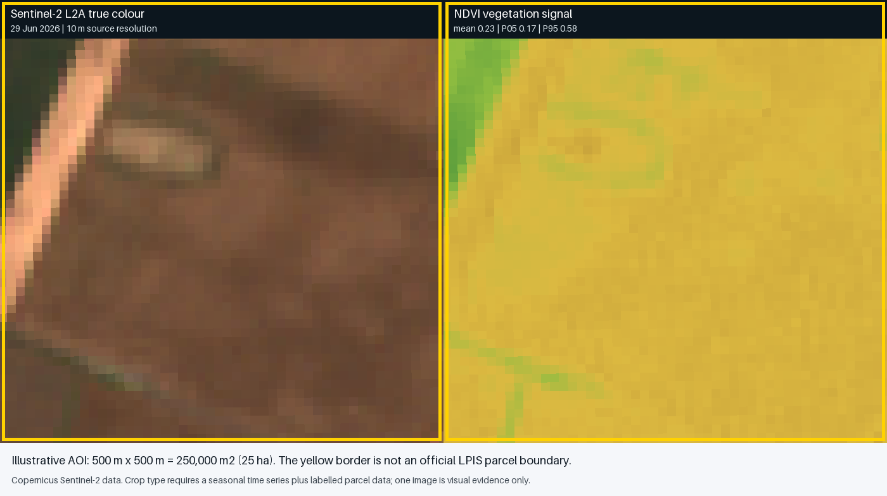

# Agricultural Analysis Use Case: Crop Type and Parcel Area

## 1. Use-Case Objective

Given a CAP claim for a known agricultural parcel:

1. calculate the parcel's official area in square metres and hectares;
2. estimate the crop type from a seasonal Sentinel time series;
3. determine whether the observed crop/activity is consistent with the farmer's
   declaration;
4. expose confidence, missing observations, and contradictory evidence;
5. produce a traceable evidence package for a farmer, caseworker, inspector, or
   auditor.

This is not a single-image recognition problem. It is a **parcel-based,
multi-temporal evidence problem**.

For mission and layer descriptions, see
[`../sentinel-data-and-layers.md`](../sentinel-data-and-layers.md).
The controlled model-development lifecycle is defined in
[`crop-classifier-training-procedure.md`](./crop-classifier-training-procedure.md).
The first implementation uses the public-data strategy in
[`public-data-crop-prototype-plan.md`](./public-data-crop-prototype-plan.md).
Parcels that cannot be resolved at Sentinel resolution follow
[`high-resolution-data-strategy.md`](./high-resolution-data-strategy.md).
Authorised manual validation and complementary drone capture follow
[`drone-survey-validation-process.md`](./drone-survey-validation-process.md).
The normal farmer-photo lane and its escalation into independent validation are
defined in
[`evidence-validation-storyline.md`](./evidence-validation-storyline.md).

## 2. Sample Copernicus Image



### Sample metadata

| Field | Value |
|---|---|
| Mission/product | Copernicus Sentinel-2 Level-2A surface reflectance |
| Scene | `S2A_34TDT_20260629_1_L2A` |
| Acquisition | 29 June 2026, 09:47 UTC |
| Tile | `34TDT` |
| Tile cloud cover | 0.16195% |
| Sample centre | 20.1000 E, 47.1200 N |
| Demonstration AOI | 500 m by 500 m |
| AOI area | 250,000 m2 / 25 ha |
| Native optical pixel | 10 m for RGB, red, and NIR bands |
| Approximate 10 m pixels | 2,500 before boundary/mask effects |
| Sample mean NDVI | 0.2264 |
| Sample NDVI P05-P95 | 0.1681-0.5836 |

Supporting files:

- [`sentinel-2-hungary-crop-sample.png`](./sample-data/sentinel-2-hungary-crop-sample.png)
- [`sentinel-2-hungary-true-colour.png`](./sample-data/sentinel-2-hungary-true-colour.png)
- [`sentinel-2-hungary-ndvi.png`](./sample-data/sentinel-2-hungary-ndvi.png)
- [`sentinel-2-hungary-sample-aoi.geojson`](./sample-data/sentinel-2-hungary-sample-aoi.geojson)
- [`sentinel-2-hungary-crop-sample.json`](./sample-data/sentinel-2-hungary-crop-sample.json)

The yellow outline is an illustrative analysis area, not a Hungarian LPIS parcel.
The sample demonstrates imagery and index extraction only. A crop type must not be
claimed from this image alone.

## 3. What Data Should We Use?

### Recommended production stack

| Purpose | Primary data | Why |
|---|---|---|
| Official parcel and area | Hungarian LPIS polygon | The legal/administrative parcel boundary must come from LPIS |
| Farmer's claimed crop/activity | IACS claim | Defines the declaration being checked |
| Optical crop signal | Sentinel-2 L2A seasonal time series | Provides visible, NIR, red-edge, and SWIR crop signatures |
| Cloud-independent signal | Sentinel-1 GRD IW VV+VH time series | Fills optical gaps and adds structure/moisture/activity features |
| Optical quality control | Sentinel-2 SCL and cloud probability | Removes cloud, shadow, snow, and invalid observations |
| Crop prior/reference | CLMS Crop Types/Cropping Patterns | Adds European context and an independent comparison layer |
| Grassland/mowing | CLMS Grasslands plus S1/S2 time series | Supports grassland and mowing-specific monitoring |
| Weather explanation | ERA5-Land/agrometeorological indicators | Explains delayed or abnormal phenology |
| Terrain/radar correction | Copernicus DEM | Supports slope/aspect and Sentinel-1 terrain correction |
| Ground truth | Validated claims and inspection outcomes | Required to train and evaluate a crop classifier |

### What not to use as the sole source

- A single RGB image.
- A single NDVI value.
- Pixel counts as the official legal area.
- CORINE Land Cover for parcel-level crop determination.
- Tile-level cloud percentage without parcel-level masking.
- A model trained on farmer declarations without validation, because declarations may
  contain the errors the model is intended to find.

## 4. Area Calculation

### Correct method

1. Retrieve the official LPIS parcel polygon and its version/effective date.
2. Validate the geometry: closed rings, no self-intersections, correct coordinate
   reference system, and expected topology.
3. Transform the polygon to an approved equal-area or national projected coordinate
   reference system.
4. Calculate polygon area in square metres.
5. Convert to hectares:

   `area_hectares = area_square_metres / 10,000`

6. Preserve the original geometry, transformed geometry or calculation parameters,
   CRS, software/library version, and rounded reported value.

For Hungary, the authoritative agency process should determine the official CRS and
rounding rules. ETRS89 / LAEA Europe (`EPSG:3035`) is suitable for harmonised European
analytics; Hungary's national EOV (`EPSG:23700`) may be required by national systems.
This must be confirmed with LPIS owners.

### Why not count Sentinel pixels?

A 10 m Sentinel-2 pixel covers approximately 100 m2 before projection and geometric
effects. Counting pixels can estimate observed coverage, but it is unsuitable as the
official parcel area because:

- boundary pixels contain mixtures of inside/outside land;
- image grids and parcel boundaries rarely align;
- reprojection changes pixel shape and sampling;
- clouds and masks remove observations but not legal area;
- narrow parcels or features may be smaller than a pixel;
- the administrative boundary, not reflectance, defines the claim area.

Pixel coverage remains useful as a quality measure:

- percentage of parcel with valid observations;
- number of uncontaminated interior pixels;
- amount of boundary/mixed-pixel exposure;
- proportion assigned to each predicted crop class.

## 5. Crop-Type Analysis Workflow

### Step 1: Ingest the parcel and declaration

Required fields:

- claim ID and scheme year;
- LPIS parcel ID and geometry version;
- declared crop/activity and taxonomy code;
- relevant eligibility conditions and dates;
- farmer-submitted evidence already on file.

The service calculates area independently of the crop model and creates an immutable
analysis request.

### Step 2: Define the agricultural season

Use the scheme year, region, crop calendar, and declared crop to determine the
observation window. A useful first implementation would collect data from pre-sowing
or winter cover through harvest, rather than selecting arbitrary calendar dates.

The window must account for:

- winter versus spring crops;
- double cropping;
- grassland and repeated mowing;
- fallow or bare-soil periods;
- unusual weather and delayed planting;
- acquisition gaps.

### Step 3: Discover Sentinel acquisitions

Query the CDSE STAC catalogue using:

- the parcel bounding box or geometry;
- Sentinel-2 L2A and Sentinel-1 GRD collections;
- the seasonal date range;
- required orbit/polarisation constraints;
- processing baseline and product metadata.

Do not discard scenes solely because the whole tile has high cloud cover. Fetch or
evaluate parcel-level quality before deciding whether a scene is usable.

### Step 4: Preprocess Sentinel-2

1. Read B02, B03, B04, B05, B06, B07, B08, B8A, B11, and B12.
2. Read SCL/cloud/shadow quality layers.
3. Mask invalid observations.
4. Resample 20 m bands to the chosen analysis grid using a documented method.
5. Apply an inward parcel buffer where parcels are large enough, reducing mixed
   boundary pixels.
6. Retain both interior and whole-parcel statistics.
7. Generate per-date spectral and index features.

Useful optical features include:

- median and interquartile range for each band;
- NDVI, EVI, NDRE, NDMI, and bare-soil indicators;
- valid-pixel percentage;
- within-parcel variability;
- rate of change between dates;
- seasonal maximum, minimum, integral, and timing;
- green-up, peak, senescence, and harvest/bare-soil dates.

### Step 5: Preprocess Sentinel-1

1. Select GRD IW VV+VH acquisitions with consistent geometry where possible.
2. Apply orbit information, calibration, noise removal, and terrain correction.
3. Convert backscatter to a documented linear or decibel representation.
4. Extract parcel-level VV, VH, ratios, and temporal-change features.
5. Record orbit direction and incidence-angle information.

Sentinel-1 helps when cloud removes key Sentinel-2 dates and when crop structure or
activity is more informative than colour.

### Step 6: Join context features

Optional but useful inputs:

- CLMS crop-type prior;
- CLMS grassland/mowing information;
- elevation, slope, and aspect;
- daily/cumulative precipitation and temperature;
- growing-degree days;
- soil-moisture context;
- region and crop-calendar zone.

Context must not leak the answer. For example, the farmer's declared crop may be used
as the item being tested but should not be supplied to the classifier as if it were
ground truth.

### Step 7: Classify the crop

For a pilot, compare at least:

- Random Forest or gradient-boosted trees over engineered seasonal features;
- a temporal model over the observation sequence;
- a simple rule/baseline classifier.

The model output should include:

- predicted crop taxonomy code and name;
- probability/confidence for the top classes;
- an abstain/unknown result;
- coverage and data-quality score;
- evidence dates and important features;
- model/version identifier;
- known limitations relevant to the parcel.

The classifier taxonomy must map explicitly to the CAP/IACS crop taxonomy. Similar
classes that cannot be separated reliably should be grouped or escalated rather than
forced into a precise answer.

Detailed cohort selection, label governance, leakage-safe splits, training,
calibration, acceptance criteria, and release controls are documented in
[`crop-classifier-training-procedure.md`](./crop-classifier-training-procedure.md).

### Step 8: Compare with the declaration

| Condition | Suggested system response |
|---|---|
| Prediction agrees and confidence/coverage are high | Mark remotely consistent; retain evidence |
| Prediction differs but alternatives include declared crop | Do not flag automatically; continue monitoring or review |
| Prediction differs with high confidence and good coverage | Create an explainable discrepancy for bounded review |
| Low confidence or poor temporal coverage | Abstain; request human review or additional evidence |
| Parcel contains multiple strong crop signals | Check boundary/data quality, mixed use, or split-parcel requirement |
| Weather or flooding explains abnormal time series | Add context and avoid unsupported adverse inference |

The model creates evidence and a recommendation. It does not impose a sanction.

An authorised inspection may also be selected independently through a documented
random or stratified quality sample. These checks are required to measure false
negatives and system performance among parcels that remote monitoring marked as
consistent. When close-range aerial evidence is proportionate and lawful, the
inspector may use the controlled drone process; otherwise the case follows another
approved field-evidence route.

## 6. Example Output Contract

```json
{
  "claimId": "DEMO-2026-0001",
  "parcelId": "LPIS-DEMO-001",
  "geometryVersion": "2026-01",
  "area": {
    "squareMetres": 250000,
    "hectares": 25.0,
    "source": "LPIS",
    "crs": "EPSG:3035",
    "official": false
  },
  "declaration": {
    "cropCode": "DEMO-WHEAT",
    "cropName": "Wheat"
  },
  "analysis": {
    "predictedCropCode": "DEMO-MAIZE",
    "predictedCropName": "Maize",
    "confidence": 0.87,
    "alternatives": [
      {"cropCode": "DEMO-SUNFLOWER", "confidence": 0.08},
      {"cropCode": "UNKNOWN", "confidence": 0.05}
    ],
    "validOpticalCoverage": 0.91,
    "sentinel2Observations": 23,
    "sentinel1Observations": 31,
    "modelVersion": "crop-classifier-demo-0.1",
    "result": "DISCREPANCY_REVIEW_REQUIRED"
  }
}
```

The values above are illustrative and are not the result of classifying the sample
image.

## 7. Evidence Package

Each analysis should produce:

- claim and parcel identifiers;
- official parcel geometry/version and area calculation;
- declared crop/activity;
- source Sentinel product IDs and acquisition times;
- cloud/quality masks and valid-coverage statistics;
- parcel-level time-series chart;
- selected RGB, false-colour, NDVI/NDRE, and radar evidence views;
- predicted class, alternatives, confidence, and abstention status;
- model, feature, preprocessing, and taxonomy versions;
- weather/context anomalies;
- explanation suitable for a caseworker;
- simplified explanation suitable for the farmer;
- complete machine-readable lineage for audit.

## 8. Human Review and Farmer Explanation

A useful farmer-facing explanation is:

> Your claim declares crop X for this parcel. The agency's satellite observations
> between dates A and B show a seasonal pattern more consistent with crop Y. The
> result is not a final decision. You can correct the declaration, provide an
> explanation or approved evidence, or request human review before an adverse measure
> is considered.

The interface should show:

- the affected parcel;
- the declaration and observed result;
- relevant dates;
- understandable imagery;
- confidence and missing-data warnings;
- acceptable evidence options;
- response deadline;
- human-review route.

## 9. Evaluation

### Crop-classification metrics

- precision, recall, and F1 by crop class;
- macro-F1 to avoid hiding weak minority classes;
- confusion matrix;
- calibration/error by confidence band;
- abstention coverage and accuracy;
- performance by region, parcel size, season, and observation coverage;
- false discrepancy rate against validated outcomes.

### Area and geometry metrics

- geometry validity failure rate;
- area difference between source and calculated result;
- boundary-pixel proportion;
- parcels too small/narrow for reliable Sentinel analysis;
- LPIS geometry/version mismatches.

### Operational metrics

- percentage remotely confirmed;
- percentage safely abstained;
- discrepancy resolution before payment;
- farmer evidence requests per parcel;
- inspection referrals and yield;
- human override and appeal outcome;
- time from observation to explainable case action.

## 10. Recommended MVP

The concrete acquisition and implementation steps for this MVP are documented in
[`public-data-crop-prototype-plan.md`](./public-data-crop-prototype-plan.md).

Start with:

1. one region and a small set of spectrally/phenologically distinct crop classes;
2. official LPIS polygons and validated historical claims;
3. Sentinel-2 L2A seasonal features;
4. Sentinel-1 VV/VH seasonal features;
5. a transparent tree-based baseline and an explicit unknown class;
6. parcel-level area calculation from LPIS;
7. a caseworker evidence page and downloadable audit record;
8. no autonomous adverse decision.

Add grassland mowing, complex eco-scheme conditions, temporal deep learning, and
farmer photo fusion only after the baseline is measured and understood.

## 11. Decision

For this project, use:

- **Sentinel-2 L2A** as the primary crop-discrimination source;
- **Sentinel-1 GRD VV+VH** as the all-weather complementary source;
- **LPIS** as the authoritative parcel geometry and area source;
- **IACS plus validated inspections** as labels and declarations;
- **CLMS and ERA5-Land** as supporting context;
- **multi-date parcel statistics**, not a single image, as the classifier input.

This combination is aligned with the Area Monitoring System, technically appropriate
for crop phenology, and defensible to farmers and auditors when the full lineage and
human-review path are preserved.
