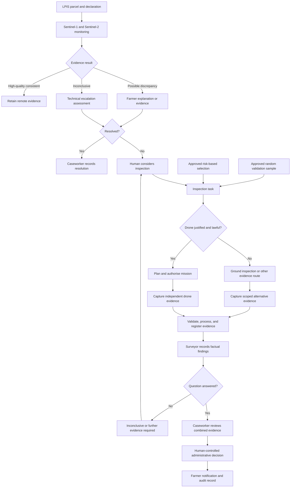

# Drone Survey and Manual Validation Process

## 1. Purpose

This document defines how an authorised field surveyor or inspector uses a drone to
collect parcel-level imagery that complements Copernicus Sentinel observations in the
CAP claim-verification process.

Drone capture is an **exception and validation channel**, not a replacement for
national Sentinel monitoring. It is used when:

1. a parcel is selected for a risk-based or otherwise targeted inspection;
2. a parcel is selected through an approved random or stratified quality-control
   sample; or
3. Copernicus imagery is inconclusive because of cloud, spatial resolution, mixed
   pixels, acquisition timing, or a condition that cannot be established remotely.

The drone supplies current, high-resolution visual evidence. It does not independently
make an eligibility decision, determine fraud, change the claim, calculate the
official parcel area, or impose a payment reduction or sanction.

Related process documents:

- [Agricultural Analysis Use Case](./agricultural-analysis-use-case.md);
- [Evidence Validation Storyline](./evidence-validation-storyline.md);
- [High-Resolution Data Strategy](./high-resolution-data-strategy.md);
- [Personas and Use Cases](../../Persona/personas-and-use-cases.md);
- [Field & File Theme and Persona Map](../../Persona/farm-theme-and-persona-map.md);
- [AKS-Centred Foundry Architecture](../../architecture/aks-centered-foundry-architecture.md).

## 2. Role in the Existing Process

The existing workflow starts with LPIS geometry, the farmer's declaration, and a
seasonal Sentinel-1/Sentinel-2 analysis. High-quality consistent cases retain their
remote evidence. Differences and low-quality results enter discrepancy review.

The drone process begins only after a controlled inspection-selection step:

The inspection task records which path selected the parcel. These paths must not be
collapsed into one generic “AI selected” reason.

## 3. Inspection Selection Paths

### 3.1 Targeted inspection

A targeted inspection may follow:

- a high-confidence difference between declaration and monitored crop/activity;
- a farmer response that does not resolve the factual question;
- inconsistent evidence from different dates or sources;
- suspected LPIS boundary, split-parcel, or mixed-use issues;
- a scheme condition that requires physical or close-range observation;
- an approved risk-control programme.

The Inspection Prioritisation Agent may rank or explain candidate cases, but an
authorised human or deterministic control process orders the inspection. The task
must state the approved selection basis and must not expose an inspector to irrelevant
risk labels.

### 3.2 Random or stratified validation

Random validation is necessary even when monitoring appears conclusive. It measures
false negatives, confirms that remotely consistent parcels are genuinely consistent,
and detects systematic blind spots.

The quality sample should:

- use probability-based selection independent of inspection outcomes, without
  cherry-picking cases already believed to be wrong;
- use a documented random or stratified sampling design; confidence/evidence-quality
  bands may be declared strata, with random selection within each stratum;
- represent relevant regions, crops, parcel sizes, boundary complexity, and evidence
  quality bands;
- lock the sample before inspection outcomes are known;
- record the sampling frame, exclusions, strata, inclusion probabilities, random
  seed, selection timestamp, and applicable weighting method;
- keep statistically selected cases identifiable in reporting;
- avoid substituting convenient or nearby parcels for selected parcels without a
  documented sampling decision.

A risk-based sample answers “where might problems be concentrated?” A random sample
answers “how well does the control system work overall?” Their results must be
reported separately.
Population estimates must use the design's weights, denominators, and uncertainty
intervals rather than an unweighted pooled inspection rate. Record aborted visits,
invalid capture, non-response, replacements, and any resulting coverage bias.
The quality owner must also confirm how this operational sample meets the applicable
EU AMS quality-assessment methodology; the prototype design is not a substitute for
that methodology.

### 3.3 Inconclusive Copernicus imagery

Technical escalation is appropriate when the remote result is `UNKNOWN`,
`INSUFFICIENT_RESOLUTION`, or otherwise cannot answer the case question because:

- cloud or shadow removes key optical dates;
- radar and optical signals disagree;
- too few uncontaminated interior pixels remain;
- the parcel is narrow, fragmented, or substantially mixed with neighbouring land;
- crop development or replanting occurs between useful satellite observations;
- the evidence is too old for the condition being checked;
- the required feature is not observable at Sentinel resolution.

Before ordering a drone mission, the caseworker or specialist considers whether a
later Sentinel acquisition, Sentinel-1 radar, approved VHR imagery, existing or
proportionately requested farmer evidence, or an ordinary ground inspection would
answer the question more safely or cheaply. Random validation remains an independent
route and must not be replaced solely by claimant-supplied evidence.

## 4. Decision to Use a Drone

The inspection task must contain:

- claim, parcel, geometry version, and scheme year;
- inspection-selection path and authority;
- the exact factual question to answer;
- the relevant rule or control requirement;
- existing evidence and unresolved limitation;
- required capture window;
- whether ground access or direct crop observation is also needed;
- prohibited areas or features that must not be captured;
- required output and review deadline.

A drone is appropriate when it materially improves evidence quality or inspector
safety and the mission can be operated lawfully. It may be inappropriate because of:

- airspace restrictions or missing operational authorisation;
- unsafe wind, precipitation, visibility, temperature, terrain, or obstacles;
- nearby people, roads, animals, sensitive sites, or emergency activity;
- privacy impact that cannot be sufficiently limited;
- insufficient land access or inability to maintain the required operation;
- a question requiring touch, measurement, interview, document review, or direct
  ground observation;
- vegetation or canopy conditions that hide the relevant feature;
- a capture date outside the period relevant to the declaration.

When the drone is not justified, the task returns to the approved alternative evidence
route rather than being silently cancelled.

## 5. Field & File Storyline: The Parcel the Satellite Could Not Settle

At Napraforgó Farm, parcel `HU-DEMO-047-12` was originally declared as sunflower.
Storm damage led to partial replanting. Persistent cloud obscured the most useful
Sentinel-2 dates, Sentinel-1 indicated agricultural activity, and later optical
observations showed two different signals near the parcel boundary.

The Parcel Monitoring workflow returns `UNKNOWN` rather than selecting a crop with
false confidence. The farmer explains the storm damage and supplies a mobile
photograph, but the image covers only the field entrance. The Caseworker cannot tell
whether the whole parcel was replanted or whether the conflicting signal comes from
the neighbouring maize field.

**Eszter, the authorised field surveyor**, receives an inspection task that asks only:

> What crop or crops are visibly present within the current LPIS parcel, and does the
> observed internal boundary indicate mixed use or an incorrect parcel boundary?

Before seeing the model's preferred class, Eszter reviews the parcel geometry, safety
constraints, capture period, and independent checklist. She confirms that an aerial
survey is lawful and suitable, records the flight plan, and notifies the relevant
parties through the approved process.

At the parcel, Eszter:

1. verifies the assigned parcel and current geometry;
2. records weather, visibility, field access, and unexpected hazards;
3. captures a calibrated, overlapping image set covering the parcel and only the
   minimum surrounding context needed to interpret its boundary;
4. captures a small number of ground photographs for crop-detail confirmation;
5. records an independent factual observation before viewing model suggestions;
6. uploads the encrypted mission package when connectivity becomes available.

The processing workflow creates an orthomosaic and overlays the LPIS boundary,
Sentinel evidence dates, and drone capture footprint. It shows a sunflower crop across
most of the parcel and a narrow maize strip outside the authoritative boundary. The
drone evidence explains the mixed Sentinel pixels; it does not prove every historical
condition during the season.

Eszter records the observed crop, coverage, boundary interpretation, limitations, and
capture date. The Caseworker combines this with the seasonal Sentinel time series and
farmer explanation. A human records the case outcome. The original images, flight log,
derived orthomosaic, checksums, findings, model result, and decision are retained in
the evidence chain for later audit.

## 6. End-to-End Drone Survey Procedure

### Phase 1: Create and approve the inspection task

1. A caseworker or approved control process identifies the inspection need.
2. The system records whether selection was targeted, random/stratified, or caused by
   inconclusive imagery.
3. The task defines the factual question and minimum evidence required.
4. An authorised official confirms that drone capture is proportionate and permitted.
5. The task is assigned to a qualified operator/surveyor with a due date.

No foundation model or agent may create a binding inspection order without the
authorised control step.

### Phase 2: Plan the mission

The surveyor:

1. confirms identity, assignment, parcel geometry, and task scope;
2. checks applicable aviation rules, operator and pilot credentials, aircraft
   registration, operational category, airspace, local restrictions, and required
   permissions;
3. reviews privacy, land-access, notification, and data-protection requirements;
4. checks weather, terrain, obstacles, nearby people, livestock, roads, and sensitive
   locations;
5. chooses capture date and time relevant to the agricultural question;
6. defines altitude, expected ground sampling distance, flight lines, overlap, camera
   angle, take-off/landing area, and emergency procedure;
7. loads the approved LPIS boundary and creates a minimal context buffer;
8. confirms battery, storage, firmware, clock, positioning, camera, and calibration
   status;
9. records the plan and receives any required supervisor approval.

Exact aviation and privacy controls must be confirmed by the agency for the operating
country and mission category. The workflow must not assume that public-authority work
is exempt.

### Phase 3: Capture field evidence

At the site, the surveyor:

1. confirms parcel identity and that conditions still match the plan;
2. records actual start time, operator, aircraft, sensor, weather, and observed risks;
3. pauses or aborts if safe or lawful operation cannot be maintained;
4. captures nadir RGB imagery with sufficient forward and side overlap for an
   orthomosaic;
5. captures oblique images only where needed to answer the approved question;
6. uses multispectral imagery only with an approved, calibrated procedure;
7. captures ground-control or RTK information when positional accuracy requirements
   justify it;
8. captures ground photographs or notes where aerial imagery alone cannot identify
   the crop or condition;
9. avoids following people, looking into buildings, or collecting unnecessary
   neighbouring-property detail;
10. records deviations, gaps, access problems, and any portion not observed.

Record and attest the independent field observations before revealing model
suggestions. If the surveyor has already seen predictions, record that exposure and
do not present the finding as blinded independent evaluation.

### Phase 4: Secure and transfer the mission package

The field application creates a manifest containing:

- case, inspection-task, parcel, and geometry-version identifiers;
- operator and approving authority identifiers;
- aircraft, sensor, lens, and relevant firmware identifiers;
- planned and actual flight times and footprint;
- source-device timestamps, time-zone/UTC normalisation, and positioning metadata;
- weather and operating conditions;
- original filenames, sizes, media types, and cryptographic hashes;
- calibration, RTK, or ground-control references where used;
- incomplete capture, manual edits, transfer retries, or other exceptions.

Raw files are encrypted on the approved device and in transit. The authoritative
ingestion service verifies the task assignment and creates a short-lived upload
session restricted to that inspection task, parcel, expected manifest, and expiry.
Issue short-lived create/write SAS URLs for each approved blob name, with no general
container access. A path prefix is a naming convention, not an arbitrary-prefix Blob
SAS permission. Validate manifest size/type limits in quarantine; SAS does not enforce
those content constraints.

Because a drone mission can contain gigabytes of imagery, the files do not pass
through the application API. The field application uses resumable block uploads
directly to an isolated Blob quarantine container. `evidence-api` retains control of
authorisation and expected content without proxying the payload.

Storage object notifications reach the ingestion service through an Event Grid
subscription; an approved scanner reports malware completion through the same
configured event bridge. An object-created event is not mission completion.

The client explicitly finalises the session against a versioned manifest. Before
`evidence-api` publishes a mission-ready message to Service Bus, all expected objects
must be committed, size/type/hash checks must pass, and scan status must be clean.
Pin the blob version or snapshot and hash so later writes cannot change the bytes
that were scanned and accepted. Missing or pending objects retain an explicit
quarantine status; a validation failure creates a task exception, not case evidence.

`drone-evidence-worker` revalidates the pinned manifest and capture metadata, records
an acceptance receipt, and preserves those exact raw bytes as read-only evidence.
Key processing by session ID and manifest version, deduplicate events, use bounded
idempotent retries, and route exhausted failures to a monitored dead-letter queue.
Do not create duplicate evidence or silently discard failed missions.

Consumer cloud synchronisation, personal storage, and unmanaged editing applications
must not be used.

### Phase 5: Process imagery

An approved, versioned processing job may produce:

- a georeferenced RGB orthomosaic;
- capture footprint and coverage mask;
- digital surface model where relevant and justified;
- quality report for blur, exposure, overlap, georeferencing, and missing coverage;
- LPIS boundary overlay;
- comparison views with appropriately dated Sentinel imagery;
- optional vegetation or surface products from calibrated sensors.

Every derivative records source hashes, software/container version, parameters,
coordinate reference system, processing time, and operator or service identity.
Derived imagery never replaces the preserved raw evidence.

Image registration must not imply that observations from different dates show the
same field condition. The interface displays the acquisition date beside every
source.

Processing is separated into three responsibilities:

1. **Deterministic geospatial processing** creates the orthomosaic, coverage mask,
   georeferencing report, LPIS overlay, and quality metrics.
2. **Optional drone computer vision** uses a separately trained and approved model for
   tasks such as crop/soil segmentation, internal-boundary detection, or visible
   damage mapping.
3. **Foundry language or multimodal assistance** may explain approved structured
   outputs or selected evidence views, but it does not replace photogrammetry, process
   the complete raw mission, or establish the surveyor's factual finding.

The existing Sentinel crop classifier cannot consume raw drone imagery directly. It
uses seasonal Sentinel-1/Sentinel-2 parcel features, while drone imagery is a
single-date centimetre-level modality. Any drone-vision model therefore has a separate
input contract, dataset, evaluation, calibration, model version, and release approval.

The drone or controller does not run the case LLM in the baseline. The controller may
run deterministic or small edge-quality checks for blur, exposure, overlap, missing
positioning, parcel coverage, and geofence deviation so the surveyor can correct a
capture before leaving the site.

### Phase 6: Independent surveyor finding

The surveyor completes and locks the independent finding from field observations,
accepted raw evidence, and non-interpretive derivatives before model predictions are
shown. Automated image outputs may be computed in parallel, but access is withheld
until attestation. Preserve the pre-AI record; any later assisted comparison or
reconciliation is a separately versioned finding, not an overwrite.

The surveyor answers the scoped factual question using structured findings:

- what was directly observed;
- spatial extent or location within the parcel;
- crop or condition identification method;
- portions not visible or not captured;
- positional and visual-quality limitations;
- whether ground evidence supports the aerial interpretation;
- whether the LPIS boundary appears consistent with observable field features;
- whether another specialist, visit, or evidence source is required.

Allowed result states:

| Result | Meaning |
|---|---|
| `OBSERVED_CONSISTENT` | Captured evidence supports the declared condition for the scoped question |
| `OBSERVED_DIFFERENCE` | Captured evidence shows a factual difference requiring case review |
| `INCONCLUSIVE` | The question remains unanswered despite valid capture |
| `PARTIALLY_OBSERVED` | Only a documented part of the parcel or condition was observable |
| `INVALID_CAPTURE` | Safety, technical, temporal, identity, or chain-of-custody failure prevents use |

These are evidence findings, not payment decisions.

### Phase 7: Caseworker and specialist review

The Caseworker receives:

- the selection reason and factual question;
- declaration and rule context;
- seasonal Sentinel evidence and quality limitations;
- farmer responses and previously submitted evidence;
- drone mission manifest and quality report;
- raw-evidence references and approved derivatives;
- surveyor's structured finding and attestation;
- any geospatial-specialist interpretation.

The reviewer determines whether the evidence resolves the discrepancy, requires a
claim correction, needs further review, or could support a proposed adverse measure.
Any contested or adverse conclusion follows the existing legal and sanctions process,
including farmer notice, opportunity to respond, human review, and appeal.

### Phase 8: Close, retain, and learn

The system:

1. records the human outcome and the contribution of each evidence source;
2. notifies the farmer using a plain-language explanation;
3. preserves the evidence lineage under the approved retention schedule;
4. removes field-device copies after confirmed synchronisation and policy-controlled
   expiry;
5. records whether the drone mission resolved the question;
6. routes confirmed, quality-approved labels to model-governance review rather than
   directly into training;
7. includes random-sample outcomes in independent accuracy and control-system
   assessment.

## 7. Evidence Fusion Rules

Copernicus and drone imagery are complementary because they answer different aspects
of the case.

| Evidence | Strength | Limitation |
|---|---|---|
| Sentinel-1/Sentinel-2 time series | Repeated seasonal observation across all parcels | Approximately 10-20 m resolution; cloud and mixed-pixel limitations |
| VHR satellite imagery | Wider-area detail at metre/sub-metre scale | Acquisition timing, licence, cadence, and cost |
| Drone orthomosaic | Current centimetre-level parcel detail and boundary context | Targeted snapshot, operational burden, privacy and flight constraints |
| Ground photograph/observation | Close crop or management detail | Limited spatial coverage and viewpoint |
| LPIS/IACS record | Authoritative parcel and declaration context | Administrative record, not direct observation of current crop |

Fusion rules:

- preserve each source, date, scale, and uncertainty separately;
- never average confidence values from unrelated models into one unexplained score;
- use Sentinel for seasonal context and drone evidence for the scoped close-range
  question;
- do not use a late-season drone image as proof of an earlier condition without a
  defensible temporal link;
- do not infer official area from the orthomosaic when LPIS is authoritative;
- distinguish visible crop/cover from legal compliance with a scheme rule;
- return `INCONCLUSIVE` when sources cannot be reconciled;
- require a human to evaluate materially conflicting evidence.

## 8. Architecture Alignment

The process uses the existing AKS-centred architecture rather than creating a parallel
decision system.

```mermaid
flowchart LR
    A[Human-approved inspection task] --> B[Inspector field app]
    C[Drone camera and sensors] --> B
    B --> D[Local capture-quality checks]
    D --> E[evidence-api authorises upload session]
    E --> F[Direct resumable upload]
    F --> G[Blob quarantine]
    G --> EG[Event Grid object notifications]
    G --> SC[Approved malware scanner]
    SC --> EG
    EG --> FIN[evidence-api checks pinned manifest and scan status]
    B -->|Explicit finalise request| FIN
    FIN -->|Complete and clean| H[Service Bus mission-ready message]
    FIN -->|Missing, pending or failed| HOLD[Quarantine status or task exception]
    H --> I[drone-evidence-worker]
    I --> J[Manifest and chain-of-custody validation]
    J --> K[Orthomosaic and quality report]
    K --> L{Drone vision approved?}
    L -->|Yes| M[Separate Azure ML batch model]
    L -->|No| N[No automated image interpretation]
    M --> O[Register advisory output\nhidden until independent attestation]
    N --> RAW
    K --> RAW[Register raw evidence and derivatives]
    RAW --> P[Lock independent surveyor finding\nbefore model suggestions]
    P --> Q[Caseworker reviews combined evidence]
    O -->|Release only after finding locked| Q
    Q --> R[Human-controlled decision]

    S[Sentinel seasonal evidence] --> Q
    T[Farmer evidence] --> Q
```

| Process step | Existing component | Required behaviour |
|---|---|---|
| Select inspection | `case-api`, rules service, human staff workflow | Records selection path, authority, question, and assignment |
| Rank candidates | Inspection Prioritisation Agent on `agent-worker` | Recommendation only; cannot order the inspection |
| Prepare field task | Inspector field mobile through `web-bff`/`case-api` | Downloads minimum assigned parcel data for offline work |
| Capture and manifest | Approved drone/field application | Signs or attests mission metadata and preserves hashes |
| Authorise upload | `evidence-api` | Creates a short-lived, task-scoped upload session; does not proxy large files |
| Upload | Field application directly to Blob quarantine | Uses encrypted resumable uploads to approved per-blob SAS URLs; content limits are checked in quarantine |
| Finalise mission | `evidence-api`, Event Grid, approved scanner, Service Bus | Pins manifest/object versions, waits for complete clean content, then publishes one logical mission-ready event |
| Validate and process | `drone-evidence-worker` on AKS CPU or approved geospatial service | Idempotently verifies the pinned manifest and chain of custody, then produces versioned derivatives and quality report; exhausted retries surface through a monitored dead-letter queue |
| Optional image analysis | Separate Azure ML managed batch model | Analyses approved derivatives; does not reuse the Sentinel model contract |
| Store lineage | Evidence storage plus immutable audit log | Separates raw evidence, derivatives, findings, and decisions |
| Independent finding | Surveyor UI through `evidence-api` | Locks pre-AI attestation before releasing predictions; preserves assisted reconciliation separately |
| Review | Caseworker UI via `case-api` and `evidence-api` | Shows Copernicus, drone, farmer, and surveyor evidence by date |
| Decide | Rules service plus authorised human workflow | No agent or image-processing job makes an adverse decision |
| Audit | `audit-pack-worker` and Audit Evidence Agent | Compiles a draft package for authorised approval |

Drone photogrammetry can be CPU- and memory-intensive. Small targeted jobs may run as
resource-limited AKS Jobs on a dedicated CPU node pool; larger jobs may use an approved
managed batch or geospatial-processing service. This does not require a GPU node pool
for the baseline.

### 8.1 Edge and central responsibility

| Location | Permitted responsibility | Not permitted |
|---|---|---|
| Drone flight controller | Flight safety, sensor operation, mission execution | Case access, eligibility reasoning, autonomous compliance finding |
| Inspector tablet/controller | Offline task data, capture checks, manifest creation, encrypted staging and upload | Final evidence acceptance or administrative decision |
| AKS drone worker | Validation, photogrammetry, quality report, evidence packaging | Legal conclusion or silent modification of raw evidence |
| Azure ML drone model | Approved high-resolution image inference | Reusing Sentinel confidence as if modalities were interchangeable |
| Foundry model | Explain structured evidence, compare approved summaries, draft text | Bulk raw-image ingestion, authoritative visual finding, sanction decision |
| Surveyor and caseworker | Factual finding and case interpretation within assigned authority | Undocumented alteration of evidence or bypass of due process |

## 9. Information Model

The following records remain distinct:

- `InspectionSelection`: targeted, random/stratified, or technical escalation;
- `InspectionTask`: authority, scope, question, assignment, and status;
- `FlightPlan`: planned capture, permissions, safety, and privacy controls;
- `DroneMission`: actual operation, equipment, footprint, timing, and exceptions;
- `EvidenceManifest`: files, hashes, metadata, transfer, and chain of custody;
- `UploadSession`: expected-object manifest version, pinned versions/hashes, scan
  status, finalisation, receipts, and processing idempotency key;
- `EvidenceDerivative`: orthomosaic or other product plus complete processing lineage;
- `SurveyFinding`: factual observation, limitations, and attestation;
- `AssistedFinding`: optional post-attestation reconciliation and prediction exposure;
- `CaseReview`: interpretation against declaration and rule;
- `AdministrativeDecision`: authorised outcome, reasoning, notification, and appeal;
- `ValidationOutcome`: quality-assessment result and eligibility for governed model
  evaluation or training.

Separating these records prevents a useful image from being mistaken for a legal
decision and allows an auditor to reconstruct every transformation.

## 10. Privacy, Safety, and Legal Controls

The agency must define and validate:

- lawful basis, transparency, retention, access, and data-subject handling;
- applicable aviation category, permissions, pilot competency, aircraft registration,
  remote identification, and operational limitations;
- rules for flights near people, roads, buildings, infrastructure, borders, protected
  sites, and restricted airspace;
- land-access, farmer-notification, and evidence-disclosure procedures;
- whether faces, vehicle plates, homes, or unrelated activity require avoidance,
  masking, restricted access, or separate retention;
- incident reporting for fly-away, injury, property damage, privacy breach, lost
  device, or corrupted evidence;
- procurement and assurance requirements for aircraft, software, storage, and
  processing suppliers.

Operational safety overrides evidence collection. An aborted mission is an explicit
outcome, not an operator failure to be hidden.

## 11. Quality Controls

Before evidence is accepted, validate:

- assignment and parcel identity;
- complete flight and file manifest;
- capture date within the relevant evidence window;
- sufficient parcel coverage and image overlap;
- expected ground sampling distance and positional quality;
- absence of material blur, exposure, or missing-image problems;
- georeferencing accuracy appropriate to the question;
- checksum match and preserved raw originals;
- declared processing software and parameters;
- surveyor attestation and unresolved limitations;
- independent or supervisory review when required.

Where area or boundary measurements may materially affect the case, use an approved
survey-grade method and accuracy standard. A consumer drone orthomosaic must not be
presented as cadastral or official LPIS geometry without validation and authority.

## 12. Random Validation and Model Governance

Random validation results provide an independent estimate of operational performance.
Apply inclusion-probability/design weights and report denominators, uncertainty,
completion/non-response, and relevant coverage limitations for population estimates.
Keep risk-targeted inspection yield separate. Report at least:

- agreement between remotely consistent results and field findings;
- false-consistent and false-discrepancy rates;
- inconclusive rate by crop, parcel size, region, season, and evidence-quality band;
- drone mission completion, invalid-capture, and repeat-visit rates;
- cases where Sentinel and drone evidence differed because of acquisition date;
- systematic LPIS geometry or neighbouring-crop contamination issues;
- farmer impact and payment delay caused by validation.

Drone findings become training labels only after:

1. evidence-quality acceptance;
2. taxonomy mapping;
3. temporal relevance review;
4. removal or segregation of ambiguous and partially observed cases;
5. data-protection and purpose-compatibility review;
6. dataset versioning and lineage registration;
7. leakage-safe train/validation/test assignment.

Random validation records are particularly valuable as a locked evaluation set. They
should not all be consumed as training data.
Assign that locked set before training-data selection, keep related parcel/holding
snapshots out of training, and use only pre-AI findings meeting the temporal and
quality requirements as independent test labels. Report assisted or previously
prediction-exposed findings separately.

## 13. Success Measures

- percentage of inconclusive Sentinel cases resolved by drone evidence;
- random-sample completion and representativeness;
- reduction in repeat visits;
- time from inspection order to accepted evidence;
- invalid or incomplete mission rate;
- cost per resolved parcel;
- agreement between surveyor findings and later reviewed outcomes;
- number of cases where drone evidence prevented an unsupported adverse conclusion;
- number of confirmed model, geometry, or process defects discovered;
- farmer notification and response timeliness;
- audit-package completeness and time to reproduce the mission.

Higher inspection yield is not automatically success. A healthy random sample may
confirm that most cases are correct. The objective is reliable control, fair treatment,
and measurable system quality.

## 14. MVP Demonstration

The first demonstration should use synthetic or explicitly authorised data for one
parcel and show:

1. a Sentinel result marked `UNKNOWN`;
2. a human-approved drone inspection task;
3. a mission plan and simulated or authorised image manifest;
4. raw-image references and a generated orthomosaic;
5. LPIS, Sentinel, and drone layers displayed with separate dates;
6. an independent surveyor finding;
7. a caseworker resolution with no autonomous adverse decision;
8. an audit pack containing complete lineage.

A second demonstration should select a remotely consistent parcel through a documented
random sample. This proves that the validation process measures missed errors rather
than inspecting only parcels the model already considers suspicious.
