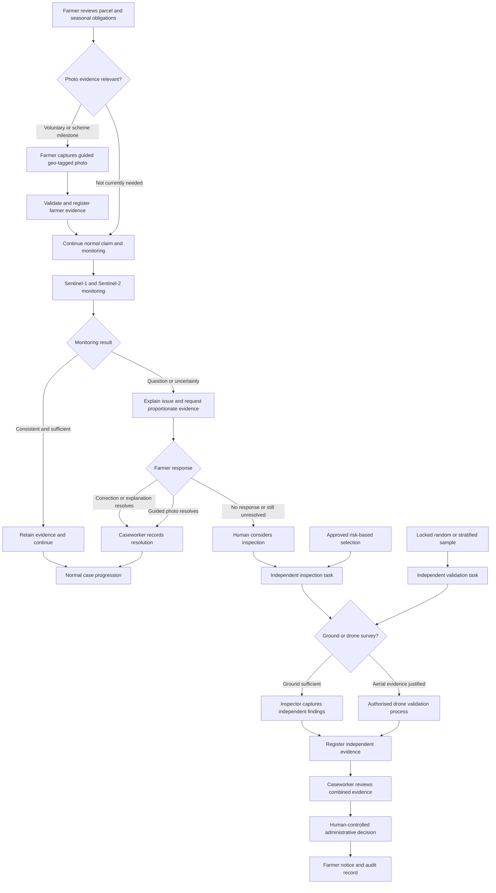
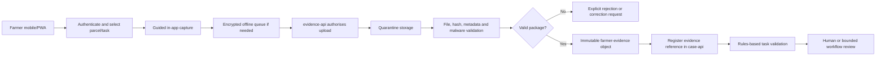

# Evidence Validation Storyline: From Farmer Photo to Drone Survey

## 1. Purpose

This document defines the complete evidence-validation storyline around the
Copernicus monitoring process. It connects:

- seasonal Sentinel monitoring;
- farmer-supplied geo-tagged photographs;
- caseworker review;
- manual ground inspection;
- authorised drone surveys;
- random or stratified control-system validation;
- the final human-controlled administrative decision.

The farmer photo capability is part of the normal service, not merely an emergency
feature that appears after a discrepancy. However, **always available does not mean
always mandatory**. Requiring every farmer to upload photographs for every parcel
would add cost, accessibility barriers, privacy impact, and duplicate evidence even
when Copernicus monitoring is already sufficient.

Farmer photographs and independent inspection evidence also serve different purposes:

- a farmer photo is claimant-supplied evidence that can explain or corroborate a
  condition;
- an inspector or drone survey is independently collected validation evidence;
- neither source automatically determines the legal outcome.

Related documents:

- [Agricultural Analysis Use Case](./agricultural-analysis-use-case.md);
- [Drone Survey and Manual Validation Process](./drone-survey-validation-process.md);
- [High-Resolution Data Strategy](./high-resolution-data-strategy.md);
- [Personas and Use Cases](../../Persona/personas-and-use-cases.md);
- [Field & File Theme and Persona Map](../../Persona/farm-theme-and-persona-map.md);
- [AKS-Centred Foundry Architecture](../../architecture/aks-centered-foundry-architecture.md).
- [CAP Claim and Payment Calendar](../../research/cap-claim-and-payment-calendar.md).

## 2. Validation Lanes

The process has four connected lanes.

| Lane | Trigger | Evidence owner | Purpose |
|---|---|---|---|
| Routine farmer evidence | Farmer choice or an approved scheme milestone | Farmer or authorised representative | Build a timely parcel record and satisfy a defined evidence obligation |
| Requested farmer evidence | Copernicus uncertainty, discrepancy, or caseworker question | Farmer or authorised representative | Resolve a specific question before inspection |
| Independent inspection | Unresolved question, approved risk selection, or condition requiring physical verification | Authorised inspector/surveyor | Establish independent factual findings |
| Random validation | Locked random or stratified quality sample | Authorised inspector/surveyor | Measure false negatives and overall control-system accuracy |

The first two lanes use the same farmer application and evidence-ingestion service.
The third and fourth use the controlled inspection and drone process. All lanes join
the same case file and human review process.

## 3. End-to-End Flow

Random validation enters the independent inspection lane directly. A farmer photo may
be present in the case, but it does not replace the independently selected observation
needed to estimate control-system accuracy.

## 4. What “Always Available” Means

The farmer application should expose a parcel evidence capability throughout the
relevant season. The farmer can:

- open an authorised parcel from the claim;
- see whether a scheme has an approved evidence milestone;
- capture a current photo through the application;
- associate it with the correct parcel and activity;
- save a protected offline draft where connectivity is poor;
- upload it when connected;
- receive an authoritative submission receipt;
- see whether the evidence is merely stored, under review, accepted for a task, or
  insufficient for the question.

The application should not encourage indiscriminate photo collection. Every upload
needs a purpose such as:

- evidence for an explicit scheme requirement;
- voluntary documentation of a material agricultural event;
- response to an agency evidence request;
- correction or explanation associated with a parcel;
- appeal or contested-case evidence.

The service must provide a non-photo or assisted-service route where photography is
unsafe, impossible, inaccessible, disproportionate, or incapable of showing the
required condition.

## 5. Farmer Photo Modes

### 5.1 Routine seasonal capture

Routine capture allows the farmer to document time-sensitive events before evidence
disappears, such as:

- sowing or replanting after severe weather;
- mowing or grazing activity;
- cover-crop establishment;
- flooding, drought, storm, or pest damage;
- harvest or land-management activity;
- a visible boundary or access problem.

The application labels the evidence as farmer supplied. Uploading it does not mean the
agency has accepted a legal claim or verified the content.

### 5.2 Scheme-triggered evidence

Some scheme or eco-scheme conditions may define an evidence milestone. The application
may create a guided task containing:

- parcel and activity;
- permitted capture period;
- what must be visible;
- required number and orientation of images;
- whether a document or other evidence is acceptable;
- deadline and consequences of missing evidence;
- support and accessibility routes.

Only an approved rule or programme configuration may make a photo mandatory. An agent
cannot invent evidence requirements.

### 5.3 Requested discrepancy evidence

When monitoring raises a question, the farmer receives a narrowly scoped request:

> Parcel `HU-DEMO-047-12` was not clearly observable during the expected crop
> development period. Please photograph the current crop from the marked location,
> include the field boundary in one image, or provide another explanation or evidence.

The request explains:

- why existing evidence is insufficient;
- what condition needs to be visible;
- the relevant observation dates;
- where and how to capture the image;
- acceptable alternatives;
- the response deadline;
- that the request is not a final adverse decision.

### 5.4 Farmer-initiated corrective evidence

The farmer may discover that the declaration no longer describes the parcel because
of replanting, crop failure, split use, or another material event. The application
allows the farmer to submit an explanation and evidence without waiting for an
automated discrepancy, subject to the applicable amendment rules and deadlines.

## 6. Field & File Storyline: A Photograph Before an Inspection

At Napraforgó Farm, the Farmer replants part of parcel `HU-DEMO-047-12` after storm
damage. The Field & File application already contains an evidence option for each
claimed parcel.

### Scene 1: Routine capture

While inspecting the replanted field, the Farmer opens the parcel in the app and
selects **Record storm damage and replanting**. The application:

1. confirms the selected LPIS parcel;
2. explains why location and capture time are requested;
3. shows a map and asks for one overview and one close crop image;
4. captures location, accuracy, time, orientation, and application task context;
5. stores the evidence securely until connectivity is available;
6. uploads it and issues a receipt.

This does not change the official declaration automatically. It creates a timely piece
of farmer-supplied evidence and offers the applicable correction route.

### Scene 2: Copernicus question

Several weeks later, cloud and mixed boundary pixels leave the Parcel Monitoring
workflow unable to reconcile the original declaration with the observed time series.
Instead of immediately ordering an inspection, the case view finds the existing storm
evidence.

The photograph explains why the seasonal signal changed, but it covers only the field
entrance. The Discrepancy Resolution Agent drafts a precise request for a second image
showing the internal field boundary. The approved rules service confirms that this is
a permitted evidence request.

### Scene 3: Farmer response

The Farmer follows the in-app guidance and submits another photo. The service verifies
the parcel association, capture context, file integrity, and location accuracy. It
does not claim that GPS proves the photograph's content.

If the image and explanation answer the question, the Caseworker records the
resolution without a visit. If they do not, the system preserves the submission and
creates a human-review task rather than repeatedly asking for arbitrary photographs.

### Scene 4: Drone escalation

The Caseworker still cannot determine whether the second crop signal lies inside the
parcel or comes from neighbouring maize. An authorised surveyor receives the exact
unresolved question. Ground observation cannot efficiently show the internal spatial
pattern, so the surveyor follows the controlled drone process.

The resulting orthomosaic, ground observations, and independent finding rejoin the
same case. They complement the Sentinel time series and farmer photographs. A human
records the administrative outcome.

### Scene 5: Random validation elsewhere

A different parcel that the monitoring system marked as consistent is selected in a
locked random sample. It enters the independent survey route even though no exception
exists and no farmer photo is required to trigger it. This protects the quality
assessment from checking only cases the model already considers unusual.

## 7. Guided Capture Requirements

The farmer application should collect only the information needed for the approved
purpose:

- authenticated farmer or authorised-representative identity;
- claim, parcel, geometry version, and evidence-task identifiers;
- application-generated capture timestamp;
- device time and server receipt time;
- GNSS location, reported accuracy, and distance from or relationship to the parcel;
- camera orientation or instructed viewpoint where relevant;
- original image dimensions, media type, and cryptographic hash;
- task instructions and application version;
- offline-capture and later-upload timestamps;
- farmer explanation, privacy-notice acknowledgement, and device camera/location
  permissions where required;
- validation warnings and upload receipt.

GPS and EXIF metadata are supporting signals, not proof. Location may be inaccurate,
spoofed, stripped, or unavailable. The service should combine task context,
application capture, file integrity, parcel geometry, server timestamps, visual
content, and human review according to risk.

Device permission allows capture; notice acknowledgement records transparency.
Neither is automatically GDPR consent for agency processing. The agency must record
the applicable legal-obligation/public-task basis, purpose, and retention, and must
not make mandatory benefit evidence depend on purported freely given consent.

The application must not:

- silently access location or the camera;
- upload unrelated gallery content without explicit selection and warning;
- require unsafe entry into a crop, road, restricted area, or hazardous location;
- reject evidence solely because a consumer device has weak positioning;
- imply that a green “GPS valid” indicator means the agricultural condition is true;
- automatically rewrite a claim from image metadata or model output.

## 8. Farmer Evidence Ingestion

Farmer images are normally much smaller than drone missions. The implementation may
use an API-mediated upload for small files or a short-lived direct Blob upload for
larger/resumable transfers. In both cases:

- `evidence-api` authorises the task and expected content;
- direct uploads use approved per-blob authorisation, not a generic prefix-scoped SAS;
- files enter quarantine before becoming case evidence;
- raw originals and hashes are preserved;
- malware, format, size, and manifest checks are explicit;
- a finalised package is accepted only when all pinned objects are complete and
  clean; a single Blob event is not a submission receipt;
- `case-api` stores the authoritative task and workflow state;
- Blob/ADLS stores evidence objects and derivatives;
- no LLM receives raw evidence by default.

Direct-upload object/scan notifications use the configured Event Grid bridge.
Session finalisation, immutable byte/hash checks, and idempotent retries follow the
[drone ingestion contract](./drone-survey-validation-process.md#phase-4-secure-and-transfer-the-mission-package),
scaled to the smaller farmer package. Offline capture remains a draft until the
server issues a receipt.

## 9. Automated Checks and Model Boundaries

### Deterministic checks

The normal ingestion path may verify:

- authenticated task and parcel association;
- accepted media type and size;
- required image count;
- presence and plausible range of location and time metadata;
- location accuracy and relationship to the parcel;
- duplicate file hashes;
- corruption, malware, or incomplete upload;
- whether the evidence arrived within the permitted period.

These checks validate the package, not the agricultural claim.

### Optional visual assistance

A separately approved image model may assess:

- blur, darkness, obstruction, or unusable framing;
- whether vegetation or the requested field boundary is visible;
- broad crop/soil/cover segmentation;
- apparent mismatch between requested and captured viewpoint;
- duplicate or replay indicators.

The result is a quality or triage signal. It does not establish compliance, fraud, or
payment entitlement.

### Foundry model

The Foundry model may:

- explain capture instructions;
- answer questions about acceptable evidence using approved guidance;
- summarise registered evidence metadata and reviewed findings;
- draft a farmer-safe explanation or caseworker note.

It must not:

- treat GPS as proof;
- analyse unrestricted personal photo libraries;
- invent a missing capture location or time;
- make an authoritative crop finding from one image;
- order an inspection;
- reject a claim or impose a sanction.

## 10. Evidence Status and Provenance

The application should distinguish:

| Status | Meaning |
|---|---|
| `DRAFT_OFFLINE` | Captured locally but not received by the agency |
| `UPLOADING` | Transfer is in progress |
| `RECEIVED` | Server has received the package and issued a receipt |
| `VALIDATION_FAILED` | The package failed an explicit technical or task check |
| `REGISTERED` | Preserved and linked to the case as farmer-supplied evidence |
| `UNDER_REVIEW` | A bounded workflow or human is assessing relevance |
| `SUFFICIENT_FOR_TASK` | The evidence answered the scoped request |
| `INSUFFICIENT_FOR_TASK` | Valid evidence was received but did not answer the question |
| `SUPERSEDED` | A newer submission replaces it for the task without deleting history |

“Received” must never be presented as “accepted as proof.”

Each material conclusion records:

- evidence source: farmer, representative, inspector, drone, satellite, or external
  dataset;
- whether the source is claimant supplied or independently collected;
- acquisition and receipt dates;
- raw-object hash and storage reference;
- validation and processing versions;
- any model output and confidence;
- reviewer identity and authority;
- relationship to the final outcome.

## 11. Escalation Rules

| Situation | Next action |
|---|---|
| Copernicus evidence is sufficient and consistent | Continue without requesting a photo |
| Scheme defines a lawful photo milestone | Create a guided farmer evidence task |
| Farmer already supplied relevant timely evidence | Reuse it; do not request the same information again |
| One focused photo can answer an unresolved question | Request proportionate guided capture |
| Photo is valid and answers the question | Record bounded or human-reviewed resolution |
| Photo is valid but spatially incomplete | Human considers ground or drone inspection |
| Photo is impossible, unsafe, or inaccessible | Offer alternative evidence or assisted service |
| Material evidence conflicts | Caseworker review; do not average incompatible confidence scores |
| Random-validation parcel | Independent observation remains required |
| Proposed adverse outcome | Human decision, notice, response opportunity, and appeal route |

Repeated photo requests should be treated as a process warning. After a focused
request fails to answer the question, the agency should normally review or escalate
rather than shifting unresolved model uncertainty back to the farmer.

## 12. Architecture Alignment

| Step | Component | Responsibility |
|---|---|---|
| Show parcel and evidence task | Farmer PWA/mobile through `web-bff` | Plain-language instructions, map, deadline, alternatives |
| Authorise submission | `case-api` and `evidence-api` | Validate identity, parcel, task, state, and allowed evidence |
| Capture | Farmer device | Guided camera and location permissions; encrypted offline draft |
| Receive | `evidence-api` and Blob quarantine | Resumable upload, receipt, scanning, manifest and hash checks |
| Preserve | Immutable evidence storage | Raw original, metadata, provenance, retention and access control |
| Validate task | Rules service and bounded worker | Deterministic completeness and timing rules |
| Explain | Discrepancy Resolution Agent using registered evidence only | Guidance and draft explanation, no authoritative visual finding |
| Review | Caseworker through `case-api`/`evidence-api` | Determine relevance and whether the question is resolved |
| Escalate | Human-approved inspection workflow | Ground or drone process for unresolved or independent validation |
| Audit | Audit Evidence Agent and worker | Draft evidence chronology for authorised sign-off |

This is the normal evidence lane beside Copernicus monitoring. The drone process is a
deeper independent-validation side flow reached only when justified, except for
separately selected random controls.

## 13. Success Measures

- percentage of relevant events documented before an agency request;
- percentage of evidence requests resolved without inspection;
- repeated or duplicate request rate;
- time between request, submission, and resolution;
- upload and offline-sync failure rate;
- proportion of photographs technically valid but insufficient for the question;
- accessibility or assisted-service usage and completion;
- inspection referrals after farmer evidence;
- farmer burden measured as requests and captures per parcel;
- cases where existing farmer evidence prevented an unnecessary request;
- false acceptance and false rejection found through independent random validation;
- complaints or appeals related to photo evidence.

Success is not maximising photo volume. Success is collecting the least burdensome
evidence needed for a timely, fair, and reproducible outcome.

Validation supports payment readiness but is not itself a payment event. Sowing,
harvest, photo submission, or drone capture does not directly trigger CAP payment.
The annual claim, completed controls, calculated eligible amount, and applicable
advance/final-payment rules determine when money can be paid.

## 14. MVP Story

The first demonstration should show:

1. the Farmer opening a claimed parcel before any discrepancy exists;
2. guided storm-damage/replanting capture with GPS accuracy and offline status;
3. upload receipt and the distinction between `RECEIVED` and
   `SUFFICIENT_FOR_TASK`;
4. a later Sentinel result that reuses the existing evidence;
5. one focused follow-up request;
6. caseworker review;
7. escalation to the drone storyline only because the parcel-wide spatial question
   remains unresolved;
8. a separate remotely consistent parcel entering random independent validation.

This demonstrates that farmer evidence is part of the normal service while preserving
independent inspection, due process, and the different purpose of random validation.
