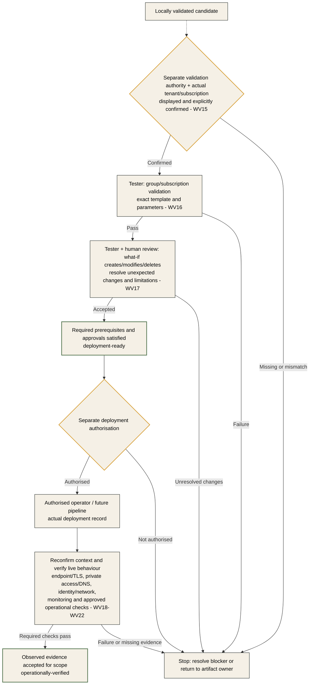

# Azure Workload Guidance

## Purpose and Boundary

This document defines the guidance applied to the **Azure solution that the
engineering agents design, implement, document and verify**. It does not define
the agent team, its routing or its execution order. Those belong in
[Multi-Agent Framework and Orchestration](multi-agent-framework.md).

The maintained architecture is the design baseline, not evidence of deployment.
This guidance does not approve new service choices, infrastructure generation,
Azure operations or a GitHub Actions pipeline.

## Sources and Authority

| Source | Use |
|---|---|
| [Original case](../../case/case-study-47.md) and [rubric](../../case/rubrik/AMA_Capstone_Rubric_Participants.md) | Business objectives and assessment requirements; preserve original material |
| [Maintained architecture](../architecture/aks-centered-foundry-architecture.md) | Existing technical decisions and component boundaries |
| [Business process](../architecture/business-process-flow.md) and [personas](../Persona/personas-and-use-cases.md) | Business ownership, authorised actions and user requirements |
| [Well-Architected Framework](https://learn.microsoft.com/en-us/azure/well-architected/) | Workload quality requirements, controls and trade-offs |
| [Azure Architecture Center](https://learn.microsoft.com/en-us/azure/architecture/) | Reference patterns and service-selection guidance |
| [Azure Verified Modules](https://azure.github.io/Azure-Verified-Modules/) | Published, reusable infrastructure modules and their actual contracts |
| [Bicep documentation](https://learn.microsoft.com/en-us/azure/azure-resource-manager/bicep/) | Resource scopes, composition, dependencies, parameters and validation semantics |
| Applicable official law and approved organisational policy | Obligations and authority, with applicability assessed by the responsible owners |

The source case is fictional and participant legal summaries are not legislation.
Use [EUR-Lex](https://eur-lex.europa.eu/) and applicable official Hungarian sources
to verify legal claims. The broader [source map](context-and-tools.md#repository-grounding)
identifies the relevant repository research.
The [workload validation catalogue](workload-checks.md) turns these standards into
named checks, owners, expected evidence and blocking rules (WV01-WV22).
These criteria apply only to the produced Azure workload. They are not requirements
for constructing, reviewing or accepting the multi-agent framework itself.

Record source URL, access date, version where relevant, supported decision and
limitations. Report conflicts explicitly. Do not silently replace a baseline
decision, invent legal applicability or treat an older example as current product support.

## Well-Architected Assessment

Assess each released workload package against all five pillars. State measurable
requirements and evidence, not just that a pillar has been considered.

| Pillar | Required design questions | Expected evidence |
|---|---|---|
| Reliability | Failure domains, retries/idempotency, service dependencies, availability, backup and recovery | Approved targets, failure/recovery design and staged verification plan; observed results only when actually tested |
| Security | Threat boundaries, identities, least privilege, private access, egress, secrets, evidence integrity and supply chain | Threat/control mapping, identity/network contracts and independent findings |
| Cost Optimization | Workload drivers, resource/model consumption, scaling bounds, retention and business value | Sizing assumptions, sourced estimates, budget decisions and a cost-measurement method |
| Operational Excellence | Ownership, diagnostics, actionable alerts, change management, runbooks and deployment readiness | Operational contracts, logging/metric coverage, validation commands and recovery procedures |
| Performance Efficiency | Expected parcel/evidence volumes, seasonality, latency, throughput, quotas and bottlenecks | Approved thresholds, capacity assumptions, scaling design and test results appropriate to the stage |

Unknown targets remain decisions with owners. Do not invent SLOs, RTO/RPO, budgets,
quotas or service availability to complete a template. AVM defaults do not establish
WAF alignment, regulatory compliance or production readiness.
The architect's assessment is not the independent review: the tester produces
`architecture-review.md` covering every pillar without authoring/modifying the design.

## Existing Solution Guardrails

These summarise the current baseline; the linked architecture/procedures contain
the detailed contracts. Material changes require an approved design amendment.

| Area | Baseline |
|---|---|
| Compute | AKS Standard, CPU-only, explicit node pools, NAP disabled; Azure CNI Overlay/Cilium, Workload Identity and the approved HPA/KEDA/Cluster Autoscaler design |
| Foundation models | Managed Microsoft Foundry inference, not foundation models hosted in AKS; approved EU Regional/EU Data Zone processing for case/personal data, not Global deployments |
| Custom models and raster work | Azure ML crop classification; separate optional drone vision; Copernicus Data Space APIs for appropriate raster processing |
| State | Prediction, authoritative case and conversation state remain distinct; agents do not own entitlement or the official payment ledger |
| Evidence ingestion | Quarantine until the complete pinned manifest/session and clean scan are verified; Event Grid/evidence-service/Service Bus flow, idempotency and failed-message handling |
| Inspection | Claimant photos and GPS are not independent proof; locked probability sampling/design weights remain distinct from risk-targeted inspections |
| Decisions and payments | Authorised humans decide adverse/contested matters; treasury owns payment authorisation, execution and ledger; deterministic integration reconciles status |

For details, use the [training procedure](../copernicus/crop-classification/crop-classifier-training-procedure.md),
[ground/drone process](../copernicus/crop-classification/drone-survey-validation-process.md)
and [payment calendar](../research/cap-claim-and-payment-calendar.md).

## Infrastructure as Code

### Composition and Ownership

- Use Bicep and exact published AVM versions. Verify the selected version's source,
  parameters, outputs, examples and limitations before relying on it.
- Use a Bicep root to compose logical project modules. A proposed starting point is
  `infra/main.bicep` plus environment `.bicepparam` files; the released design fixes
  actual scopes, boundaries and contracts.
- Let Bicep own resource dependencies through typed inputs/outputs and scopes.
  Do not replace the resource graph with one pipeline job per resource/module.
- Add local modules for meaningful project contracts, not automatic pass-through
  wrappers around every AVM. Document native-resource exceptions for real AVM gaps.
- If separate roots are necessary for lifecycle or ownership reasons, document
  their dependency/interface contracts rather than assuming one root fits everything.
- Keep Kubernetes/application releases, model lifecycle, data ingestion and indexing
  separate from ARM resource provisioning unless specifically approved otherwise.

### Security and Configuration

Use approved naming, tags, environment parameters, managed identities, narrowly scoped
RBAC, private access/DNS, egress controls, diagnostics and retention. Never commit
credentials or output keys/connection strings. Use secret references where needed.
For an approved Azure SQL implementation, use Entra-only authentication without
SQL administrator login/password fields.
Required resource tags are `environment`, `workload`, `owner` and `costCenter` on
taggable resources in scope. Service limitations or approved exceptions are explicit,
not blanket omissions. Supported TLS settings enforce at least TLS 1.2, with the
actual service property and any stricter requirement recorded in the released design.

ARM deployment is not transactional. Resource dependencies do not guarantee RBAC
propagation, private DNS resolution or data-plane readiness; specify and verify those
conditions separately.

The reusable [AVM/Bicep skill](../../.github/skills/ama-avm-bicep/SKILL.md) supplies the
implementation/review procedure; the [AVM quickstart](https://azure.github.io/Azure-Verified-Modules/usage/quickstart/bicep/)
is official usage guidance, not approval to deploy its example.

## Data, AI and Compliance

- Use approved as-of-date features, prefix training/backtests and availability cutoffs.
  Do not leak future observations into early-season decisions.
- Keep weak-label/confidence metadata separate from model inputs where required.
  A public-data demonstrator is not an authoritative Hungarian production pilot.
- Record model provenance, evaluation cohorts, failure/abstention behaviour and
  governance requirements. Infrastructure provisioning does not validate model quality.
- Map applicable obligations to technical and procedural controls, owners and evidence.
  Infrastructure cannot supply lawful authority, hearing/appeal procedures, staff
  responsibilities, DPIA completion or real independent inspection practice.
- Treat AI Act classification and NIS2 status as applicability assessments requiring
  competent human decisions, not blanket conclusions about public-sector AI.

## Documentation and Verification

Maintain architecture decisions, diagrams and operational guidance as the work
evolves. Distinguish **proposed**, **implemented**, **validated**, **deployed** and
**observed** states; only claim the state supported by actual evidence.
Retain editable diagram sources and follow the existing
[Field & File presentation guidance](../Persona/farm-theme-and-persona-map.md).

| Verification stage | What it establishes | What it does not establish |
|---|---|---|
| Local restore/build/lint/parameter checks | Available tooling accepts the candidate and tested contracts | Azure availability, authorisation or successful provisioning |
| Authenticated validation / what-if | Scoped validation/preview against the authorised Azure context | Guaranteed changes, deployment permission or runtime readiness |
| Deployment record | What was actually provisioned by an authorised operation | End-to-end application, model or operational correctness |
| Data-plane and operational checks | The explicitly tested behaviours in that environment | Untested behaviours, blanket compliance or certification |

Record exact revisions, commands, tool versions, scope, expected/actual results and
limitations. Missing tools/access are explicit blockers. Unexecuted checks are
`NOT RUN`, not passes; use the [handoff evidence contract](handoffs.md#evidence-contract).
Each acceptance criterion names its earliest required
[gate](handoffs.md#gate-specific-acceptance): `design-released`, `locally-validated`,
`deployment-ready` or `operationally-verified`. Required current-gate failures block
that gate. Future checks stay pending without being falsely passed, waived or used
to block an earlier gate merely because execution belongs later.

Security and compliance are reviewed against both the fixed design and the actual
implementation candidate. The tester runs executable control assertions; the
specialist reviewers assess findings and legal/procedural evidence independently.
Post-deployment checks establish actual behaviour only after an authorised deployment.

## Release and Deployment Boundary

Infrastructure implementation consumes a bounded, human-approved architect release
with contracts, criteria, AVM feasibility, independent full-WAF/specialist reviews
and an accepted workload-specific `development-plan.md`. The plan derives from the
reviewed architecture and defines actual files/dependencies, finding dispositions,
parameter variants and tests. The delivery-process backlog is not that plan.
Early feasibility research does not require generating infrastructure.

Azure mutations, authenticated checks, deployments and operational drills require
their stated authorisation. Pipeline design remains later work. A future pipeline
should invoke the approved deployment roots and handle identity, validation,
what-if and approvals; it must not become a substitute resource dependency graph.

## Later Azure Validation and Live Verification

This is the Azure-specific continuation after a locally validated candidate, not
the agent orchestration model. It defines future acceptance only; no deployer agent
or pipeline is implemented. Every authenticated stage needs its own authorisation.

WV15-WV22 define the context confirmation, validation/preview and observed checks.
Passing a preview does not itself authorise deployment.
