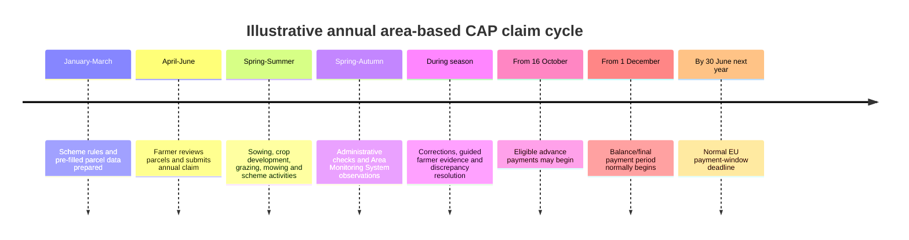
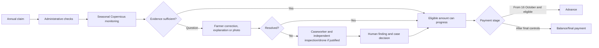

# CAP Claim and Payment Calendar

## 1. Short Answer

For annual area-based CAP support, payment is normally **not triggered directly by
sowing or harvesting**.

The typical sequence is:

1. the farmer submits the annual claim in spring;
2. the paying agency performs administrative checks and monitors eligibility during
   the agricultural season;
3. the farmer corrects the claim or supplies evidence where required;
4. eligible advances may begin from **16 October**;
5. balance payments normally follow after the required controls, from **1 December**
   through the applicable payment window;
6. the EU payment window normally closes on **30 June of the following calendar
   year**.

Sowing, mowing, grazing, cover establishment, harvest, or another activity can be an
eligibility condition or evidence event. Those activities influence whether and how
much is paid, but they do not normally cause an immediate payment at the moment they
occur.

Exact interventions, deadlines, advance percentages, control requirements, and
national payment campaigns vary by Member State, scheme, and claim year.

## 2. Typical Annual Cycle

The agricultural calendar differs by crop and region. Winter crops may be sown in the
previous autumn; spring crops may be harvested before or after advance payments begin.
The system must therefore use scheme-year and crop-calendar logic rather than assuming
one universal “sow, harvest, pay” sequence.

## 3. Relationship Between Farm Events and Payment

| Farm or administrative event | Payment meaning |
|---|---|
| Sowing | May establish or support an eligibility condition; normally no immediate payment |
| Crop emergence | Provides monitoring evidence; normally no payment event |
| Mowing, grazing, cover establishment, or another scheme activity | May satisfy a dated commitment and require evidence |
| Harvest | Often produces a monitoring signal and closes part of the evidence period; it is not the universal payment trigger |
| Claim correction | Can change eligible area, intervention, or calculated amount |
| Monitoring result | Supports consistency, discrepancy, or abstention status |
| Farmer photo or document | May resolve a scoped evidence question |
| Inspector/drone finding | Supplies independent factual evidence |
| Completed controls | Allows the paying agency to establish the eligible amount |
| Advance authorisation | Allows an eligible portion to be paid from the permitted date |
| Final calculation and decision | Determines the remaining balance, reductions, or recovery |

Some interventions are activity-, investment-, cost-, or result-based rather than
simple annual area payments. They may use different milestones, claims for
reimbursement, multi-year commitments, or payment schedules. The project must keep
intervention-specific payment rules versioned in the rules service.

## 4. EU Payment Framework

Regulation (EU) 2021/2116 governs CAP financing, management, and monitoring. The
annual payment framework allows:

- advance payments from **16 October** of the claim year;
- ordinary payment of the balance during the period starting **1 December**;
- completion by **30 June of the following calendar year**, subject to the applicable
  legal provisions and exceptions.

The normal advance ceilings may be temporarily increased by European Commission
authorisation. For example, the Commission authorised Member States in 2024 to pay:

- up to **70%** of direct payments instead of the usual 50%; and
- up to **85%** for area- and animal-based rural-development interventions instead of
  the usual 75%.

An increased ceiling does not mean every farmer automatically receives that
percentage. The Member State must use the authorisation, and the paying agency must
have sufficient completed controls and an eligible amount that can safely be paid.

## 5. Hungarian Example

The Hungarian annual **Egységes Kérelem** (single application) provides a useful
concrete example.

For claim year 2025:

- applications could be submitted between **7 April and 10 June 2025**;
- the Hungarian advance-payment campaign began on **16 October 2025**, the earliest
  date allowed by the EU framework;
- the Hungarian government announced advance payments for direct and area-based rural
  development support, with some interventions beginning later in October or
  November;
- the Hungarian State Treasury stated that final payments should reach eligible
  farmers before the following June legal deadline, with substantial payments planned
  by the end of 2025.

This is an example, not a permanent calendar. The exact Hungarian dates, interventions,
advance amounts, and operational conditions must be taken from the Hungarian State
Treasury and CAP authority publications for the relevant claim year.

## 6. Where Validation Fits

Validation runs throughout the growing season because the paying agency needs enough
evidence to calculate a defensible eligible amount before paying an advance or final
balance.

The farmer photo lane can run before a discrepancy. A farmer may preserve timely
evidence of replanting, weather damage, mowing, or another material event. This can
make later validation faster, but receiving a photo does not itself authorise payment.

An unresolved parcel or intervention may affect whether an amount is sufficiently
established for an advance. Whether the paying agency can pay uncontested parts while
holding another part depends on the intervention, national implementation, and case
state. The architecture must not invent a general partial-payment rule; it belongs in
the versioned rules service.

## 7. Field & File Storyline

### Spring: claim and planting

The Farmer submits the annual claim after checking the pre-filled parcel map. Spring
planting begins. No subsidy is immediately paid because sowing alone does not establish
all eligibility conditions for the year.

### Growing season: monitoring and evidence

Sentinel observations accumulate. After storm damage, the Farmer records replanting
through the Field & File application. The evidence is stored with parcel, time, and
location context.

The agency continues administrative and Area Monitoring System checks. Most parcels
remain consistent. One parcel cannot be resolved from Copernicus and farmer evidence,
so an authorised surveyor collects independent drone evidence.

### Autumn: advance readiness

By mid-October, the agency has enough validated information for many claims or
interventions to enter the advance campaign. A farmer does not receive an advance
merely because harvest occurred; payment depends on the calculated eligible amount,
completed controls, the intervention's rules, and the national campaign.

The Farmer sees separate statuses:

- `Monitoring in progress`;
- `Evidence requested`;
- `Eligible amount provisionally established`;
- `Advance scheduled`;
- `Advance paid`;
- `Final calculation pending`.

### Winter: balance and unresolved cases

After remaining controls and intervention-specific conditions are completed, the
paying agency determines the balance. The case file records the advance, final eligible
amount, reductions if any, payment transaction, explanation, and appeal route.

The Farmer can therefore distinguish:

- agricultural activity completed;
- evidence accepted for a specific task;
- eligibility established;
- payment calculated;
- payment authorised;
- money transferred.

These are different events and must not be shown as one generic “approved” status.

## 8. Product and Architecture Requirements

### Case state

`case-api` should represent at least:

- claim submitted;
- monitoring in progress;
- action or evidence required;
- under human review;
- eligible amount provisionally established;
- advance eligible;
- advance scheduled;
- advance paid;
- final calculation pending;
- final decision issued;
- balance paid;
- payment held, adjusted, recovered, or appealed.

The exact transitions are controlled by intervention and scheme-year rules.

### Rules service

The rules service owns:

- claim and amendment deadlines;
- activity and evidence windows;
- advance eligibility and percentage limits;
- conditions that must be checked before an advance;
- whether partial/intervention-level payment is permitted;
- final payment deadline;
- rounding, reduction, penalty, recovery, and offset rules.

Agents may explain these rules but cannot choose a payment date, percentage, or amount.

### Farmer experience

The portal should show:

- the claim year and intervention;
- what has been completed and what remains;
- whether the displayed amount is estimated, provisionally established, authorised,
  or paid;
- the advance amount separately from the final amount;
- evidence or control issues that affect payment;
- expected window rather than an unsupported exact payment date;
- transaction and decision references after payment.

### Operations

Operational dashboards should track:

- claims ready for advance;
- claims blocked by missing evidence or unresolved exceptions;
- claims waiting for inspection or legal review;
- advance and final-payment throughput;
- age and value of payment holds;
- intervention-specific deadlines;
- avoidable delays caused by data, model, workflow, or staffing failures.

## 9. Design Guardrails

- Do not promise payment at sowing, harvest, or photo submission.
- Do not treat a model-consistent parcel as a payment authorisation.
- Do not mark evidence as “approved” when it is merely received.
- Do not expose an estimated amount as legally established.
- Do not let an LLM calculate or schedule payment.
- Do not delay a case merely to wait for irrelevant imagery after sufficient evidence
  has been established.
- Do not hide which intervention, parcel, evidence request, or control is holding
  payment.
- Do not assume that one unresolved parcel necessarily blocks every intervention or
  the complete claim; apply only approved national rules.

## 10. Official Sources

- [European Commission: Managing CAP payments and IACS](https://agriculture.ec.europa.eu/common-agricultural-policy/financing-cap/assurance-and-audit/managing-payments_en)
- [Regulation (EU) 2021/2116 on CAP financing, management and monitoring](https://eur-lex.europa.eu/legal-content/EN/TXT/?uri=CELEX:32021R2116)
- [European Commission: higher CAP advance payments authorised in 2024](https://agriculture.ec.europa.eu/media/news/commission-authorises-higher-advance-cap-payments-eu-farmers-2024-09-13_en)
- [Hungarian CAP authority: opening of the 2025 single-application period](https://kap.gov.hu/news/2025-04-07/095303/indul-2025.-evi-egyseges-kerelmek-benyujtasa)
- [Hungarian CAP authority: start of 2025 advance payments](https://kap.gov.hu/news/2025-10-16/134028/az-egyseges-kerelem-elolegfizeteseivel-csutortokon-125-milliard-forint)

Official annual Hungarian publications take precedence over the illustrative calendar
in this document.
