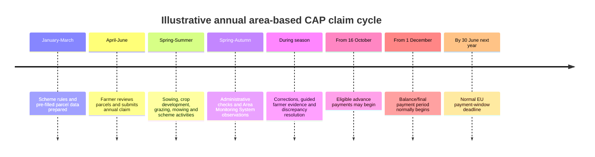
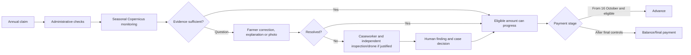

# CAP Claim and Payment Calendar

## 1. Short Answer

For annual area-based CAP support, payment is normally **not triggered directly by
sowing or harvesting**.

The typical sequence is:

1. the farmer submits the annual claim in spring;
2. the paying agency performs administrative checks and monitors eligibility during
   the agricultural season;
3. the farmer corrects the claim or supplies evidence where required;
4. eligible advances may begin from **16 October**;
5. balance payments normally follow after the required controls, from **1 December**
   through the applicable payment window;
6. the EU payment window normally closes on **30 June of the following calendar
   year**.

Sowing, mowing, grazing, cover establishment, harvest, or another activity can be an
eligibility condition or evidence event. Those activities influence whether and how
much is paid, but they do not normally cause an immediate payment at the moment they
occur.

Exact interventions, deadlines, advance percentages, control requirements, and
national payment campaigns vary by Member State, scheme, and claim year.

## 2. Typical Annual Cycle



The agricultural calendar differs by crop and region. Winter crops may be sown in the
previous autumn; spring crops may be harvested before or after advance payments begin.
The system must therefore use scheme-year and crop-calendar logic rather than assuming
one universal “sow, harvest, pay” sequence.

## 3. Relationship Between Farm Events and Payment

| Farm or administrative event | Payment meaning |
|---|---|
| Sowing | May establish or support an eligibility condition; normally no immediate payment |
| Crop emergence | Provides monitoring evidence; normally no payment event |
| Mowing, grazing, cover establishment, or another scheme activity | May satisfy a dated commitment and require evidence |
| Harvest | Often produces a monitoring signal and closes part of the evidence period; it is not the universal payment trigger |
| Claim correction | Can change eligible area, intervention, or calculated amount |
| Monitoring result | Supports consistency, discrepancy, or abstention status |
| Farmer photo or document | May resolve a scoped evidence question |
| Inspector/drone finding | Supplies independent factual evidence |
| Completed controls | Allows the paying agency to establish the eligible amount |
| Advance authorisation | Allows an eligible portion to be paid from the permitted date |
| Final calculation and decision | Determines the remaining balance, reductions, or recovery |

Some interventions are activity-, investment-, cost-, or result-based rather than
simple annual area payments. They may use different milestones, claims for
reimbursement, multi-year commitments, or payment schedules. The project must keep
intervention-specific payment rules versioned in the rules service.

## 4. EU Payment Framework

Regulation (EU) 2021/2116 governs CAP financing, management, and monitoring. The
annual payment framework allows:

- advance payments from **16 October** of the claim year;
- ordinary payment of the balance during the period starting **1 December**;
- completion by **30 June of the following calendar year**, subject to the applicable
  legal provisions and exceptions.

The normal advance ceilings may be temporarily increased by European Commission
authorisation. For example, the Commission authorised Member States in 2024 to pay:

- up to **70%** of direct payments instead of the usual 50%; and
- up to **85%** for area- and animal-based rural-development interventions instead of
  the usual 75%.

An increased ceiling does not mean every farmer automatically receives that
percentage. The Member State must use the authorisation, and the paying agency must
have sufficient completed controls and an eligible amount that can safely be paid.

### Normal payment handling

The normal process is not “pay every farmer provisionally and inspect every farm
later.” Physical inspection applies to selected or unresolved cases, while
administrative checks and the Area Monitoring System cover the wider claim
population.

A typical claim follows one of these paths:

| Path | Typical handling |
|---|---|
| Sufficiently checked and eligible for advance | An advance is paid from the permitted autumn date; the remaining balance is calculated and paid later |
| Partly resolved claim or intervention | The sufficiently established amount may progress where national rules permit; unresolved elements remain pending |
| No advance available or controls incomplete | The farmer waits for the normal/final payment after the required checks |
| Later finding changes eligibility | The balance is recalculated; an overpaid advance may be recovered or offset under the applicable rules |
| No material issue and no separate advance | The paying agency may issue one payment during the ordinary payment campaign |

The simplified lifecycle is:

```text
Annual claim
    ↓
Administrative checks and seasonal monitoring
    ↓
Enough eligibility established for an advance?
    ├─ Yes → autumn advance
    │           ↓
    │      remaining checks and final calculation
    │           ↓
    │      balance payment or recovery/offset
    │
    └─ No  → claim remains pending
                ↓
           checks completed
                ↓
           one final/ordinary payment
```

January is therefore not the mandatory payment month. Some farmers may receive an
advance from October, many receive additional or final amounts from December onward,
and unresolved cases may continue into the following months. The exact batch depends
on intervention rules, completed controls, national implementation, and the individual
case.

## 5. Hungarian Example

The Hungarian annual **Egységes Kérelem** (single application) provides a useful
concrete example.

For claim year 2025:

- applications could be submitted between **7 April and 10 June 2025**;
- the Hungarian advance-payment campaign began on **16 October 2025**, the earliest
  date allowed by the EU framework;
- the Hungarian government announced advance payments for direct and area-based rural
  development support, with some interventions beginning later in October or
  November;
- the Hungarian State Treasury stated that final payments should reach eligible
  farmers before the following June legal deadline, with substantial payments planned
  by the end of 2025.

This is an example, not a permanent calendar. The exact Hungarian dates, interventions,
advance amounts, and operational conditions must be taken from the Hungarian State
Treasury and CAP authority publications for the relevant claim year.

## 6. Interpreting the Case Target: Payment Two Months Earlier

The case brief does not define a separate two- or three-month legal payment window. It
sets a relative outcome target:

> Payments two months earlier.

The target is too ambiguous if interpreted only as the first transfer. A farmer who
already receives a substantial advance on 16 October cannot receive that advance two
months earlier under the normal framework. The useful interpretation is:

> Increase the amount of valid support paid during the earliest lawful payment
> campaigns and reduce the time until farmers receive substantially all of their
> final eligible amount.

The original two-month target remains relevant for farmers whose advance or balance is
currently delayed, but it should not be presented as a universal benefit.

The historical baseline must be established before claiming the benefit. Illustrative
movements could be:

| Current first material payment | Target payment | Approximate improvement |
|---|---|---:|
| February | December | Two months |
| January | November | Two months |
| December | October advance campaign | Approximately two months |
| 16 October | Cannot move two months earlier under the normal framework | Increase the number of claims reaching this earliest batch |

The practical value differs by payment cohort:

| Current farmer situation | Likely value from the programme |
|---|---|
| No advance because validation is unfinished | High: the claim may become ready for an autumn payment instead of waiting until winter or spring |
| Advance is paid late | High or moderate: earlier evidence resolution can move it into an earlier batch |
| Maximum available advance is already paid on 16 October | Little or no first-payment benefit |
| Advance is timely but the balance is delayed | Benefit applies to the unpaid balance, not to the amount already received |
| Claim remains blocked into the following spring | High: resolving the exception can remove a long payment delay |
| Eligibility or sanction is genuinely disputed | Correctness and due process take priority over speed |

The programme cannot move the normal legal opening for advances earlier than
16 October. Its opportunity is to:

- make more valid claims ready for the earliest lawful payment batch;
- move claims from January-March into October-December;
- prevent incomplete evidence and inspection backlogs from pushing cases toward the
  following June deadline;
- resolve discrepancies before payment processing rather than during or after it;
- allow unaffected claim elements to progress where approved national rules permit.

The target must not be presented as an unconditional promise to every farmer. Some
interventions have later evidence windows, multi-year conditions, unresolved
eligibility questions, sanctions, debt offsets, appeals, or other lawful reasons for a
different payment date.

### Baseline and KPI definition

The paying agency should calculate the baseline from at least the previous three claim
years using authoritative claim and treasury records.

The case's original headline measure may still be reported:

- median calendar days from **complete claim** to **first material payment**, with a
  target direction of up to 60 days earlier for delayed cohorts.

It must not be the sole KPI. A first-payment measure can appear successful when farmers
already receive a timely advance but wait too long for the remaining balance.

Primary operational measures should therefore include:

- percentage of eligible farmers receiving an advance by 31 October;
- percentage of the final eligible amount paid by 31 December;
- median date on which each farmer has received at least 90% of the final eligible
  amount;
- value still unpaid at 31 December and 31 March;
- median time from an unresolved discrepancy to release of the affected payment;
- number and value of claims moved from January-June into October-December;
- payment timing for farmers receiving no advance, a partial advance, and the maximum
  available advance.

Supporting measures:

- median and P90 claim-to-first-payment and claim-to-substantially-complete-payment
  time;
- percentage and value paid by 16 October, 31 October, 31 December, and 31 March;
- time from evidence request to discrepancy resolution;
- percentage of claims ready when the advance campaign opens;
- percentage receiving an advance versus only a final payment;
- value delayed by missing evidence, inspection, legal review, data defects, or
  operational backlog;
- payment timing by intervention, region, farm-size cohort, parcel complexity, and
  validation path;
- correction, recovery, appeal, and overturned-decision rates for accelerated cases.

“Complete claim,” “first material payment,” “final eligible amount,” and
“substantially complete payment” require formal definitions. The programme must not
improve the metric artificially by:

- excluding difficult claims from the denominator;
- treating a nominal or trivial transfer as material payment;
- redefining completeness only after controls finish;
- accelerating easy claims while allowing the P90 or vulnerable cohorts to worsen;
- paying before sufficient controls and creating avoidable recoveries.

The preferred substantially-complete threshold is 90% for initial measurement, because
it captures whether most of the farmer's entitlement is available without requiring
every minor reconciliation to be closed. The agency must validate that threshold
against its actual interventions and payment practices.

## 7. Farmer Benefits of Earlier Payment

The case brief identifies improved farm liquidity as the principal farmer benefit.
That benefit is concentrated among farmers whose advance is missing or delayed and
farmers waiting for a material balance. Farmers who already receive the maximum
available advance at the earliest lawful date may receive little benefit from faster
first-payment processing.

CAP support is often part of the farm's annual working-capital cycle. Moving a valid,
material amount forward can provide value even when the total annual support does not
change.

### 7.1 Working capital

Earlier payment gives the farmer cash sooner for:

- seed, fertiliser, feed, fuel, plant protection, and veterinary costs;
- machinery repair and maintenance;
- land rent and lease obligations;
- wages and seasonal contractors;
- energy, insurance, tax, and utility bills;
- loan instalments and other scheduled liabilities;
- autumn sowing and preparation for the following season.

This is especially relevant when harvest income is delayed, yields are poor, output
prices fall, or weather creates unplanned replanting and recovery costs.

### 7.2 Reduced short-term financing pressure

Farmers may use overdrafts, supplier credit, short-term loans, or deferred payments
while waiting for support. Earlier payment can reduce the period for which that
temporary financing is required. The business case should keep this as a qualitative
liquidity benefit until the agency has real farm and financing evidence; detailed
interest or cost calculations are outside the current design scope.

### 7.3 Better purchasing decisions

Earlier liquidity may allow a farmer to:

- buy inputs when needed rather than after prices rise;
- use legitimate early-order or prompt-payment discounts;
- secure scarce seed, feed, fertiliser, fuel, or contractor availability;
- avoid reducing an agronomically necessary input solely because cash has not arrived;
- schedule maintenance before a critical field operation.

The programme should not count the full value of an early-purchase discount as an
automatic benefit. It should be measured from real farmer outcomes.

### 7.4 Resilience and reduced distress

Predictable earlier payment can reduce the likelihood that a farmer must:

- postpone essential repairs;
- sell crops, livestock, or other assets at an unfavourable time;
- delay payments to employees or local suppliers;
- abandon a planned crop or environmental activity because of temporary liquidity;
- absorb a weather shock without adequate working capital.

This may matter most to smaller farms and farmers with limited access to affordable
credit. The benefits analysis should therefore examine distribution, not only the
national average.

### 7.5 Certainty and administrative benefit

The benefit is not only the date money arrives. Earlier resolution provides:

- a clearer expected payment window;
- fewer repeated evidence requests;
- less uncertainty over whether a parcel is blocking payment;
- earlier knowledge of any reduction or unresolved issue;
- more time to correct procedural problems before a deadline;
- reduced time spent calling advisers, the paying agency, or lenders for status.

Predictability may be valuable even where payment cannot move by the full two months.

### 7.6 Risks of accelerating payment

Earlier is beneficial only when the eligible amount is sufficiently established.
Unsafe acceleration can cause:

- overpayment and later recovery;
- unexpected debt or offset against future support;
- avoidable disputes and appeals;
- cash-flow shock when money already spent must be repaid;
- unequal treatment if only digitally confident farmers can resolve cases quickly.

The objective is therefore **earlier valid payment**, not payment before adequate
control. The solution must preserve human review, alternative evidence channels,
accessibility, correction rights, and a clear final reconciliation.

### 7.7 Measuring farmer value

Evaluate:

- actual days payment was accelerated;
- reported reduction in short-term financing pressure;
- late supplier-payment incidents;
- ability to purchase planned inputs on time;
- complaints and status-enquiry volume;
- farmer confidence in the expected payment date;
- payment timing by farm size, region, intervention, digital-access needs, and credit
  access;
- recoveries or corrections following accelerated payment.

Farmer surveys and interviews are required because treasury data shows when payment
occurred but not how the farmer used it or what financing cost was avoided.

## 8. Where Validation Fits

Validation runs throughout the growing season because the paying agency needs enough
evidence to calculate a defensible eligible amount before paying an advance or final
balance.



The farmer photo lane can run before a discrepancy. A farmer may preserve timely
evidence of replanting, weather damage, mowing, or another material event. This can
make later validation faster, but receiving a photo does not itself authorise payment.

An unresolved parcel or intervention may affect whether an amount is sufficiently
established for an advance. Whether the paying agency can pay uncontested parts while
holding another part depends on the intervention, national implementation, and case
state. The architecture must not invent a general partial-payment rule; it belongs in
the versioned rules service.

## 9. Field & File Storyline

### Spring: claim and planting

The Farmer submits the annual claim after checking the pre-filled parcel map. Spring
planting begins. No subsidy is immediately paid because sowing alone does not establish
all eligibility conditions for the year.

### Growing season: monitoring and evidence

Sentinel observations accumulate. After storm damage, the Farmer records replanting
through the Field & File application. The evidence is stored with parcel, time, and
location context.

The agency continues administrative and Area Monitoring System checks. Most parcels
remain consistent. One parcel cannot be resolved from Copernicus and farmer evidence,
so an authorised surveyor collects independent drone evidence.

### Autumn: advance readiness

By mid-October, the agency has enough validated information for many claims or
interventions to enter the advance campaign. A farmer does not receive an advance
merely because harvest occurred; payment depends on the calculated eligible amount,
completed controls, the intervention's rules, and the national campaign.

The Farmer sees separate statuses:

- `Monitoring in progress`;
- `Evidence requested`;
- `Eligible amount provisionally established`;
- `Advance scheduled`;
- `Advance paid`;
- `Final calculation pending`.

Receiving the advance two months earlier than the farm's historical norm allows the
Farmer to settle a seasonal overdraft, repair machinery, and order inputs for the next
crop cycle without waiting until winter. These are potential storyline benefits, not
guaranteed outcomes for every farm.

### Winter: balance and unresolved cases

After remaining controls and intervention-specific conditions are completed, the
paying agency determines the balance. The case file records the advance, final eligible
amount, reductions if any, payment transaction, explanation, and appeal route.

The Farmer can therefore distinguish:

- agricultural activity completed;
- evidence accepted for a specific task;
- eligibility established;
- payment calculated;
- payment authorised;
- money transferred.

These are different events and must not be shown as one generic “approved” status.

## 10. Product and Architecture Requirements

### Case state

`case-api` should represent at least:

- claim submitted;
- monitoring in progress;
- action or evidence required;
- under human review;
- eligible amount provisionally established;
- advance eligible;
- advance scheduled;
- advance paid;
- final calculation pending;
- final decision issued;
- balance paid;
- payment held, adjusted, recovered, or appealed.

The exact transitions are controlled by intervention and scheme-year rules.

### Rules service

The rules service owns:

- claim and amendment deadlines;
- activity and evidence windows;
- advance eligibility and percentage limits;
- conditions that must be checked before an advance;
- whether partial/intervention-level payment is permitted;
- final payment deadline;
- rounding, reduction, penalty, recovery, and offset rules.

Agents may explain these rules but cannot choose a payment date, percentage, or amount.

### Farmer experience

The portal should show:

- the claim year and intervention;
- what has been completed and what remains;
- whether the displayed amount is estimated, provisionally established, authorised,
  or paid;
- the advance amount separately from the final amount;
- evidence or control issues that affect payment;
- expected window rather than an unsupported exact payment date;
- transaction and decision references after payment.

### Operations

Operational dashboards should track:

- claims ready for advance;
- claims blocked by missing evidence or unresolved exceptions;
- claims waiting for inspection or legal review;
- advance and final-payment throughput;
- age and value of payment holds;
- intervention-specific deadlines;
- avoidable delays caused by data, model, workflow, or staffing failures.

### Benefit tracking

The programme dashboard should show the case target separately from the statutory
calendar:

- historical baseline median and P90;
- current median and P90;
- days improved against baseline for first payment and substantially complete payment;
- number and value of farmers moved into an earlier payment batch;
- percentage ready at the 16 October opening;
- percentage of final eligible value paid by 31 December;
- unpaid value at 31 December and 31 March;
- separate outcomes for no-advance, partial-advance, and maximum-advance cohorts;
- farmer-reported liquidity and predictability outcomes;
- correction and recovery rates to confirm that speed did not weaken accuracy.

## 11. Design Guardrails

- Do not promise payment at sowing, harvest, or photo submission.
- Do not treat a model-consistent parcel as a payment authorisation.
- Do not mark evidence as “approved” when it is merely received.
- Do not expose an estimated amount as legally established.
- Do not let an LLM calculate or schedule payment.
- Do not delay a case merely to wait for irrelevant imagery after sufficient evidence
  has been established.
- Do not hide which intervention, parcel, evidence request, or control is holding
  payment.
- Do not assume that one unresolved parcel necessarily blocks every intervention or
  the complete claim; apply only approved national rules.
- Do not describe the case's two-month target as a new statutory payment window.
- Do not present a two-month benefit as universal when many farmers already receive an
  early advance.
- Do not use first-payment timing alone when the material balance remains unpaid.
- Do not claim quantified financing savings before a separate evidence-based benefits
  methodology is approved.
- Do not optimise only the median while late-payment cohorts become slower.

## 12. Official Sources

- [European Commission: Managing CAP payments and IACS](https://agriculture.ec.europa.eu/common-agricultural-policy/financing-cap/assurance-and-audit/managing-payments_en)
- [Regulation (EU) 2021/2116 on CAP financing, management and monitoring](https://eur-lex.europa.eu/legal-content/EN/TXT/?uri=CELEX:32021R2116)
- [European Commission: higher CAP advance payments authorised in 2024](https://agriculture.ec.europa.eu/media/news/commission-authorises-higher-advance-cap-payments-eu-farmers-2024-09-13_en)
- [Hungarian CAP authority: opening of the 2025 single-application period](https://kap.gov.hu/news/2025-04-07/095303/indul-2025.-evi-egyseges-kerelmek-benyujtasa)
- [Hungarian CAP authority: start of 2025 advance payments](https://kap.gov.hu/news/2025-10-16/134028/az-egyseges-kerelem-elolegfizeteseivel-csutortokon-125-milliard-forint)

Official annual Hungarian publications take precedence over the illustrative calendar
in this document.
