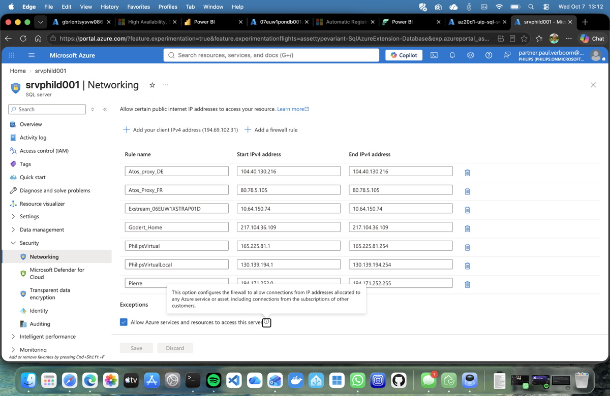
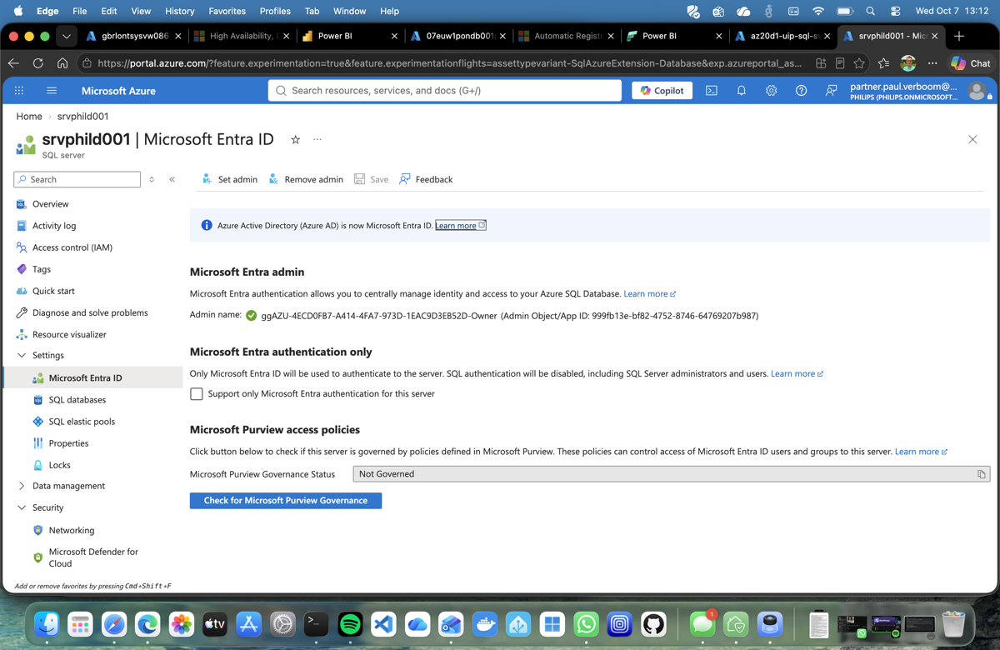
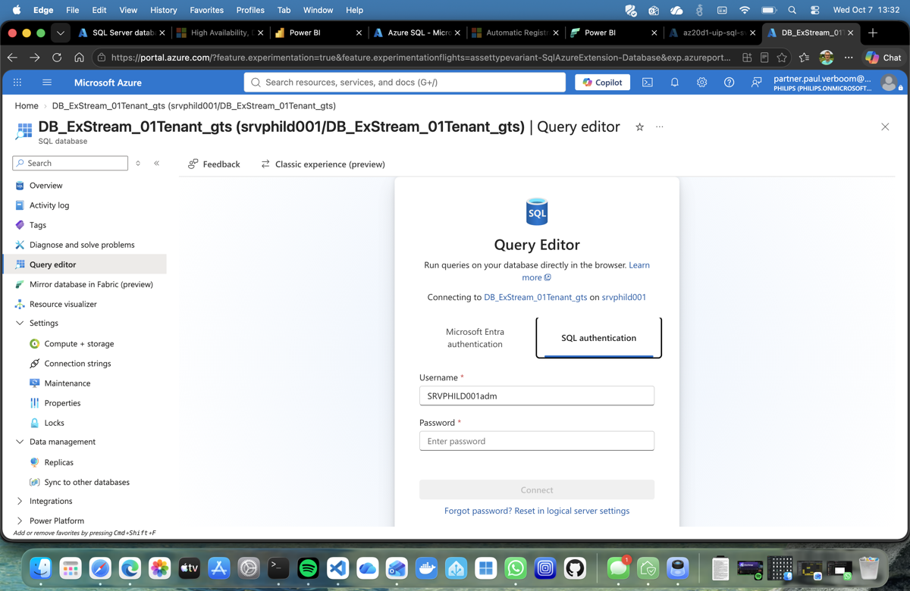

# Business Case: Subscription-Level SQL Server Insights Enablement

## Decision Requested

Approve a controlled rollout of **Automatic SQL Server VM registration** at subscription level to improve SQL estate discovery and feed centralized insights, security posture, performance visibility and license reporting.

The enablement should start with selected non-production subscriptions and expand only after licensing, security and operational controls are validated.

---

## Why This Is Needed

The current insights represent only the resources that Azure can discover and that the reviewing account is authorized to assess. Unregistered SQL Server installations, disconnected Arc machines, stopped VMs and inaccessible subscriptions may be absent.

The observed results must therefore be treated as a **minimum known exposure**, not a complete Philips estate assessment.

Current visible inventory includes:

- **2,989** database resources in the Database Hub view
- **2,313** SQL Server instances represented through Azure Arc
- **79** registered SQL Server on Azure VM resources
- Production and non-production workloads
- Standard, Developer and Express editions

Automatic registration expands coverage by periodically detecting SQL Server on current and future running Azure VMs in enabled subscriptions and registering them with the SQL IaaS Agent extension.

---

## Current Issues in the Assessable Subset

| Area | Finding | Known impact |
|---|---:|---|
| Security | 1,338 issues | 544 affected resources |
| Public exposure | 516 resources have public network access | Increased network attack surface |
| Identity | 492 resources do not have Microsoft Entra authentication enabled | Continued dependence on SQL credentials |
| Private connectivity | 330 resources lack a private endpoint or VNet-integrated endpoint | Weak network isolation |
| Performance | 209 issues | 153 affected resources |
| Storage | 119 resources exceed 85% utilization | Capacity and availability risk |
| Memory | 85 resources exceed 90% utilization | Contention and performance risk |
| Compute | 5 resources exceed 90% utilization | Acute saturation risk |

Issue categories overlap. The figures should not be added to calculate unique affected resources.

---

## Security Risk Assessment

| Risk | Finding | Evidence | Potential impact | Required control |
|---|---|---|---|---|
| **High** | Public SQL endpoint and broad firewall allowlists | Server networking shows public IP firewall rules, including broad ranges | Internet or shared-network sources can attempt authentication against SQL | Use private endpoints, disable public network access and time-limit approved exceptions |
| **High** | "Allow Azure services and resources to access this server" is enabled | Azure-wide firewall exception is selected | Resources in other Azure customer subscriptions can reach the endpoint and attempt authentication | Disable the exception and use explicit private connectivity |
| **High** | SQL authentication remains enabled | Microsoft Entra-only authentication is not selected | Password attacks and persistent SQL credentials remain possible | Migrate applications to managed identities or service principals, then enforce Entra-only authentication |
| **Medium** | SQL administrator login is prefilled in the portal query editor | The query editor suggests the administrative username to an authorized portal user | The username is not a password, but disclosure lowers attacker effort when combined with public reachability and SQL authentication | Avoid sharing login names, remove standing admin use and use named Entra identities with PIM |
| **Medium-High** | Personal, home and shared proxy IP rules are present | Firewall entries include personal and broad proxy-style rules | Stale access, weak ownership and bypass of managed network paths | Require owner, purpose, expiry and periodic review for every exception |
| **Medium** | Private endpoint or VNet integration is absent for part of the estate | Dashboard reports 330 affected resources | Traffic is not consistently isolated to controlled private networks | Establish a private-connectivity policy with an exception process |
| **Medium** | Microsoft Entra authentication is missing across part of the estate | Dashboard reports 492 affected resources | Inconsistent identity governance and continued credential management | Set an Entra authentication baseline and track migration progress |

The prefilled username does **not** demonstrate anonymous username exposure or a compromised credential. It demonstrates that the SQL administrator login is available to an authorized portal session. The combined scenario—public endpoint, Azure-wide reachability, SQL authentication and a known administrator login—creates the material risk.

### Screenshot Evidence

---

## Proposed Enablement

Enable **Automatic SQL Server VM registration** on approved Azure subscriptions.

The service:

1. Runs a monthly discovery job against unregistered, running Azure VMs.
2. Copies SQL IaaS extension binaries to the VM.
3. Checks for a SQL Server registry hive.
4. Registers detected SQL Server VMs.
5. Removes the binaries when SQL Server is not detected, subject to resource locks.

Basic registration provides inventory and licensing capabilities. Features requiring the full SQL IaaS agent remain separately controlled and are not automatically enabled by registration alone.

---

## How to Enable in the Azure Portal

### Before enabling

1. Select one approved non-production subscription for the pilot.
2. Confirm the operator has **Virtual Machine Contributor**, **Contributor** or **Owner** rights on the subscription.
3. Export the current SQL VM inventory, PAYG usage and central AHB assignment utilization.
4. Confirm with Software Asset Management whether newly discovered SQL VMs should remain PAYG or consume available AHB capacity.
5. Inform subscription and application owners that a monthly discovery job will inspect running VMs for SQL Server.

### Enable automatic registration

1. Sign in to the Azure portal.
2. Search for and open **SQL virtual machines**.
3. Select **Automatic SQL Server VM registration**.
4. Select the approved pilot subscription.
5. Review the terms and select **I accept**.
6. Select **Register**.

Registration does not restart the SQL Server service. Azure runs a monthly discovery job against unregistered, running VMs in the subscription.

### Validate the pilot

1. Return to **SQL virtual machines** and record newly registered resources.
2. Review failed registrations and confirm that hardened images, resource locks and VM Agent connectivity are not blocking registration.
3. Compare the resulting inventory with CMDB, EDR and application-owner records.
4. Review Database Hub security and performance findings for the expanded population.
5. Review **Cost Management + Billing → Reservations + Hybrid Benefit** at the EA or MCA billing scope for changes in AHB utilization or PAYG cost.
6. Obtain application-owner confirmation that no workload impact occurred.

### Stop further automatic registration

The Azure portal currently enables the feature, but disabling it requires Azure CLI or PowerShell. Disabling automatic registration only stops future discovery; it does **not** unregister SQL VMs already processed.

---

## Benefits and Drawbacks

| Pros | Cons / risks |
|---|---|
| Discovers previously unregistered SQL Server VMs | Subscription-wide scope may include workloads not yet approved by application owners |
| Improves completeness of Database Hub and Azure SQL inventory | Discovery runs only monthly and is not real-time |
| Creates a consistent management-plane resource for SQL VMs | Binaries are copied and a detection utility runs inside candidate VMs |
| Improves security and performance issue visibility | Registration identifies issues but does not remediate them |
| Supports centralized license reporting and AHB decisions | Newly discovered SQL usage can expose AHB shortfalls or cause PAYG charges |
| Includes future SQL VMs without relying on manual registration | Disabling automatic registration does not unregister existing resources |
| No SQL Server service restart is required for registration | Resource locks, hardened images, old guest agents or network restrictions can cause failures |
| Basic registration is free | Operational ownership is required for failures, exceptions and stale resources |
| Supports governance through Azure Policy and reporting | FCIs and unusual multi-instance configurations have limited support |
| Data remains in the VM's Azure region according to Microsoft | Privacy, change-management and regulated-workload approval still need validation |

---

## How Enablement Covers the Current Issues

| Issue | What subscription enablement provides | Additional control required |
|---|---|---|
| Unknown SQL Server estate | Finds and registers eligible Azure SQL VMs | Arc onboarding and independent CMDB/EDR reconciliation for non-Azure hosts |
| Public network access | Makes more SQL resources visible to centralized assessment | Azure Policy, private endpoints and approved firewall exceptions |
| Missing Entra authentication | Identifies more instances requiring identity modernization | Application migration, managed identities and Entra-only enforcement |
| Missing private connectivity | Expands the population evaluated for endpoint posture | Network architecture, private DNS and public-access disablement |
| Storage pressure | Adds eligible SQL VMs to centralized inventory and monitoring surfaces | Alerts, capacity forecasting and storage remediation |
| Memory and compute pressure | Improves workload visibility when required monitoring is configured | Monitoring agents, baselines and rightsizing processes |
| AHB uncertainty | Reports SQL VM usage and license metadata more completely | Reconciliation against EA/MCA entitlement and other license allocations |
| Configuration inconsistency | Creates standardized SQL virtual-machine resources | Policy definitions, ownership, exception workflow and remediation automation |

**Important:** automatic registration is a visibility control. It does not itself close the security, capacity or licensing findings.

---

## Coverage Model

Full estate coverage requires multiple discovery sources:

| Estate segment | Primary coverage method |
|---|---|
| Azure-native SQL Server on Azure VMs | Subscription-level automatic SQL VM registration and the SQL IaaS Agent extension |
| SQL Server on Arc-enabled machines | Azure Arc-enabled SQL Server discovery and onboarding |
| Azure SQL Database and Elastic Pools | Native Azure resource inventory |
| Azure SQL Managed Instance | Native Azure resource inventory |
| Unknown or disconnected systems | CMDB, EDR, vulnerability scanning and network discovery |
| Contract and AHB position | EA/MCA entitlement records plus Azure assignment and usage reports |

The authoritative estate should be produced by reconciling these sources rather than treating any single dashboard as complete.

### Azure-native versus Azure Arc discovery

| Topic | Azure-native SQL VM | Azure Arc-enabled SQL Server |
|---|---|---|
| Host location | Azure virtual machine | Commonly on-premises, edge or another cloud; can also be an Arc-enabled Azure VM |
| Enablement | Automatic SQL Server VM registration at Azure subscription level | Azure Arc machine onboarding plus SQL Server discovery/extension |
| Azure resource type | SQL virtual machine | SQL Server instance hosted by an Arc machine |
| Main value | Native SQL VM management, licensing metadata and Azure-specific operational features | Hybrid inventory, assessment and governance across non-native infrastructure |
| Included by subscription auto-registration | **Yes**, for eligible running Azure VMs | **No** |

The visible **2,313 Arc SQL instances** and **79 Azure SQL VMs** are different inventory views. They should not automatically be added together: an Azure VM can also be Arc-enabled, and one host can expose multiple SQL instances. Reconcile by machine resource ID, hostname and SQL instance name to remove overlap.

---

## Licensing Safeguard

Before enabling production subscriptions:

1. Determine whether Centrally Managed Azure Hybrid Benefit is active.
2. Record current Standard and Enterprise normalized-core assignments.
3. Estimate unregistered SQL VM consumption.
4. Confirm available qualifying EA/MCA entitlements with Software Asset Management.
5. Decide whether newly registered workloads should be covered by AHB or PAYG.
6. Monitor billing changes after each rollout wave.

If central AHB is already enabled, newly registered SQL VMs can consume assigned capacity and expose other usage to PAYG. This is the primary financial risk.

---

## Proposed Rollout

| Phase | Scope | Exit criteria |
|---|---|---|
| 1. Baseline | Export current inventory, issues, license assignments and PAYG usage | Baseline approved by Security, SAM and platform owners |
| 2. Pilot | One representative non-production subscription | Registration succeeds; no material workload or billing impact |
| 3. Validate | Compare Azure results with CMDB, EDR and known SQL owners | Discovery gaps and false classifications documented |
| 4. Remediate | Address failed registrations and define exceptions | Support process and ownership operational |
| 5. Expand | Roll out by subscription wave | Each wave passes licensing and change-control checks |
| 6. Govern | Implement dashboards, policies and recurring reviews | Monthly coverage and remediation reporting established |

---

## Success Measures

- Percentage of known Azure SQL VMs registered
- Difference between Azure inventory and CMDB/EDR inventory
- Number of failed or unsupported registrations
- Publicly accessible SQL resources
- Resources without Entra authentication
- Resources without private connectivity
- High storage, memory and compute findings
- AHB assignment utilization and unexpected PAYG cost
- Findings remediated within agreed service levels

---

## Recommendation

Proceed with a **controlled pilot**, not immediate enterprise-wide enablement.

Subscription-level registration is justified because current insight coverage is incomplete and the assessable subset already shows material security and capacity findings. Approval should be conditional on:

- SAM validation of AHB and PAYG impact
- Security approval of the discovery mechanism
- A defined application-owner exception process
- Monitoring for registration failures and cost changes
- A funded remediation process for the issues that improved visibility will uncover
